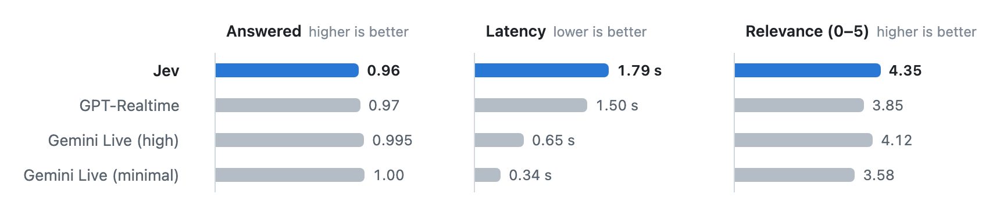
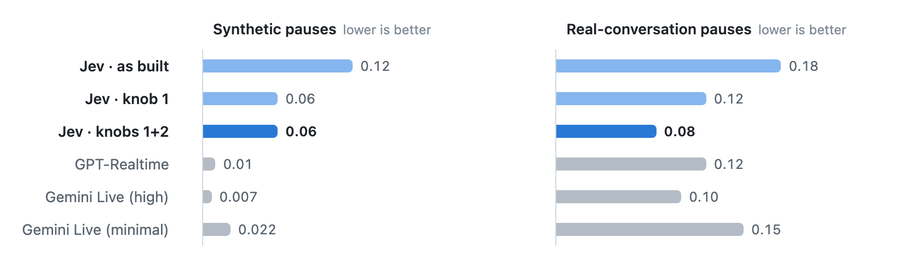
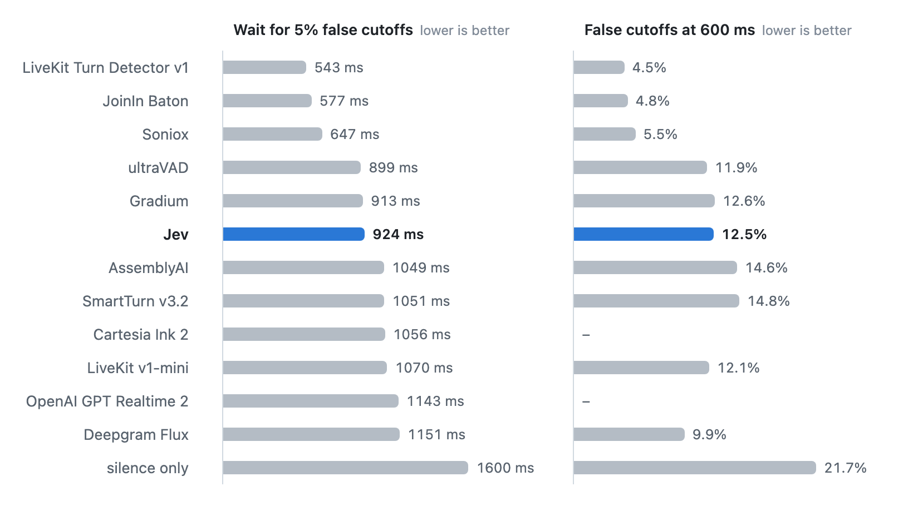
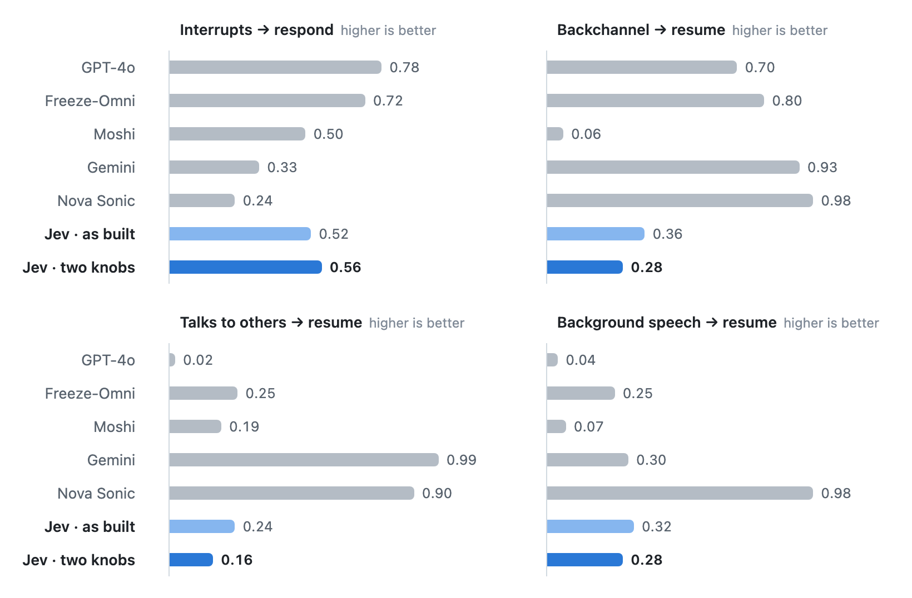
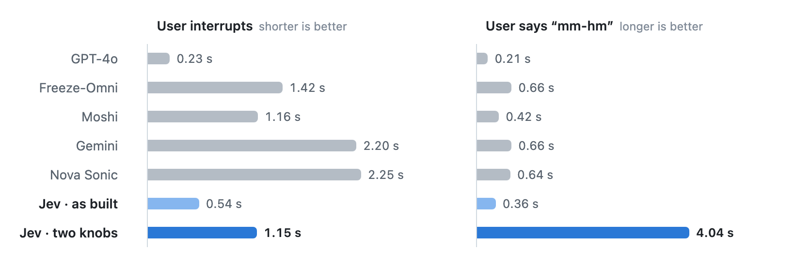
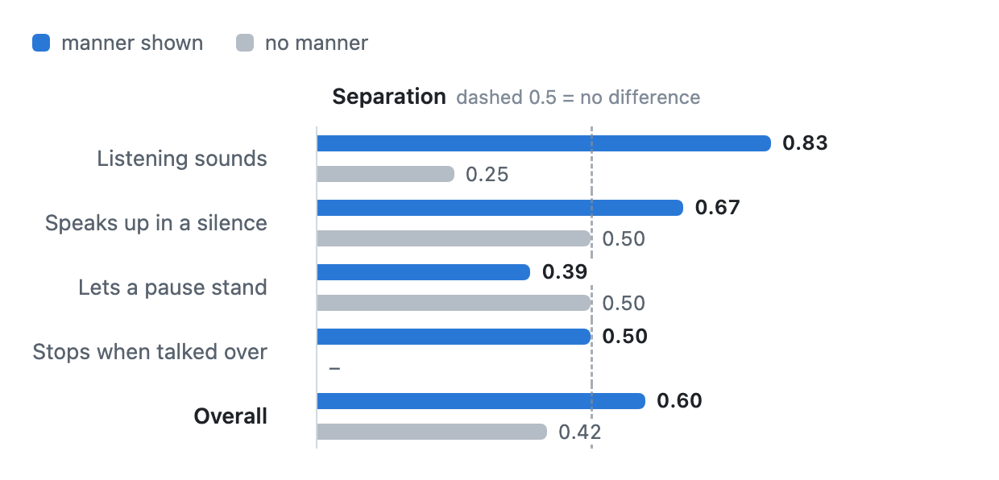
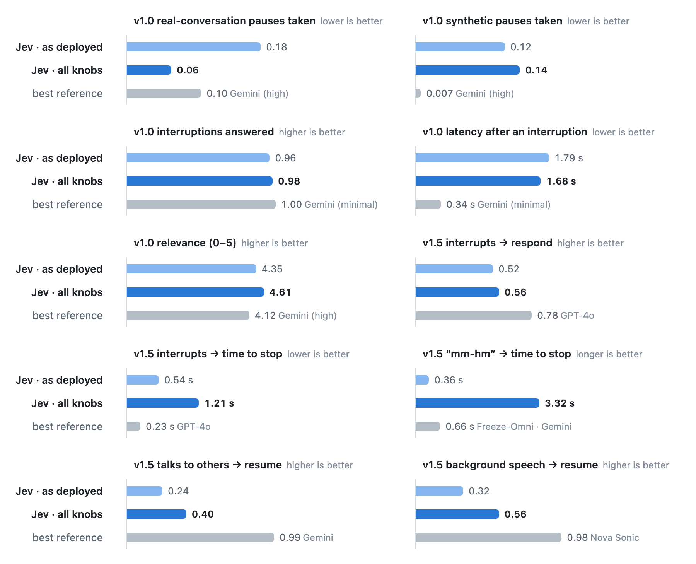

<div align="center">

# Jev-Interaction

**System-One-controlled full-duplex voice interaction.**<br>Turn-taking as decisions you write — not a model you train.

[中文](README.zh-CN.md) · [Cookbook](cookbook) · [Profiles](jev_interaction/profiles) · [Decisions](jev_interaction/judge/questions.py)

🏆 **Build of the Week** at [TypeSafe](https://typesafe.ai) · 🤗 **Live demo** on [Hugging Face](https://huggingface.co/spaces/pupunpu/Jev-Interaction)

[](https://typesafe.ai) [](https://huggingface.co/spaces/pupunpu/Jev-Interaction)
[](https://pypi.org/project/jev-interaction/) [](https://github.com/native-bond-lab/Jev-Interaction/actions/workflows/tests.yml)     
<br>

*Most of a conversation happens in the gaps: who waits, who yields, who answers with nothing but an "mm-hm".<br>We wrote every gap down as a question, and gave the questions to Jev.* Try it here: [Try it now](https://pupunpu-jev-interaction.hf.space/) (or [on Hugging Face](https://huggingface.co/spaces/pupunpu/Jev-Interaction)).


</div>


> **Built on [Jev](https://typesafe.ai).** Every turn-taking decision here is a question Jev answers in tens of
> milliseconds. Without it, none of this would work.

> **From an applied lab.** Native Bond Lab is the applied research lab behind a consumer voice product. Everything in
> this repository comes out of that product and runs at scale on real calls with real users, not in a demo.



**Full duplex from a cascade.** Speech recognition → Jev's decisions → any language model → any speech synthesis. The
agent listens while it talks, says "mm-hm" while you talk, lets a pause stand, carries on through a backchannel, yields
or finishes its sentence when you cut in, and picks the call back up after a silence.

**A System One for conversation.** People on a call run two minds at once: a fast one that knows, without thinking,
when to wait, when to yield and when to say "mm-hm", and a slow one that works out what to say. Here Jev is the fast
mind, deciding each moment in tens of milliseconds; the language model is the slow one, writing the words. Neither
waits for the other.

Voice agents today take one of two roads. **Cascades** bolt a small trained model onto that pipeline to guess *"has
the user finished?"* and leave everything else to timers. **End-to-end full-duplex models** (Moshi, GPT-4o Realtime,
Gemini Live) learn turn-taking inside one large speech model: fast and natural, but a black box. You cannot see why it
stopped, cannot change how it takes turns for a product or a persona, and are tied to the vendor's model, voices and
session limits.

**Jev-Interaction keeps the cascade's freedom and gives it the judgement.** Every one of those moments becomes an
explicit decision: a plain-language multiple-choice question, a probability from Jev for every choice, and a policy
that turns the probabilities into an action. Questions, policies and the agent's manner are text you can read, change
and replay against real calls.

**Demo video: on the way.**

## The policy


Jev-Interaction is an interaction engine, not a voice-activity detector. Jev never hears audio and never decides that
someone is speaking; the ears do that (voice activity, the recognizer, a sound model, a voiceprint) and their output is
only signals. What the engine decides is what to do with the moment: answer, wait, slip in an "mm-hm", cut in, carry on
over an interruption, pick a quiet up, hang up. Three principles shape it.

1. **Two parties, four moments.** The agent and the user each make sound or not, which gives four moments: the user
   has the turn, both are quiet, both are talking, the agent is talking. Each moment has its own set of actions, and
   nothing else.
2. **One timeline, one "now".** The call is one record that only grows: the words, the signals, every answer from Jev,
   every action taken, each on the same clock (`Ledger`). Every judgement and the model that writes the lines read the
   same present from it (`judge/state.py`, `Now`); no decision keeps its own account of the call.
3. **One action per moment, no case left out.** In any moment there is one set of choices that do not overlap, and
   every situation belongs to exactly one of them. One answer from Jev, one thing done.

What follows from them:

- **Questions are small facts about the user and the call, one thing each:** "have they finished?", "did they say
  'one moment'?", "is this sparring or telling?". Never "what would the agent do?". A fact is the same whoever the
  agent is.
- **Thresholds, not dice.** Nothing is drawn: the same moment goes the same way, and a recorded call can be worked
  through again. The thresholds sit in one place (`Config`), to be tuned on data.
- **The persona sets the thresholds and the timing, never the questions:** how readily its line stops, whether it cuts
  in, how soon it picks a quiet up.
- **Jev picks the moment, the language model picks the words.** No rule makes Jev's decision for it, and Jev never
  writes a line.

| moment | Jev is asked | one action |
|---|---|---|
| the user has the turn | have they finished · which pace (one yes/no fact per pace) · is something they asked for due · sparring or telling | take the turn (when the words and the sound agree) · cut in (in a pace that does) · slip in a sound · stay silent |
| quiet | does the agent's last line leave them a move · did they say they need a moment · were goodbyes said · has the agent called out with no answer | let it be · pick the thread up · check on them · hang up (the facts and the clock decide) |
| both talking | what their words over the line are: a reaction, a "stop", or something of their own | carry on · stop and listen · finish the sentence · take the floor back · react at once |
| the agent is talking | nothing | nothing to decide |

The caller asking for someone else is one more fact in the first moment (`who`: stay, or put them on; experimental,
for personas that list a `cast`).

**Paces** (normal, patient, narrate, eager) say who holds the floor. Their timing is blended by Jev's probabilities, so
a call that is "60% normal, 40% patient" waits in between.

**The same engine, two personas.** Two personas from our product, a dominant and a submissive one, each with its own
thresholds and timing (`turn_taking` in the persona's YAML: its line stops more or less readily, it always or never
cuts in, it picks a quiet up sooner or later; every shipped persona has one, [cookbook](cookbook/role-policies.md#turn-taking)),
on the same written moments (`tools/persona_bench.py`, 628 requests to Jev):

- Everyday moments (132): they act alike where nothing calls for a difference: a silence 28 of 28 the same, both
  talking 30 of 32. Cutting in differs where it should: in the six sparring moments the dominant one cuts in and the
  submissive one lets them finish.
- A scene of control (16 moments): they act differently in 6, each the way round one would expect. "Make me." over an
  order: the dominant one takes the floor back, the submissive one carries on; defiant rambling: one cuts in, the other
  lets them finish. Where they should act alike, they do: a real "stop, I'm not okay" stops both, an upset user is let
  finish by both, a quiet after an order is waited out by both.
- The facts Jev gave about the user barely moved between the two (0.002 to 0.048 on average): the questions are the
  same, only the thresholds differ.

## What you get

- **Every piece is yours to choose.** The intelligence (any language model), the voice (any synthesizer and voice),
  the style, the task and the persona. The persona reaches the interaction itself, not only the words: an impatient
  character cuts in and answers half-sentences, a gentle one says "mm-hm" often and waits you out, a tutor finishes the
  explanation before yielding, a support agent stays brief and stops the moment you speak.
- **The pace routes itself, turn by turn.** Each turn Jev also judges which pace the call is in: normal conversation,
  listening (the caller is pouring something out: more listening sounds, longer waits, fewer interruptions), narrating
  (the agent is telling a story: an "mm-hm" does not stop it) or eager (quick to take the floor). One call moves between
  them on its own, from small talk into a game and back.
- **A new task is a few knobs, zero-shot.** Nothing here is trained on any benchmark or on your data. A task profile is
  a page of text; the pause problem in Full-Duplex-Bench was fixed with two knobs, and each trade-off is measured, not
  guessed.
- **Every number comes with a reason.** Each decision is logged with the state Jev read and the probabilities it gave,
  so a bad moment points at the step that caused it, and a reworded question can be replayed against recorded calls
  before it ships.
- **Calls of any length.** No session is held open on a model provider; each decision and each reply is a fresh request
  over a text history.
- **Cheap.** A decision is a few hundred tokens to Jev; in our runs a reply cost about $0.002 of language model and a
  400-sample benchmark round about $2.

## Benchmarks at a glance

Zero-shot: nothing here was trained on any benchmark. Four public benchmarks, 16 metrics, against end-to-end duplex
systems (GPT-Realtime, Gemini Live, GPT-4o, Moshi, Nova Sonic, Freeze-Omni) and trained turn detectors. With the knobs
tested below, Jev-Interaction is first on 3 metrics and in the top three on 8.

**Where it leads.** It understands what a moment calls for.

- **Fewest real pauses taken as turns:** 0.06, against Gemini Live 0.10 and GPT-Realtime 0.12 (Full-Duplex-Bench v1.0).
- **Most relevant answers after an interruption:** 4.61 of 5, against 4.12 for the best reference.
- **Talks through an "mm-hm":** it carries on; every end-to-end system in Full-Duplex-Bench v1.5 stops within 0.7 s.
- **Lets background speech pass:** second only to Nova Sonic (0.56, against Gemini 0.30 and GPT-4o 0.04).
- **Catches interruptions between two people:** 0.92 on TurnBench from words alone, 4th of 16, ahead of GPT Live and
  Gemini Live, which caught none.

**Where it trails, and where we would love help.**

- **Pure timing from sound.** On eot-bench (6th of 13 from words alone) and TurnBench end of turn (8th of 16) the
  leaders are small audio models trained on that kind of conversation. The engine now pairs Jev with an open audio
  model and answers only when both say finished: in Chinese, at 2% false cutoffs, that waits less than VoxTurn but
  more than the closed LiveKit v1, and at a tight 300 ms it still cuts in more often than either; in English VoxTurn
  alone is best ([details](#end-of-turn-livekit-eot-bench)).
- **Speed after an interruption.** 1.7 s, against 0.3–1.5 s for end-to-end models; most of it is the language model
  writing its first line, so a faster model or an earlier first sentence closes much of the gap.
- **Synthetic pauses** (0.14 on Full-Duplex-Bench v1.0): it answers clauses that sound finished.

Every decision is a readable question and every run can be replayed, so a contribution is a reworded question, a new
adapter or a policy, measured on the same benchmarks. Issues and pull requests are welcome.

To our knowledge this is the first full-duplex framework that writes turn-taking as plain-language decisions, and,
zero-shot, it is already state of the art on the decisions that take understanding.

## Why

| | cascade + turn detector | end-to-end duplex model (Moshi, GPT-4o Realtime, Gemini Live) | Jev-Interaction |
|---|---|---|---|
| when to answer | a trained end-of-turn model, one threshold | learned inside the model; you cannot see or move it | a question Jev answers from the words, the timing and the conversation |
| listening sounds | none, or a fixed clip | whatever the model learned | decided each time: a continuer, a reaction, an echoed word, or nothing |
| being talked over | stop on any voice, or never | learned; on Full-Duplex-Bench v1.5 every one of them stops within 0.7 s for an "mm-hm" | carry on, yield, finish the sentence, take the floor back, or react at once |
| silence | a timeout | the model's habit | go on, check in, wait, or hang up, weighed against how this caller talks |
| a persona or a new task | retrain or re-tune the detector | a prompt changes the words; the timing stays the model's | a task profile: the manner Jev reads and the policy per decision, so the persona changes how it takes turns |
| changing behaviour | collect data, retrain | wait for the vendor, or retrain a very large model | reword a question, replay recorded calls, ship |
| why it did that | a score | not inspectable | every decision logged with the state Jev read and its probabilities |
| model and voice | any | the vendor's model and voices | any language model, any synthesizer and voice |
| long calls | no session cap | a session cap (OpenAI Realtime: 60 min) or audio tokens filling the context (Gemini Live: about 15 min of audio before compression drops or summarizes old turns) | no session cap: each decision and each reply is a fresh request over a text history, about 200 tokens per minute of speech |
| speed | the language model's | the fastest: 0.3–1.5 s to answer after an interruption on Full-Duplex-Bench v1.0 | 1.7 s after an interruption, mostly the language model writing its first line |

## Task profiles

One framework, many products. A profile says what the agent is for, how it behaves on a call, and how each decision is
read.

| profile | listening sounds | mid-sentence pauses | talked over | silence | policies |
|---|---|---|---|---|---|
| [companion](jev_interaction/profiles/companion.yaml) | often, varied | quick to react | stops, delighted | fills it | defaults |
| [support](jev_interaction/profiles/support.yaml) | a short "okay" | waits (numbers being read) | stops at once | waits, then one check | thresholds |
| [tutor](jev_interaction/profiles/tutor.yaml) | encouraging | very patient | finishes the explanation | offers a prompt | defaults |
| [interviewer](jev_interaction/profiles/interviewer.yaml) | none | lets thinking run | cuts in on rambling | waits for the answer | mixed |
| [Vera · speaking coach](jev_interaction/profiles/vera.yaml) | almost none | lets silence work | finishes her sentence | gives the next exercise | thresholds |
| [话唠阿乐 · chatterbox](jev_interaction/profiles/chatterbox_zh.yaml) | constant | jumps in | finishes his sentence | can't bear one | defaults |
| [小奶狗小言 · sweet puppy](jev_interaction/profiles/puppy_zh.yaml) | soft "mm, and then?" | waits | stops the moment you speak | asks if you're okay | defaults |
| [电商客服小安 · support (Chinese)](jev_interaction/profiles/support_zh.yaml) | a rare "好的" | never cuts in on an order number | stops at once | one check | thresholds |

```yaml
name: Sam
task: A customer-support agent for a broadband provider.
prompt: >            # read by the language model
  Be clear and brief, confirm what you understood, one step at a time.
manner: >            # read by Jev
  Waits for the caller to finish even through long pauses (they may be reading a number). Stops at once when talked over.
policies:
  end_of_turn: {type: threshold, default: 0.7}
  quiet: argmax
```

## Quickstart

From PyPI, in any folder; the page walks you through each provider and key:

```bash
pip install "jev-interaction[server]"     # add ,sound for the sound model and ,voiceprint for the caller's voiceprint
jev-interaction serve                     # http://localhost:8080
```

Or from a clone, one command installs everything, starts the server and opens the page:

```bash
git clone https://github.com/native-bond-lab/Jev-Interaction && cd Jev-Interaction
./scripts/setup.sh            # --china installs through a domestic PyPI mirror
```

Or with Docker (any OS):

```bash
cp .env.example .env          # fill it in, or leave it empty and use the setup steps on the page
docker compose up             # http://localhost:8080
```

Open <http://localhost:8080>. Setup goes one node at a time: the judge (Jev), a language model, speech recognition, a
voice. Paste a key and the page recognises whose it is; pick the language model from the endpoint's own model list; test
each step before moving on. Settings are saved to `.env` in the folder you started from. Then pick a persona and click
the orb to call (click it again to hang up). The voice detector is TEN VAD, the one our product runs on; headphones still give the cleanest call.

**Every node is your choice.** The language model is any OpenAI-compatible endpoint (xAI, OpenAI, DeepSeek, Qwen,
Doubao, GLM, Kimi, OpenRouter, Groq, a local Ollama or vLLM server); recognition and voice come from the provider
registry, and a third-party package can add its own ([docs/adapters.md](docs/adapters.md)). The language model is told
how to write for the voice you pick: voices that perform audio tags (ElevenLabs v3/v4) get a style that uses
`[laughs]`, `[whispers]`; others get plain spoken words (`jev_interaction/prompts/speech/`).

**Recommended setups**, offered on the setup page and at the bottom of `.env.example`, never applied unless you choose them
(what each is good for, and how to swap one node: [cookbook/stacks.md](cookbook/stacks.md)):

| | recommended (global), proven at scale in our product | recommended (mainland China) |
|---|---|---|
| judge | Jev | Bailian `decision-model-preview`, the same protocol (`JEV_PROVIDER=bailian`; what we measured: [cookbook](cookbook/stacks.md#the-judge-on-the-mainland)) |
| language model | grok-4.3, reasoning off, temperature 0.7 | qwen-plus via DashScope |
| recognition | ElevenLabs Scribe v3 Live | Paraformer realtime v2 |
| voice | ElevenLabs eleven_v4_turbo (audio tags) | CosyVoice v2, per-persona voices (plain words) |
| keys | Jev, the language model (xAI), TTS (ElevenLabs; `TTS_API_KEY`) | one Bailian (DashScope) key |
| ready-made file | the bottom of `.env.example` | [`deploy/mainland-china.env`](deploy/mainland-china.env): copy to `.env`, fill in two values |

**Presets.** `JEV_PRESET=recommended` (default) is the timing our product runs on today; `tested` adds the knobs
measured below; `default` is the library defaults. In code: `jev_interaction.preset("recommended", language="en")`
(`production`, its earlier name, still works). What each knob does: [cookbook/parameters.md](cookbook/parameters.md).

**Hugging Face Space.** `HF_TOKEN=... ./scripts/push_hf_space.sh <owner>/<space>` publishes this repository as a Docker
Space ([card](deploy/huggingface/README.md)); add the keys as Space secrets and the push sets `MAX_CONCURRENT_CALLS`,
`MAX_CALL_SECONDS` and `MAX_CALL_MINUTES_PER_DAY` as variables, since every call is billed to them.

### In your own code

```python
from jev_interaction import Config, Profile
from jev_interaction.adapters import best_vad
from jev_interaction.adapters.openai_compat import OpenAICompatResponder
from jev_interaction.adapters.scribe import ScribeRealtime
from jev_interaction.judge import JevClient
from jev_interaction.session import Session

session = Session(
    Profile.load("support")          # a built-in persona, or a path to your own YAML,
    send=my_send,                       # async: deliver events to your client
    judge=JevClient(),
    recognizer=ScribeRealtime(language="en"),
    responder=OpenAICompatResponder(),   # any OpenAI-compatible endpoint
    vad=best_vad(),                      # TEN VAD (pip install ten-vad), or the energy detector without it
    config=Config(language="en"),
)
await session.start()
await session.on_audio(frame)          # 200 ms of 16 kHz PCM16, as it arrives
await session.on_client({"type": "playback", "state": "idle"})
```

Events to the client: `line`, `listen`, `stop`, `finish_line`, `persona`, `hangup`, plus `user`, `pace` and
`decision` for display. Client messages: `playback` and `heard`.

### Add a decision

A decision is one module: when it is asked, what Jev is asked, and what the answer does. Write the question:

```python
# jev_interaction/judge/questions.py
def laugh(name: str) -> dict:
    return {"type": "choice", "instructions": f"The user just made a joke. Would {name}, being who they are, laugh?",
            "criteria": {"laugh": f"{name} finds it funny and laughs", "smile": "a warm word, no laugh", "none": "let it pass"}}
```

then the decision, and register it with a policy:

```python
# jev_interaction/decisions/laugh.py
from .. import speaking
from ..judge import questions as Q
from .base import Decision

speaking.event("laugh", "they made a joke; you laugh, in a few words", answers_user=True, max_tokens=60)


class Laugh(Decision):
    name = policy = "laugh"

    def on_words(self, s):                        # when: new words while the agent is quiet
        if not s.speaking and not s.generating:
            s._spawn(self.ask(s))

    def questions(self, s, ctx):                  # what Jev is asked, about the call so far
        return {"laugh": Q.laugh(s.p.short)}

    async def apply(self, s, answers, ctx):       # what the policy's choice does
        if self.choose(s, answers, "laugh", ctx) == "laugh":
            await s.respond("laugh")
```

```python
register(Laugh())                                 # jev_interaction.decisions; or add it to DECISIONS there
config = Config(policies={**Config().policies, "laugh": ThresholdPolicy(default=0.6)})
```

Nothing else changes: the session offers every registered decision each new segment of words (`on_words`) and each
100 ms tick (`on_tick`), and logs the state, the questions and the answers. `allowed` narrows the choices to what
applies now and `state` adds to what Jev reads; the five built-in decisions in `jev_interaction/decisions/` are the
examples. Replay recorded calls with `jev-interaction replay runs/*.jsonl --purpose laugh` to see where its answers land.

### Tested knobs

The knobs measured in "All knobs together" below, as `Config` fields. Off by default; each one is a trade-off.

```python
from jev_interaction import Config
cfg = Config(overlap_ask_ms=1000, listen_max_words=3, not_for_me=True, far_db=10)
```

| field | what it does | measured effect |
|---|---|---|
| `overlap_ask_ms=1000` | ask the floor question only after 1 s of voice over the agent (default 400; measured as `hold_after_ms`, which paused the audio) | an "mm-hm" no longer stops the line (stop latency 0.36 s → 3.3 s); a real interruption stops about 0.6 s later |
| `listen_max_words=3` | drop listening sounds longer than this (default 6) | fewer pauses counted as taking the turn (Full-Duplex-Bench counts 4+ words as a turn) |
| `not_for_me=True` | a "not said to me" choice in the turn and floor questions, never before the first answer | side remarks and background voices let pass instead of answered |
| `far_db=10` | a voice this many dB under the caller's answered words is someone else's | background speech "resume" 0.28 → 0.56; pair it with a voiceprint, or a quiet caller can be dropped |

## Early results

Measured on the voice-call engine in our product with the 0.1 behaviour (same decision layer, ElevenLabs Scribe and TTS;
the experimental listening and overlap changes since 0.1 are not re-measured yet) on [Full-Duplex-Bench](https://github.com/DanielLin94144/Full-Duplex-Bench) v1.0: 50 samples per set, drawn with a
fixed seed. The pause sets used gpt-4o-mini as the language model and the interruption set grok-4.3.

| | this engine (n) | GPT-Realtime | Gemini 3.1 Flash Live (high / minimal) |
|---|---|---|---|
| synthetic pauses taken as turns (lower is better) | 0.12 (50) | 0.01 | 0.007 / 0.022 |
| real-conversation pauses taken as turns | 0.18 (50) | 0.12 | 0.10 / 0.15 |
| interruptions answered | 0.96 (50) | 0.97 | 0.995 / 1.0 |
| latency after an interruption (benchmark rule) | 1.79 s mean, 1.68 median | 1.50 s | 0.65 / 0.34 s |
| relevance of the answer, 0–5 | 4.35 (judged by grok) | 3.85 | 4.12 / 3.58 |

**When the user interrupts.** Full-Duplex-Bench v1.0, 50 interruption samples, grok-4.3. Latency is the benchmark's mean (median 1.68 s); our relevance was judged by grok, the references by the official judge.

<picture>
  <source media="(prefers-color-scheme: dark)" srcset="docs/charts/fdb10-interruptions.dark.png">
  
</picture>

Interruptions are on par with the commercial systems and the answers score well. Pauses are the weak spot: of the 15
pause samples counted as taking the turn, 9 were the agent speaking up on its own because it believed the line had gone
quiet (the samples start without a greeting, and some recordings are quiet enough that the voice detector may miss the
caller), and 6 were answers before the caller had finished, mostly after a complete first sentence. Latency is mostly
the language model writing its first line; the decisions take tens of milliseconds.

### Case study: fixing pauses in two knobs

Because every decision is logged with the state Jev read, the 15 pause samples counted as "taking the turn" could be
traced one by one: 9 were the agent speaking up because the quiet-line question fired while the caller was still in
their first sentence (no words recognized yet), 4 were listening sounds longer than the benchmark's three-word limit,
and 2 were answers after a complete first sentence. Two knobs, tested on the same 100 samples:

| | synthetic pauses | real-conversation pauses |
|---|---|---|
| before | 0.12 | 0.18 |
| no quiet-line question while the caller's voice is going | 0.06 | 0.12 |
| plus listening sounds capped at three words | **0.06** | **0.08** |

**Pauses taken as the end of the turn, before and after the knobs.** 50 samples per set. Knob 1: no quiet-line question while the caller's voice is going. Knob 2: listening sounds capped at three words. Tested in the harness, not yet in the engine.

<picture>
  <source media="(prefers-color-scheme: dark)" srcset="docs/charts/fdb10-pauses.dark.png">
  
</picture>

Real-conversation pauses now beat the commercial systems in the table above (0.10–0.15). These knobs were tested in the
benchmark harness and are not yet in the engine; nothing was retrained.

A third knob, answering only when Jev is at least 0.8 sure the caller has finished, brought real-conversation pauses to
0.04 without slowing answers after interruptions, but ordinary answers took about a second longer (median 0.8 s → 1.8 s).
It stays off: the trade-off is visible, measured and reversible, which is the point.

### End of turn: LiveKit eot-bench

[eot-bench](https://github.com/livekit/eot-bench) scores "has the user finished?" at every pause of 400 real user turns
(English validation split, 11,191 scoring points). We asked Jev the framework's `turn` question as is, from text only
(words arrive 0.5 s late, as the benchmark requires), zero-shot.

| | false cutoffs at 600 ms wait | wait for 5% false cutoffs |
|---|---|---|
| LiveKit Turn Detector v1 | 4.5% | 543 ms |
| Deepgram Flux | 9.9% | 1151 ms |
| **Jev, text only, zero-shot** | **12.5%** | **924 ms** |
| SmartTurn v3.2 | 14.8% | 1051 ms |
| OpenAI GPT Realtime 2 | – | 1143 ms |
| silence only | 21.7% | 1600 ms |

**Has the user finished? LiveKit eot-bench.** 400 real user turns, 11,191 scoring points, sorted by the wait needed for 5% false cutoffs. Jev reads words only, zero-shot. Other systems from the published results; – means not reported.

<picture>
  <source media="(prefers-color-scheme: dark)" srcset="docs/charts/eot-bench.dark.png">
  
</picture>

Mid-table: ahead of AssemblyAI, SmartTurn, Cartesia, OpenAI Realtime and Deepgram at 5%, well behind detectors trained
on audio of this kind of conversation. About 11,000 Jev calls, about one dollar.

**Words and sound together, in the engine.** Words arrive half a second after the sound, so for the first moments of
a pause a text judge has nothing new to read; an audio model hears how the voice ended but not what was said, and the
two miss on different pauses (in English each cut people off on about 85 of 850 mid-turn pauses, only 11 of them the
same). Since 0.3.0 the engine asks both: Jev on the words, a sound model on the last 8 s of audio (SmartTurn v3.2 by
default, BSD-2, on the CPU; [your own](docs/adapters.md#the-sound-model-and-the-voiceprint) plugs in the same way). By
default the turn is taken only when both say finished: cutting someone off is the worse mistake (`Config.sound_rule =
"and"`).

Scored on eot-bench **v1.0** (dataset revision `ca9d98a`; the benchmark's main branch is now v1.1, with 1,888 more
English rows, which we have not run), English validation (400 turns, 11,191 points) and Chinese validation (344
turns, 9,441 points), from each model's predictions at every scoring point. Lower is better in every column.

| Chinese | wait at 2% false cutoffs | wait at 5% | false cutoffs at 300 ms |
|---|---|---|---|
| **Jev + SmartTurn v3.2, both must agree (the engine's default)** | **1050 ms** | **783 ms** | 32.2% |
| Jev, words only | 1119 ms | 839 ms | 34.5% |
| SmartTurn v3.2, sound only | 1274 ms | 891 ms | 40.1% |
| VoxTurn v1 (non-commercial licence) | 1078 ms | 806 ms | 25.0% |
| LiveKit Turn Detector v1 (closed, LiveKit Agents only) | 1006 ms | 799 ms | 20.6% |

| English | wait at 2% false cutoffs | wait at 5% | false cutoffs at 300 ms |
|---|---|---|---|
| **Jev + SmartTurn v3.2, both must agree (the engine's default)** | **1248 ms** | **835 ms** | 29.6% |
| Jev, words only | 1552 ms | 924 ms | 36.7% |
| SmartTurn v3.2, sound only | 1763 ms | 1045 ms | 32.8% |
| VoxTurn v1 (non-commercial licence) | 1000 ms | 462 ms | 8.5% |
| LiveKit Turn Detector v1 (closed, LiveKit Agents only) | 991 ms | 543 ms | 9.9% |

What this says, the losses included:

- **Chinese.** Requiring both waits less than either half alone at every budget. At 2% false cutoffs it waits less
  than VoxTurn (1050 against 1078 ms) but more than the closed LiveKit v1 (1006 ms); at 5% it waits less than both
  (783 against 806 and 799 ms). At a tight 300 ms it loses clearly: 32% of mid-turn pauses cut off, against 25% and
  21%. The sound model needs a stretch of quiet to be sure, and the words are not in yet.
- **English.** VoxTurn alone is the best of everything here, the closed LiveKit v1 included. Requiring both takes Jev
  from 1552 to 1248 ms at 2%, still far behind the trained audio models.
- **Why SmartTurn.** It is the audio model we may ship: VoxTurn is CC BY-NC, LiveKit v1 may only be used inside
  LiveKit Agents. Another one plugs in through the registry.
- **How far to trust it.** The rule and its lines (`sound_min` by language, `words_min`) were chosen on these same
  splits; there is no held-out split and no test on recorded calls yet. Every reading of the sound model and every
  turn it held back is in the call log, to set the lines on your own calls.

SmartTurn and VoxTurn are read all through the pause, as the engine reads SmartTurn. LiveKit v1 is read once at 0.2 s
and held, as on the benchmark's leaderboard; read all through the pause it waits longer (1026 ms in Chinese, 1460 ms in
English, at 2%). VoxTurn read the leaderboard's way: 1131 / 830 ms in Chinese, 982 / 669 ms in English.

### Being talked over: Full-Duplex-Bench v1.5

25 noisy samples per scenario, grok-4.3, scored with the official judge (gpt-4o-2024-08-06).

| scenario | wanted | this engine | paper (GPT-4o · Gemini · Nova Sonic · Moshi) |
|---|---|---|---|
| user interrupts | respond | 0.52 | 0.78 · 0.33 · 0.24 · 0.50 |
| | stop latency | **0.54 s** | 0.23 · 2.20 · 2.25 · 1.16 |
| user backchannels | resume | 0.36 | 0.70 · 0.93 · 0.98 · 0.06 |
| user talks to someone else | resume | 0.24 | 0.02 · 0.99 · 0.90 · 0.19 |
| background speech | resume | 0.32 | 0.04 · 0.30 · 0.98 · 0.07 |

**What the judge saw.** Share of the wanted label per scenario, 25 noisy samples each; paper systems from Table 2. Before/after changes are within the ±0.08 noise of 25 samples.

<picture>
  <source media="(prefers-color-scheme: dark)" srcset="docs/charts/fdb15-behavior.dark.png">
  
</picture>

It stops fast, but it also stops for an "mm-hm", a side remark or a voice in the room. The traces show why: Jev reads
most backchannels right (carry on, 19 of 25), but playback is paused 0.4 s into any voice, before the words are known;
and the `floor` question had no choice for "this is not said to me", so side remarks ended the line early and got
answered. Two knobs, tested in the harness: pause only after 1 s of voice, and add that choice. The agent then talked
through every backchannel (stop latency 0.36 s → 4.0 s; every system in the paper stops within 0.7 s) and let 9 of 25
side remarks pass, at the cost of stopping 0.6 s later for real interruptions (1.15 s). The judge's labels did not move
beyond the noise of 25 samples: it compares the answer against a separate clean run, and a companion's short, varied
answers rarely read as "the same content, resumed".

**How long until the agent stops talking.** Median stop latency by the benchmark's rule. Two knobs: pause playback only after 1 s of voice, and a "not said to me" choice. Tested in the harness; the deployed engine is unchanged.

<picture>
  <source media="(prefers-color-scheme: dark)" srcset="docs/charts/fdb15-stop.dark.png">
  
</picture>

### Task profiles: does behaviour follow the profile?

The four shipped profiles on the same 12 recordings (long story, mid-sentence pause, interruption, silence), with and
without the manner shown to Jev. Separation = how often a profile expected "high" on an axis scores above one expected
"low" on the same recording (0.5 = no difference). Three recordings per cell, so read it as a direction.

| axis | manner shown | no manner |
|---|---|---|
| listening sounds | **0.83** | 0.25 |
| speaks up in a silence | **0.67** | 0.50 |
| lets a mid-sentence pause stand | 0.39 | 0.50 |
| stops when talked over | 0.50 | – |
| overall | **0.60** | 0.42 |

**Does behaviour follow the profile?** Separation across the four shipped profiles on 12 recordings, with and without the manner shown to Jev; 0.5 means no difference. Three recordings per cell, so read it as a direction.

<picture>
  <source media="(prefers-color-scheme: dark)" srcset="docs/charts/task-profiles.dark.png">
  
</picture>

Listening sounds per minute with the manner shown: tutor 7.5, companion 3.0, support 2.3, interviewer 1.0. Pauses do
not separate (no profile took the turn), and every profile yields when talked over, including the tutor that should
finish its sentence: playback is paused before the floor question is asked, as above.

### Two people talking: TurnBench

[TurnBench](https://turnbench.sesame.com) listens to two people in free conversation, one microphone each, and asks
when a speaker's turn ends (EOT) and when one takes the floor from the other (INT). We ran 6 dev conversations (about an
hour): Scribe words per channel, Jev asked at each pause and each overlap, no audio model, no TurnBench training data.
Thresholds and question wording were chosen on these same 6 conversations, so the numbers lean optimistic.

| | EOT recall (false positives ≤ 0.10) | INT recall |
|---|---|---|
| vap (trained on TurnBench's training set) | 0.86 | 0.99 |
| kyutai semantic VAD | 0.84 | 0.98 |
| **Jev, words only** | **0.67** (8th of 16) | **0.92** (4th of 16) |
| GPT Live | 0.62 | 0.00 |
| Gemini Live | 0.73 | 0.00 |

The other speaker leaks into each microphone: about 30% of one channel's words were the other person, 20–40 dB
quieter. Dropping those words took INT false positives on one conversation from 0.39 to 0.06. The first EOT question
("has A finished?") missed turns the other speaker had already taken over; asking "whose turn is it now?" raised EOT
recall from 0.48 to 0.63, and the engine's own voiceprint check on unclear words to 0.67.

### All knobs together

One engine setup with every knob above (no quiet-line question while the caller talks, short listening sounds, pause
after 1 s of voice, a "not said to me" choice in both the floor and the turn question, and a voice 10 dB or more under
the caller's answered words treated as someone else's), grok-4.3 throughout, the v1.5 clean reference re-run with the
same setup. Tested in the harness; the deployed engine is unchanged.

| | engine as deployed | all knobs | best reference |
|---|---|---|---|
| v1.0 real-conversation pauses taken as turns | 0.18 | **0.06** | Gemini (high) 0.10 |
| v1.0 synthetic pauses taken as turns | 0.12 | 0.14 | Gemini (high) 0.007 |
| v1.0 interruptions answered | 0.96 | 0.98 | Gemini (minimal) 1.0 |
| v1.0 latency after an interruption | 1.79 s | 1.68 s | Gemini (minimal) 0.34 s |
| v1.0 relevance (judged by grok) | 4.35 | **4.61** | Gemini (high) 4.12 |
| v1.5 user interrupts: respond | 0.52 | 0.56 | GPT-4o 0.78 |
| v1.5 user interrupts: stop latency | 0.54 s | 1.21 s | GPT-4o 0.23 s |
| v1.5 user backchannels: stop latency (longer is better) | 0.36 s | **3.32 s** | 0.66 s |
| v1.5 user talks to someone else: resume | 0.24 | 0.40 | Gemini 0.99 |
| v1.5 background speech: resume | 0.32 | **0.56** | Nova Sonic 0.98 |

**One engine setup, every knob on.** Engine as deployed (light), all knobs (dark), and the best reference system per metric (gray, named). Harness only; the deployed engine is unchanged.

<picture>
  <source media="(prefers-color-scheme: dark)" srcset="docs/charts/all-knobs.dark.png">
  
</picture>

Across 16 metrics against outside systems (the four benchmarks above), the deployed engine ranks first on 1 and in the
top half on 7; with all knobs, first on 3 and in the top half on 10.

### Every number comes with a reason

An end-to-end model gives a score. A pipeline gives the score and the decisions behind it, because every decision is
logged with the state Jev read and the probabilities it returned. What the traces of the all-knobs run say:

| number | what actually happened |
|---|---|
| backchannel stop latency 3.32 s | Not slow: it did not stop. In the 23 traced samples Jev was asked the floor question 20 times and said "carry on" 20 times. The 3.3 s is the rest of the sentence; every system in the paper stopped within 0.7 s, i.e. an "mm-hm" cut them off. |
| backchannel "resume" 0.32 | The same samples. The judge compares the reply with a separate clean run, and a companion's short, varied replies rarely read as "the same content, resumed". With the same reply in both runs (temperature 0) it rose to 0.56, and talking to others and background speech rose with it. |
| interruption stop latency 1.21 s | A choice: playback pauses after 1 s of voice so a backchannel can be told from an interruption. On the 21 floor questions over real interruptions Jev chose yield 7, finish the sentence 7, carry on 7; the last are visible misses. |
| latency after an interruption 1.68 s | Median 1.71 s over 41 traced turns: 0.8 s waiting to be sure the caller has finished, 0.75 s for the language model's first words, 0.1 s for synthesis and playback. The decisions take tens of milliseconds. |
| real-conversation pauses 0.06 | 3 of 50, each in the trace with the probability Jev gave; one was a one-word "Mm." |
| synthetic pauses 0.14 | 7 of 50, mostly answers right after a clause that sounded finished ("Yeah? What's the story about?"). The synthetic voice pauses after complete clauses. |
| background speech 0.56 | 15 of 22 traced samples were treated as someone else's voice (the 10 dB rule did most of it, Jev's "not said to me" the rest). The 7 still answered had a caller who spoke quietly themselves (less than 10 dB apart) or a first line too short to measure. |
| TurnBench EOT 0.67 | Words arrive after the sound; the audio models that lead were trained on two-person conversation of this kind. |

## Swappable pieces

| piece | protocol | included |
|---|---|---|
| VAD | `is_voice(pcm) -> bool`, optionally `voiced_ms(pcm, playing) -> int` | `TenVAD`, `EnergyVAD` |
| recognizer | streaming, closed segments | `ScribeRealtime` (ElevenLabs), `ParaformerRealtime` (Alibaba Cloud Bailian) |
| responder | `lines(messages) -> async lines` | `OpenAICompatResponder` |
| synthesizer | `audio(text) -> async bytes` | `ElevenLabsTTS`, `CosyVoiceTTS` (Alibaba Cloud Bailian) |
| sound model (optional) | `score(pcm) -> p(finished)`, `ready`, `warm()` | `SmartTurn` (`[sound]` extra): has the user finished, from the voice; `JEV_SOUND` picks a registered one |
| speaker embedder (optional) | `embed(pcm) -> unit vector`, `ready`, `warm()` | `EcapaEmbedder` (`[voiceprint]` extra): the caller's voiceprint, from 20 s read before the call and the call itself, cleared at hang-up; `JEV_VOICEPRINT` picks a registered one |
| judge | `ask(questions, state) -> probabilities` | `JevClient` |
| policy | `choose(probs, allowed)`, `draw(p)` | `ThresholdPolicy` (every default), `ArgmaxPolicy`, `SamplePolicy` (draws, for whoever wants them) |

## Layout

```
jev_interaction/
  session.py          one call: its state and its loop (audio in, lines out)
  decisions/          one module per decision: turn · listen · floor · cut_in · quiet
  judge/              Jev client · the question set · the state text
  utterance.py        what the user is saying now: words, length, loudness
  speaking.py         what the responder is told before each kind of line
  policy.py           sample · threshold · argmax
  profile.py          task profiles
  config.py           paces, timings, default policies
  presets.py          recommended · tested · default
  ledger.py           the call's one record, on one clock: turns, their times, what was judged and done
  recorder.py         one JSON line per event, for replay
  adapters/           VAD · recognizer · responder · synthesizer · sound model · voiceprint; registry.py lists the providers
  prompts/            the responder's system prompt; speech/ holds one writing style per kind of voice
  profiles/           the built-in personas
  server/             call server (WebSocket, line audio, profiles, health, settings) and its page (web/)
  replay.py           re-ask the recorded questions, as asked or reworded
  testing.py          fake judge, recognizer, responder, VAD and synthesizer: a call with no keys
  cli.py              `jev-interaction serve` / `init` / `replay`
scripts/setup.sh      one-click local setup (--china: domestic PyPI mirror)
deploy/huggingface/   Hugging Face Space card; scripts/push_hf_space.sh publishes it
deploy/mainland-china.env  the setup that measured best in mainland China, ready to copy to .env
tools/                judge_bench · persona_bench · draw_policy (docs/policy.svg) and other measurement scripts
cookbook/             stacks · parameters · role policies: recipes, not defaults
docs/                 the policy and architecture diagrams, benchmark charts, the protocol
```

## Roadmap

- Send the first sentence to synthesis as soon as it ends, not at the line break.
- A second recognizer behind the existing protocols.
- Turn the tested knobs on in our product's engine (here they are `Config` options), with a voiceprint beside the 10 dB rule (a quiet real caller must not become "someone else").
- Judge v1.5 against a fixed clean answer (same reply in both runs).
- The sound model's lines set on recorded calls and a held-out split, and a closer look at the tight 300 ms budget.
- Full TurnBench dev (38 conversations) for thresholds, then the hidden test set; larger task-profile runs.
- Benchmark harnesses in this repository, run against this package.

## FAQ

**Is Jev a voice-activity detector here?** No. Jev never hears audio. Voice activity, the recognizer, the sound
model and the voiceprint are the ears and give signals; Jev answers small facts about the user and the call, and the
policy turns them into one action per moment ([the policy](#the-policy)).

**Is Jev required?** The judge is one protocol (`ask(questions, state)`). Jev is what this was built and measured with;
another judge that returns probabilities per choice fits the same slot.

**How long can a call last?** As long as you like. Nothing holds a session open on a model provider: Jev and the
language model are asked turn by turn over a text history, and a minute of speech is about 200 tokens of text against
about 1,500 tokens of audio in a speech-to-speech model (Gemini Live counts 25 tokens per second). The history the
responder sees is windowed, so a very long call keeps its early turns only through a memory or summary you add.

**Does it need a big model for speed?** No. The decisions run in tens of milliseconds. Response speed follows the
language model you plug in.

**What does it cost?** On our measurements, a minute of call audio is a few cents, most of it the language model.

## Citing

If Jev-Interaction helps your research, please cite it. GitHub's **Cite this repository** button reads
[CITATION.cff](CITATION.cff); the BibTeX is:

```bibtex
@software{jev_interaction,
  author  = {Yang, Hengjie and Wu, Zipeng},
  title   = {Jev-Interaction: full-duplex voice turn-taking as plain-language decisions},
  year    = {2026},
  version = {0.3.0},
  url     = {https://github.com/native-bond-lab/Jev-Interaction},
  license = {Apache-2.0}
}
```

## Acknowledgements

Thanks to [Jev](https://typesafe.ai) and the TypeSafe team: the idea of turn-taking as questions only works because a
judge can answer them in tens of milliseconds, with a probability per choice, from plain text. Thanks also to the
authors of Full-Duplex-Bench, LiveKit eot-bench and TurnBench for open benchmarks and published baselines.

## Status

**At scale.** Native Bond Lab is the applied lab behind a consumer voice product. The voice-call engine in that product
runs at scale on real calls with real users, with the same design of decisions, questions, paces and policies, and
Jev judges every moment. Every benchmark number above was measured on that engine.

**This repository: 0.3, alpha.** The decision layer is the tested part. The browser client is a
minimal stand-in; bring your own VAD, recognizer, language model and voice through the protocols in
[Swappable pieces](#swappable-pieces). Jev is a hosted API (`JEV_API_KEY`).

| | |
|---|---|
| decision layer (questions, state, policies, paces, profiles) | tested, running at scale in our product |
| session and server | working; used by the tests and the browser client |
| browser client | minimal, for trying it out |
| benchmark harnesses | not in this repository yet (see the roadmap) |
| public surface | written down in [docs/stability.md](docs/stability.md); frozen from 1.0.0-beta |

Licensed under Apache-2.0 (see [LICENSE](LICENSE)). Jev-Interaction is an independent project built on Jev; it is not
affiliated with or endorsed by TypeSafe.
