# jev-interaction

**English** · [中文](README.zh-CN.md)

A full-duplex voice framework where **turn-taking is not a model you train but a set of decisions you write**.

Voice agents usually bolt a turn detector onto ASR → LLM → TTS: a small model trained to guess "has the user finished?".
Everything else a person does on a call (a listening "mm-hm", letting a pause stand, stopping when talked over, picking
the conversation up after a silence, hanging up) is left to timers and thresholds.

jev-interaction makes each of those an explicit decision: a plain-language multiple-choice question that
[Jev](https://typesafe.ai) answers with a probability per choice, typically in under 100 ms, and a policy that turns the
probabilities into an action.



An interactive version, where the same moment is judged for a companion and for a support line, is in
[docs/architecture.html](docs/architecture.html) (open it locally, or on GitHub Pages once published).

## What this gives you

1. **No turn-detection model to train.** A new behaviour is a new question; a better Jev improves every decision at once.
2. **Latency lives where you can swap it.** The interaction decisions take tens of milliseconds; most of the response
   time is the responder's first line. Plug in a faster model and the whole call gets faster, decisions unchanged.
3. **Policies per business.** The same questions, read differently: a companion *samples* from Jev's probabilities so
   the same moment goes a little differently each time; a support line acts only on *confident* answers.
4. **Behaviour per task type.** A profile's `manner` is read by Jev, so the same moment is judged differently for a
   chatty companion, a quiet support agent, a patient tutor or an interviewer. Audio-only turn detectors cannot do this.
5. **Iterable and inspectable.** Every decision is logged with the exact state Jev read. Change a question's wording and
   re-ask recorded calls (`tools/replay.py`) before it ships.

## The decisions

| when | question | choices |
|---|---|---|
| the user pauses | turn | finished / continuing, how long to wait, reply / sound, which pace |
| the user talks on | listen | continuer / feeling / echo / quiet / an answer is due |
| both talk at once | floor | carry on / yield / finish the sentence / take the floor back / react at once / short aside |
| the agent leads | cut_in | cut in / let them finish |
| the line is quiet | quiet | go on / check on them / wait / hang up |

Paces (normal, patient, narrate, eager) say who holds the floor; their timing is blended by Jev's probabilities rather
than switched at the most likely one. All of it lives in `jev_interaction/judge/questions.py` and `config.py`.

## Task profiles

```yaml
name: Sam
task: A customer-support agent for a broadband provider.
prompt: >            # for the responder
  Be clear and brief, confirm what you understood, one step at a time.
manner: >            # for Jev
  Waits for the caller to finish even through long pauses (they may be reading a number). Stops at once when talked over.
policies:
  end_of_turn: {type: threshold, default: 0.7}
  quiet: argmax
```

`examples/profiles/` has a companion, a support line, a language tutor and an interviewer.

## Run it

```bash
pip install -e ".[server]"
cp .env.example .env          # JEV_API_KEY, an OpenAI-compatible LLM endpoint, ELEVENLABS_API_KEY / VOICE_ID
uvicorn server.app:app --port 8080
```

Open http://localhost:8080, pick a profile, press Call (headphones recommended with the built-in energy VAD).

## Pieces you can swap

| piece | protocol | included |
|---|---|---|
| VAD | `is_voice(pcm) -> bool` | `EnergyVAD` |
| recognizer | streaming, closed segments | `ScribeRealtime` (ElevenLabs) |
| responder | `lines(messages) -> async lines` | `OpenAICompatResponder` |
| synthesizer | `audio(text) -> async bytes` | `ElevenLabsTTS` |
| judge | `ask(questions, state) -> probabilities` | `JevClient` |
| policy | `choose(probs, allowed)`, `draw(p)` | `SamplePolicy`, `ThresholdPolicy`, `ArgmaxPolicy` |

## Layout

```
jev_interaction/
  session.py        one call: inputs, decisions, speaking
  judge/            Jev client, the question set, the state text
  policy.py         sample / threshold / argmax
  profile.py        task profiles
  config.py         paces, timings, default policies
  ledger.py         the call's history for both readers
  recorder.py       one JSON line per event, for replay
  adapters/         VAD, recognizer, responder, synthesizer
  prompts/system.md the responder's default system prompt
server/app.py       WebSocket call server + line audio route
web/                minimal browser client
tools/replay.py     re-ask recorded decisions with changed questions
```

## Status

0.1, extracted from a companion phone-call system still in development. jev-interaction is an independent project built on Jev; it is not affiliated with or endorsed by TypeSafe. The decision layer is the tested part; the browser client and
energy VAD are minimal. Jev is a hosted API (`JEV_API_KEY`). License: to be decided before publishing.
