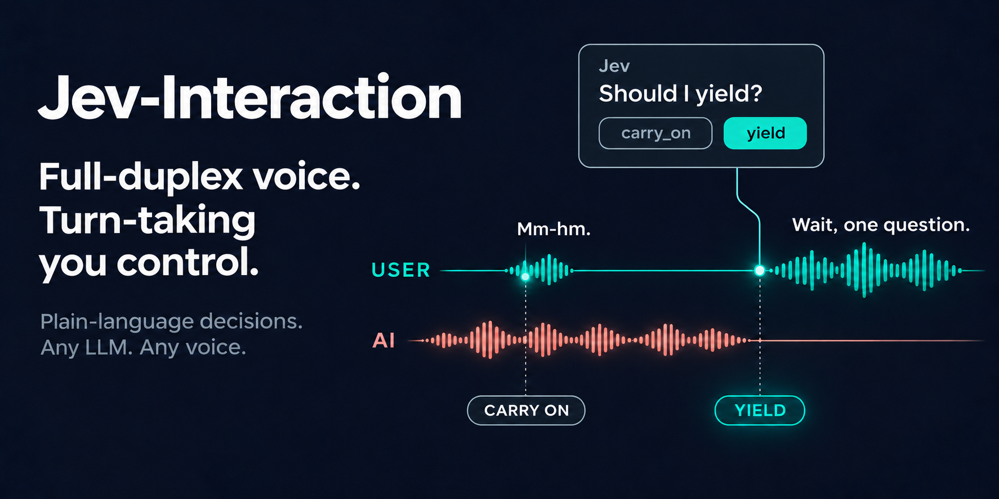
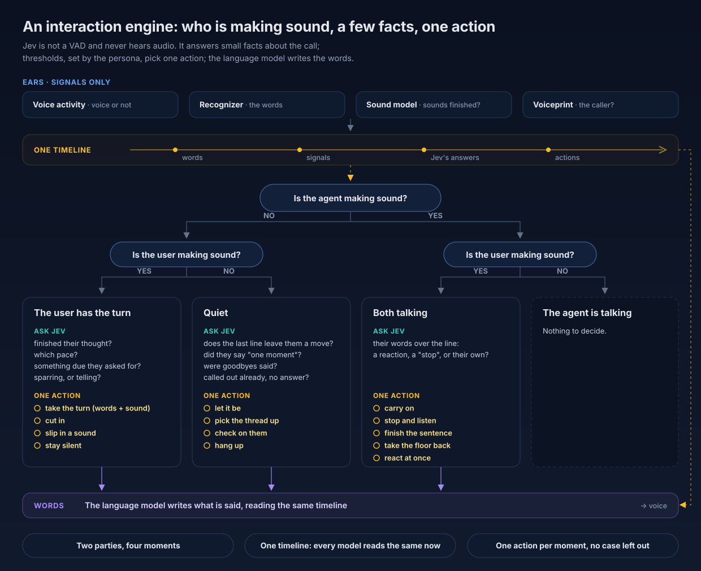

<div align="center">

# Jev-Interaction

**System-One-controlled full-duplex voice interaction.**<br>Turn-taking as decisions you write — not a model you train.

[中文](README.zh-CN.md) · [Cookbook](cookbook) · [Profiles](jev_interaction/profiles) · [Decisions](jev_interaction/judge/questions.py) · [Docs](#documentation)

🏆 **Build of the Week** at [TypeSafe](https://typesafe.ai) · 🤗 **Live demo** on [Hugging Face](https://huggingface.co/spaces/pupunpu/Jev-Interaction)

[](https://typesafe.ai) [](https://huggingface.co/spaces/pupunpu/Jev-Interaction)
[](https://pypi.org/project/jev-interaction/) [](https://github.com/native-bond-lab/Jev-Interaction/actions/workflows/tests.yml)     
<br>

*Most of a conversation happens in the gaps: who waits, who yields, who answers with nothing but an "mm-hm".<br>We wrote every gap down as a question, and gave the questions to Jev.* Try it here: [Try it now](https://pupunpu-jev-interaction.hf.space/) (or [on Hugging Face](https://huggingface.co/spaces/pupunpu/Jev-Interaction)).


</div>



> **Built on [Jev](https://typesafe.ai).** Every turn-taking decision here is a question Jev answers in tens of
> milliseconds. Without it, none of this would work.

> **From an applied lab.** Native Bond Lab is the applied research lab behind a consumer voice product. Everything in
> this repository comes out of that product and runs at scale on real calls with real users, not in a demo.


**Full duplex from a cascade.** Speech recognition → Jev's decisions → any language model → any speech synthesis. The
agent listens while it talks, says "mm-hm" while you talk, lets a pause stand, carries on through a backchannel, yields
or finishes its sentence when you cut in, and picks the call back up after a silence.

**A System One for conversation.** People on a call run two minds at once: a fast one that knows, without thinking,
when to wait, when to yield and when to say "mm-hm", and a slow one that works out what to say. Here Jev is the fast
mind, deciding each moment in tens of milliseconds; the language model is the slow one, writing the words. Neither
waits for the other.

Voice agents today take one of two roads. **Cascades** bolt a small trained model onto that pipeline to guess *"has
the user finished?"* and leave everything else to timers. **End-to-end full-duplex models** (Moshi, GPT-4o Realtime,
Gemini Live) learn turn-taking inside one large speech model: fast and natural, but a black box. You cannot see why it
stopped, cannot change how it takes turns for a product or a persona, and are tied to the vendor's model, voices and
session limits.

**Jev-Interaction keeps the cascade's freedom and gives it the judgement.** Every one of those moments becomes an
explicit decision: a plain-language multiple-choice question, a probability from Jev for every choice, and a policy
that turns the probabilities into an action. Questions, policies and the agent's manner are text you can read, change
and replay against real calls.

**Demo video: on the way.**

## Quickstart

From PyPI, in any folder; the page walks you through each provider and key:

```bash
pip install "jev-interaction[server]"     # add ,sound for the sound model and ,voiceprint for the caller's voiceprint
jev-interaction serve                     # http://localhost:8080
```

Or from a clone, one command installs everything, starts the server and opens the page:

```bash
git clone https://github.com/native-bond-lab/Jev-Interaction && cd Jev-Interaction
./scripts/setup.sh            # --china installs through a domestic PyPI mirror
```

Or with Docker (any OS):

```bash
cp .env.example .env          # fill it in, or leave it empty and use the setup steps on the page
docker compose up             # http://localhost:8080
```

Open <http://localhost:8080>. Setup goes one node at a time: the judge (Jev), a language model, speech recognition, a
voice. Paste a key and the page recognises whose it is; pick the language model from the endpoint's own model list; test
each step before moving on. Settings are saved to `.env` in the folder you started from. Make a persona of your own or change one with **New
persona** / **Edit** under the cards (on your own machine or your own Docker; a public deployment does not offer it):
who it is for the language model, its habits on a call for Jev, its turn-taking and its voice, saved to `profiles/`. Then pick a persona and click
the orb to call (click it again to hang up). The voice detector is TEN VAD, the one our product runs on; headphones still give the cleanest call.

Each node and its providers, the recommended setups (global and mainland China), presets and publishing a Hugging Face Space: [docs/setup.md](docs/setup.md).

### In your own code

```python
from jev_interaction import Config, Profile
from jev_interaction.adapters import best_vad
from jev_interaction.adapters.openai_compat import OpenAICompatResponder
from jev_interaction.adapters.scribe import ScribeRealtime
from jev_interaction.judge import JevClient
from jev_interaction.session import Session

session = Session(
    Profile.load("support")          # a built-in persona, or a path to your own YAML,
    send=my_send,                       # async: deliver events to your client
    judge=JevClient(),
    recognizer=ScribeRealtime(language="en"),
    responder=OpenAICompatResponder(),   # any OpenAI-compatible endpoint
    vad=best_vad(),                      # TEN VAD (pip install ten-vad), or the energy detector without it
    config=Config(language="en"),
)
await session.start()
await session.on_audio(frame)          # 200 ms of 16 kHz PCM16, as it arrives
await session.on_client({"type": "playback", "state": "idle"})
```

Events to the client: `line`, `listen`, `stop`, `finish_line`, `persona`, `hangup`, plus `user`, `pace` and
`decision` for display. Client messages: `playback` and `heard`.

### Inside a coding agent

In Claude Code or DeepSeek Harness, a slash command brings up a voice companion for the session you are in: you talk to
the computer, it hands what you ask for to the session as a background task, says how far it has got when you ask,
tells you when it is done, and sleeps in between. The talking is done by a fast model of the harness's own that you
choose the first time, speech recognition and synthesis by providers of your choice; there is no page and no window.

```bash
pipx install "jev-interaction[server,local]"
# Claude Code:        /plugin marketplace add native-bond-lab/Jev-Interaction
#                     /plugin install interaction@jev-interaction      then  /interaction:start
# DeepSeek Harness:   dsh plugin --profile tui add <this repo>/connectors/deepseek-harness      then  /interaction
```

Setup, how it works and what is still open: [docs/harness.md](docs/harness.md). Background tasks and sleep in your own
code (`Session(executors=...)`): [docs/tasks.md](docs/tasks.md).

## How it works



Jev-Interaction is an interaction engine, not a voice-activity detector. Jev never hears audio and never decides that
someone is speaking; the ears do that (voice activity, the recognizer, a sound model, a voiceprint) and their output is
only signals. What the engine decides is what to do with the moment: answer, wait, slip in an "mm-hm", cut in, carry on
over an interruption, pick a quiet up, hang up. Three principles shape it.

1. **Two parties, four moments.** The agent and the user each make sound or not, which gives four moments: the user
   has the turn, both are quiet, both are talking, the agent is talking. Each moment has its own set of actions, and
   nothing else.
2. **One timeline, one "now".** The call is one record that only grows: the words, the signals, every answer from Jev,
   every action taken, each on the same clock (`Ledger`). Every judgement and the model that writes the lines read the
   same present from it (`judge/state.py`, `Now`); no decision keeps its own account of the call.
3. **One action per moment, no case left out.** In any moment there is one set of choices that do not overlap, and
   every situation belongs to exactly one of them. One answer from Jev, one thing done.

| moment | Jev is asked | one action |
|---|---|---|
| the user has the turn | have they finished · which pace (one yes/no fact per pace) · is something they asked for due · sparring or telling | take the turn (when the words and the sound agree) · cut in (in a pace that does) · slip in a sound · stay silent |
| quiet | does the agent's last line leave them a move · did they say they need a moment · were goodbyes said · has the agent called out with no answer | let it be · pick the thread up · check on them · hang up (the facts and the clock decide) |
| both talking | what their words over the line are: a reaction, a "stop", or something of their own | carry on · stop and listen · finish the sentence · take the floor back · react at once |
| the agent is talking | nothing | nothing to decide |

What follows from the principles, the paces, and the same engine under two personas: [docs/policy.md](docs/policy.md).

## What you get

- **Every piece is yours to choose.** The intelligence (any language model), the voice (any synthesizer and voice),
  the style, the task and the persona. The persona reaches the interaction itself, not only the words: an impatient
  character cuts in and answers half-sentences, a gentle one says "mm-hm" often and waits you out, a tutor finishes the
  explanation before yielding, a support agent stays brief and stops the moment you speak.
- **The pace routes itself, turn by turn.** Each turn Jev also judges which pace the call is in: normal conversation,
  listening (the caller is pouring something out: more listening sounds, longer waits, fewer interruptions), narrating
  (the agent is telling a story: an "mm-hm" does not stop it) or eager (quick to take the floor). One call moves between
  them on its own, from small talk into a game and back.
- **A new task is a few knobs, zero-shot.** Nothing here is trained on any benchmark or on your data. A task profile is
  a page of text; the pause problem in Full-Duplex-Bench was fixed with two knobs, and each trade-off is measured, not
  guessed.
- **Every number comes with a reason.** Each decision is logged with the state Jev read and the probabilities it gave,
  so a bad moment points at the step that caused it, and a reworded question can be replayed against recorded calls
  before it ships.
- **Calls of any length.** No session is held open on a model provider; each decision and each reply is a fresh request
  over a text history.
- **Cheap.** A decision is a few hundred tokens to Jev; in our runs a reply cost about $0.002 of language model and a
  400-sample benchmark round about $2.

## Task profiles

One framework, many products. A profile says what the agent is for, how it behaves on a call, and how each decision is
read.

| profile | listening sounds | mid-sentence pauses | talked over | silence | policies |
|---|---|---|---|---|---|
| [companion](jev_interaction/profiles/companion.yaml) | often, varied | quick to react | stops, delighted | fills it | defaults |
| [support](jev_interaction/profiles/support.yaml) | a short "okay" | waits (numbers being read) | stops at once | waits, then one check | thresholds |
| [tutor](jev_interaction/profiles/tutor.yaml) | encouraging | very patient | finishes the explanation | offers a prompt | defaults |
| [interviewer](jev_interaction/profiles/interviewer.yaml) | none | lets thinking run | cuts in on rambling | waits for the answer | mixed |
| [Vera · speaking coach](jev_interaction/profiles/vera.yaml) | almost none | lets silence work | finishes her sentence | gives the next exercise | thresholds |
| [话唠阿乐 · chatterbox](jev_interaction/profiles/chatterbox_zh.yaml) | constant | jumps in | finishes his sentence | can't bear one | defaults |
| [小奶狗小言 · sweet puppy](jev_interaction/profiles/puppy_zh.yaml) | soft "mm, and then?" | waits | stops the moment you speak | asks if you're okay | defaults |
| [电商客服小安 · support (Chinese)](jev_interaction/profiles/support_zh.yaml) | a rare "好的" | never cuts in on an order number | stops at once | one check | thresholds |

```yaml
name: Sam
task: A customer-support agent for a broadband provider.
prompt: >            # read by the language model
  Be clear and brief, confirm what you understood, one step at a time.
manner: >            # read by Jev
  Waits for the caller to finish even through long pauses (they may be reading a number). Stops at once when talked over.
policies:
  end_of_turn: {type: threshold, default: 0.7}
  quiet: argmax
```

## Results at a glance

Zero-shot: nothing here was trained on any benchmark. Four public benchmarks, 16 metrics, against end-to-end duplex
systems (GPT-Realtime, Gemini Live, GPT-4o, Moshi, Nova Sonic, Freeze-Omni) and trained turn detectors. With the tested
knobs on, Jev-Interaction is first on 3 metrics and in the top three on 8.

**Where it leads.** It understands what a moment calls for.

- **Fewest real pauses taken as turns:** 0.06, against Gemini Live 0.10 and GPT-Realtime 0.12 (Full-Duplex-Bench v1.0).
- **Most relevant answers after an interruption:** 4.61 of 5, against 4.12 for the best reference.
- **Talks through an "mm-hm":** it carries on; every end-to-end system in Full-Duplex-Bench v1.5 stops within 0.7 s.
- **Lets background speech pass:** second only to Nova Sonic (0.56, against Gemini 0.30 and GPT-4o 0.04).
- **Catches interruptions between two people:** 0.92 on TurnBench from words alone, 4th of 16, ahead of GPT Live and
  Gemini Live, which caught none.

**Where it trails:** pure timing from sound, speed after an interruption (1.7 s, mostly the language model writing its first line) and synthetic pauses. Every table, chart and trace, and the knobs: [docs/benchmarks.md](docs/benchmarks.md).

## Swappable pieces

| piece | protocol | included |
|---|---|---|
| VAD | `is_voice(pcm) -> bool`, optionally `voiced_ms(pcm, playing) -> int` | `TenVAD`, `EnergyVAD` |
| recognizer | streaming, closed segments | `ScribeRealtime` (ElevenLabs), `ParaformerRealtime` (Alibaba Cloud Bailian) |
| responder | `lines(messages) -> async lines` | `OpenAICompatResponder` |
| synthesizer | `audio(text) -> async bytes` | `ElevenLabsTTS`, `CosyVoiceTTS` (Alibaba Cloud Bailian) |
| sound model (optional) | `score(pcm) -> p(finished)`, `ready`, `warm()` | `SmartTurn` (`[sound]` extra): has the user finished, from the voice; `JEV_SOUND` picks a registered one |
| speaker embedder (optional) | `embed(pcm) -> unit vector`, `ready`, `warm()` | `EcapaEmbedder` (`[voiceprint]` extra): the caller's voiceprint, from 20 s read before the call and the call itself, cleared at hang-up; `JEV_VOICEPRINT` picks a registered one |
| judge | `ask(questions, state) -> probabilities` | `JevClient` |
| policy | `choose(probs, allowed)`, `draw(p)` | `ThresholdPolicy` (every default), `ArgmaxPolicy`, `SamplePolicy` (draws, for whoever wants them) |

## Documentation

| | |
|---|---|
| [docs/setup.md](docs/setup.md) | every node and its providers, recommended setups (global / mainland China), presets, a Hugging Face Space |
| [docs/policy.md](docs/policy.md) | the call policy in full: moments, questions, paces, personas |
| [docs/benchmarks.md](docs/benchmarks.md) | every benchmark table, chart and trace; the tested knobs |
| [docs/extending.md](docs/extending.md) | add a decision; the layout of the code |
| [docs/harness.md](docs/harness.md) | voice interaction inside Claude Code and DeepSeek Harness: setup, how it works, what is open |
| [docs/tasks.md](docs/tasks.md) | background tasks and sleep: the agent hands work off and keeps talking |
| [docs/adapters.md](docs/adapters.md) | the providers for each node, and adding your own |
| [docs/protocol.md](docs/protocol.md) | the events between the server and a client |
| [docs/faq.md](docs/faq.md) | how it compares with a cascade and an end-to-end model; common questions |
| [cookbook](cookbook) | stacks, parameters, role policies: recipes, not defaults |
| [docs/stability.md](docs/stability.md) | the public surface |

## Roadmap

- Send the first sentence to synthesis as soon as it ends, not at the line break.
- A second recognizer behind the existing protocols.
- Turn the tested knobs on in our product's engine (here they are `Config` options), with a voiceprint beside the 10 dB rule (a quiet real caller must not become "someone else").
- Judge v1.5 against a fixed clean answer (same reply in both runs).
- The sound model's lines set on recorded calls and a held-out split, and a closer look at the tight 300 ms budget.
- Full TurnBench dev (38 conversations) for thresholds, then the hidden test set; larger task-profile runs.
- Benchmark harnesses in this repository, run against this package.

## Contributing

Work lands on `dev`: branch from it and open the pull request against it; `main` is what is released. A contribution is a reworded question, a new adapter, a policy or a profile, each one checkable by replay or on the same benchmarks: [CONTRIBUTING.md](CONTRIBUTING.md).

## Citing

If Jev-Interaction helps your research, please cite it. GitHub's **Cite this repository** button reads
[CITATION.cff](CITATION.cff); the BibTeX is:

```bibtex
@software{jev_interaction,
  author  = {Yang, Hengjie and Wu, Zipeng},
  title   = {Jev-Interaction: full-duplex voice turn-taking as plain-language decisions},
  year    = {2026},
  version = {0.3.0},
  url     = {https://github.com/native-bond-lab/Jev-Interaction},
  license = {Apache-2.0}
}
```

## Acknowledgements

Thanks to [Jev](https://typesafe.ai) and the TypeSafe team: the idea of turn-taking as questions only works because a
judge can answer them in tens of milliseconds, with a probability per choice, from plain text. Thanks also to the
authors of Full-Duplex-Bench, LiveKit eot-bench and TurnBench for open benchmarks and published baselines.

## Status

**At scale.** Native Bond Lab is the applied lab behind a consumer voice product. The voice-call engine in that product
runs at scale on real calls with real users, with the same design of decisions, questions, paces and policies, and
Jev judges every moment. Every benchmark number in [docs/benchmarks.md](docs/benchmarks.md) was measured on that engine.

**This repository: 0.3, alpha.** The decision layer is the tested part. The browser client is a
minimal stand-in; bring your own VAD, recognizer, language model and voice through the protocols in
[Swappable pieces](#swappable-pieces). Jev is a hosted API (`JEV_API_KEY`).

| | |
|---|---|
| decision layer (questions, state, policies, paces, profiles) | tested, running at scale in our product |
| session and server | working; used by the tests and the browser client |
| browser client | minimal, for trying it out |
| benchmark harnesses | not in this repository yet (see the roadmap) |
| public surface | written down in [docs/stability.md](docs/stability.md); frozen from 1.0.0-beta |

Licensed under Apache-2.0 (see [LICENSE](LICENSE)). Jev-Interaction is an independent project built on Jev; it is not
affiliated with or endorsed by TypeSafe.
