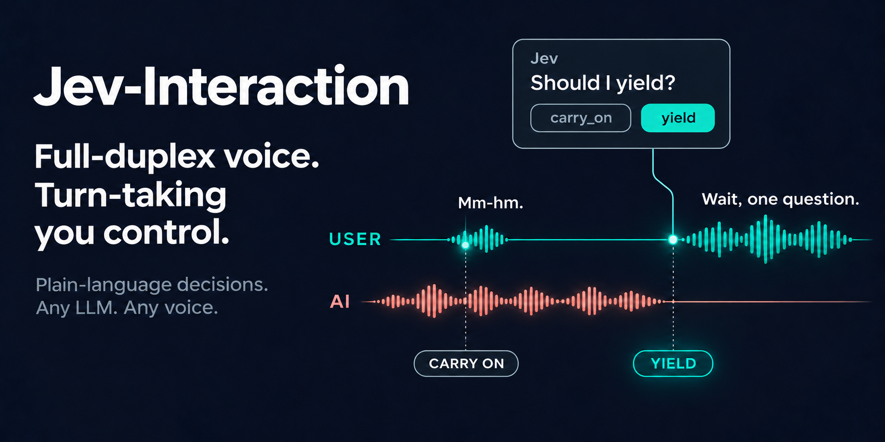
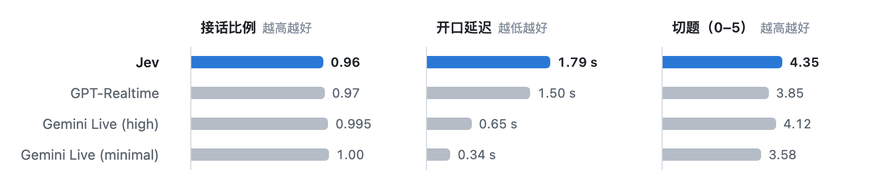
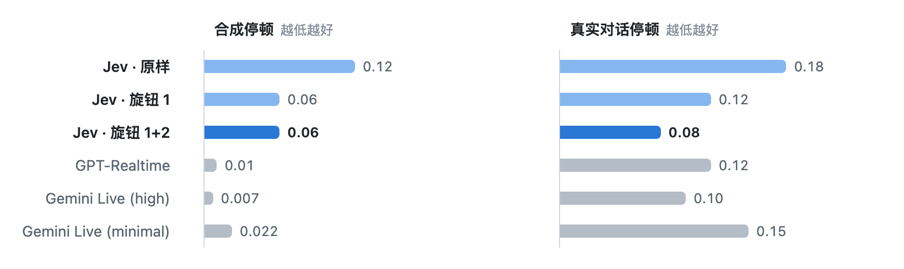
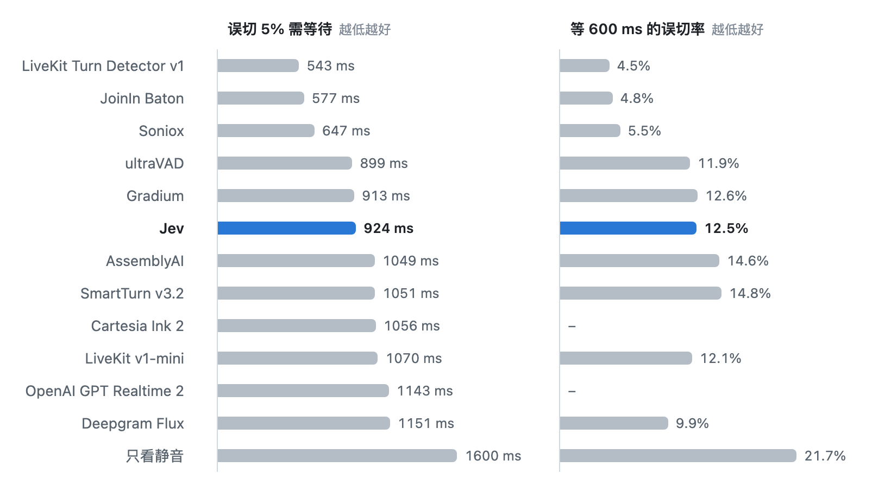
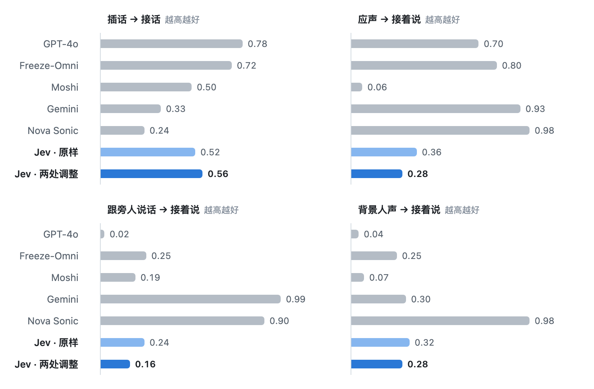
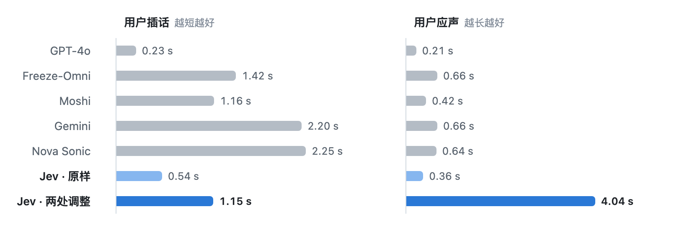
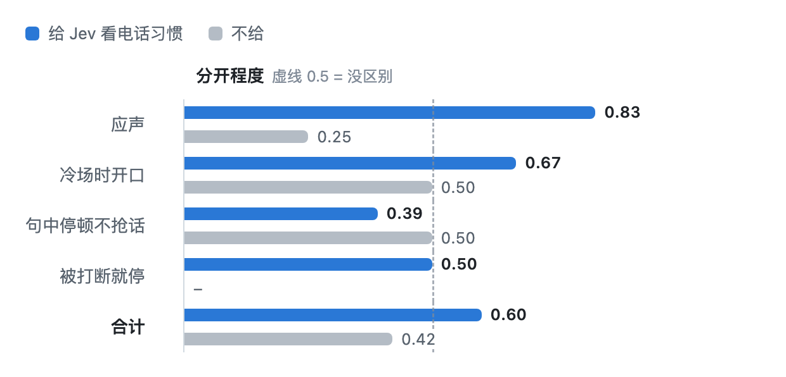
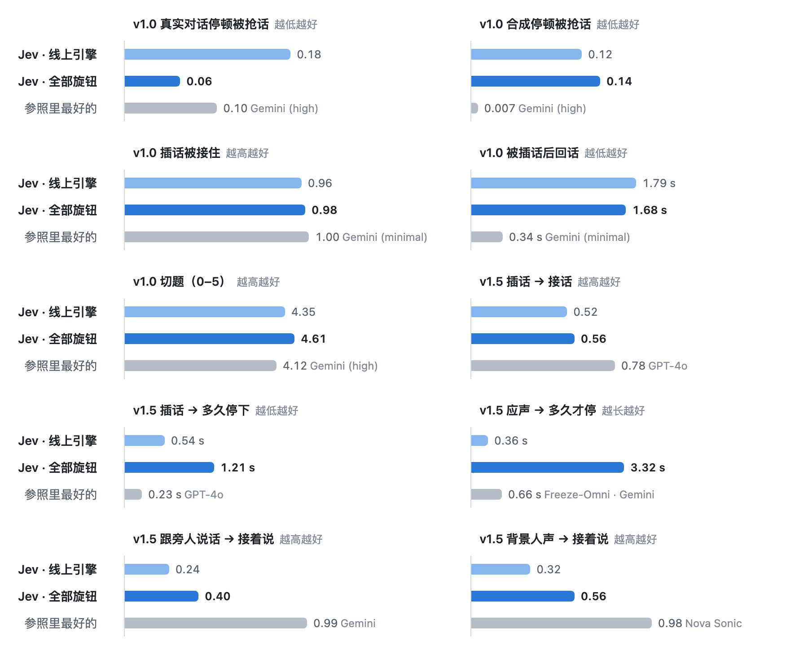

<div align="center">

# Jev-Interaction

**由“系统一”掌控的全双工语音交互。**<br>轮次交互是写出来的决策，而不是训练出来的模型。

[English](README.md) · [Cookbook](cookbook/README.zh-CN.md) · [任务配置](jev_interaction/profiles) · [决策题目](jev_interaction/judge/questions.py)

🏆 被 [TypeSafe](https://typesafe.ai) 选为 **Build of the Week** · 🤗 **在线体验**：[Hugging Face](https://huggingface.co/spaces/pupunpu/Jev-Interaction)

[](https://typesafe.ai) [](https://huggingface.co/spaces/pupunpu/Jev-Interaction)
[](https://pypi.org/project/jev-interaction/) [](https://github.com/native-bond-lab/Jev-Interaction/actions/workflows/tests.yml)     
<br>

*一场对话，大半发生在缝隙里：谁等，谁让，谁只轻轻"嗯"一声。<br>我们把每一道缝隙写成一个问题，交给 Jev。* 欢迎在这里进行体验：[体验入口](https://pupunpu-jev-interaction.hf.space/)（或 [Hugging Face 页面](https://huggingface.co/spaces/pupunpu/Jev-Interaction)）。


</div>



> **基于 [Jev](https://typesafe.ai)。** 这里每一个轮次决策，都是 Jev 在几十毫秒内回答的一道题。没有 Jev，就没有这个项目。

> **来自一个应用实验室。** Native Bond Lab 是一个由消费级语音产品驱动的应用实验室。这里开源的每一部分都来自我们的产品，
> 已经在规模化的真实通话里稳定运行，不是演示代码。



**用级联实现全双工。** 语音识别 → Jev 判断 → 任意大模型 → 任意语音合成。角色可以边说边听，你说话时它会"嗯嗯"，你停下来想词它会等，你应一声它接着说，你插话它会让路或者先说完这句，冷场了它会把话接起来。

**对话的“系统一”。** 人打电话时同时有两个脑子：一个快的，不用想就知道什么时候该等、该让、该“嗯”一声；一个慢的，负责想清楚说什么。在这里，Jev 是那个快的脑子，几十毫秒判断一个时刻；大模型是慢的那个，负责写出要说的话。两者互不等待。

今天的语音助手大致走两条路。**级联方案**在这条流水线上加一个训练出来的小模型，专门猜**用户说完没**，其余的都交给计时器。**端到端全双工模型**（Moshi、GPT-4o Realtime、Gemini Live）把轮次交互学进一个很大的语音模型里：又快又自然，但是个黑盒。你看不到它为什么停，没法按产品或人设改它的接话方式，模型、音色和会话时长也都受厂商限制。

**Jev-Interaction 保留级联的自由，再给它判断力。** 每一个这样的时刻都变成明确的决策：一道用自然语言写的选择题，Jev 给每个选项一个概率，再由策略把概率变成动作。题目、策略和角色的交互习惯都是看得懂的文字，可以直接改，也可以拿真实通话重放验证。

**演示视频：制作中。**

## 通话策略（policy）


Jev-Interaction 是一个交互引擎，不是人声检测（VAD）。Jev 不听音频，也不判断有没有人在说话；那是耳朵的事（人声检测、语音识别、声音模型、声纹），耳朵只给信号。引擎决定的是这一刻怎么做：接话、等、垫一声"嗯"、插话、被打断时接着说、冷场时接上、挂断。它按三条原则搭起来：

1. **两方对偶。** 模型和用户各自出声或不出声，组合成四个时刻：用户在说、两边都安静、两人同时说、模型在说。每个时刻有自己的一组动作，别的没有。
2. **一条线性的上下文。** 整通电话是一份只追加、不分叉的记录：说的话、信号、Jev 的每个回答、做过的每个动作，都在同一个时钟上（`Ledger`）。每个判断和写台词的模型读的是同一个"此刻"（`judge/state.py` 的 `Now`）；没有哪个决策自己另记一套。
3. **互斥穷尽。** 任何时刻只有一组互不重叠的选项，任何情况都恰好归其中一个管。Jev 回答一次，只做一件事。

由此而来的几条做法：

- **问的是关于用户和通话的小事实，一题一件事：**"说完了吗？""他说了'等一下'吗？""是在斗嘴还是在讲事？"。从不问"模型这时会怎么做"。事实不随角色变。
- **用阈值，不抽签。** 同一个时刻永远同样处理，录下来的通话可以原样重走。阈值集中在一处（`Config`），之后用数据调。
- **人设决定阈值和时机，不改题目：**它的话多容易被打断、插不插话、冷场多久接上。
- **Jev 定时机，语言模型定内容。** 规则不替 Jev 做决定，Jev 也不写台词。

| 时刻 | 问 Jev | 一个动作 |
|---|---|---|
| 用户在说 | 说完了吗 · 哪种节奏（每种节奏一道是非题） · 他要的东西该给了吗 · 斗嘴还是讲事 | 接话（字和声音都说说完了） · 插话（节奏允许时） · 垫一声 · 不出声 |
| 安静 | 模型上一句留给他接吗 · 他说了要等一下吗 · 道过别了吗 · 喊过了没人应吗 | 让它安静 · 接着自己的话头 · 问一声还在吗 · 挂断（事实加时钟决定） |
| 两人同时说 | 他压着说的是什么：附和、喊停，还是自己的话 | 接着说 · 停下来听 · 说完这半句 · 把话头拿回来 · 立刻回应 |
| 模型在说 | 不问 | 没有要决定的 |

来电者要找别人，是第一个时刻里多出来的一个事实（`who`：不换，或换人接；实验性，角色配置里列了 `cast` 才有）。

**节奏**（normal、patient、narrate、eager）表示谁掌握话头。各节奏的等待时间按 Jev 给的概率加权混合：Jev 判断"六成普通、四成耐心"时，等待时间就落在两者之间。

**同一个引擎，换两个人设。** 我们产品里的两个角色，一个支配型（Dom）、一个顺从型（Sub），各带自己的阈值和时机（`turn_taking`：话多容易被打断、插不插话、冷场多久接上；在引擎里就是节奏的 `yield_p`、`cut_in`、`lead_after_s`），用同一批写好的时刻测（`tools/persona_bench.py`，628 次 Jev 请求）：

- 日常时刻（132 个）：没理由不同的地方表现一样：冷场 28/28 相同，两人同时说 30/32 相同。插话只在该不同的地方不同：6 个斗嘴的时刻里，Dom 插话，Sub 让对方说完。
- 一场主导的戏（16 个时刻）：6 个时刻表现不同，方向都符合预期。命令说到一半用户来一句"Make me."：Dom 把话头拿回来，Sub 接着说；用户挑衅地一直说：一个插话，一个让他说完。该一样的地方一样：真的"停，我不舒服"两个都停，用户难过时两个都让他说完，下完命令后的安静两个都等着。
- 两边 Jev 给出的用户事实几乎没变（平均差 0.002 到 0.048）：题目一样，只有阈值不同。

## 你能得到什么

- **每个环节都由你选。** 用哪个大模型、什么声音、什么风格、做什么任务、什么人设。人设影响的不只是说的话，还有整套交互方式：急性子会抢话、话说一半就接；温柔的会多应声、耐心等你说完；家教会先把这句讲完再让你；客服说话简短，你一开口就停。
- **节奏每一轮自动切换（策略路由）。** 每一轮 Jev 还会判断这通电话现在处在哪种节奏：普通对话；倾听（对方在倾诉：多应声、等得更久、少打断）；讲述（角色在讲故事：一声"嗯嗯"不会打断它）；急性子（随时接话）。同一通电话里会自己切换，比如从闲聊切到一起玩游戏，再切回来。
- **换任务就是调几个旋钮，零样本。** 没有用任何基准或你的数据训练过。一份任务配置就是一页文字；Full-Duplex-Bench 上的停顿问题，就是改两个旋钮修好的，每个取舍都量过，不靠猜。
- **每个数字都说得出原因。** 每次决定都记下了 Jev 读到的状态和给出的概率，哪里出了问题能定位到具体哪一步；改一句题目，可以先拿录下来的通话重放，再上线。
- **通话不限时长。** 不在模型服务商那边一直开着会话，每次决策、每次回答都是对文字记录的一次新请求。
- **便宜。** 一次决策只给 Jev 几百个 token；我们的测试里，一次回答的大模型费用约 0.002 美元，跑一整轮 400 条基准约 2 美元。

## 基准成绩一览

零样本：没有用任何基准的数据训练过。四个公开基准、16 项指标，对手是端到端全双工系统（GPT-Realtime、Gemini Live、GPT-4o、Moshi、Nova Sonic、Freeze-Omni）和专门训练的轮次模型。打开下文测过的旋钮后，Jev-Interaction 有 3 项排第一，8 项进前三。

**领先的地方：它听得懂此刻该做什么。**

- **真实对话停顿被抢话最少：** 0.06，Gemini Live 0.10，GPT-Realtime 0.12（Full-Duplex-Bench v1.0）。
- **被插话后的回答最切题：** 4.61 分（满分 5），参照里最好的是 4.12。
- **听到"嗯嗯"不停：** 它接着说；Full-Duplex-Bench v1.5 里所有端到端系统都在 0.7 秒内停下。
- **背景人声不接：** 仅次于 Nova Sonic（0.56，Gemini 0.30，GPT-4o 0.04）。
- **两个人聊天时认得出谁在插话：** TurnBench 上只看文字就有 0.92，16 个里第 4；GPT Live 和 Gemini Live 一次都没认出来。

**落后的地方，也是最欢迎大家一起做的地方。**

- **只靠声音判断节奏：** eot-bench（只看文字时 13 个里第 6）和 TurnBench 判断说完了（16 个里第 8），领先的都是用这类对话训练过的小声音模型。引擎现在让 Jev 和一个开源声音模型一起判断，两个都说说完了才接话：中文误切 2% 时，等得比 VoxTurn 短，比闭源的 LiveKit v1 长；300 毫秒这一档误切仍比它们多；英文上 VoxTurn 单独最好（[详情](#说完没livekit-eot-bench)）。
- **被插话后回话的速度：** 1.7 秒，端到端模型是 0.3–1.5 秒；大部分时间花在大模型写第一句上，换更快的模型、更早送出第一句就能补回不少。
- **合成停顿**（Full-Duplex-Bench v1.0 上 0.14）：听起来像说完的分句，它会接话。

每个决策都是看得懂的题目，每次运行都能重放，所以贡献可以是改一句题目、加一个适配器或一种策略，在同样的基准上量出来。欢迎提 issue 和 pull request。

据我们所知，这是第一个把轮次交互写成自然语言决策的全双工框架；零样本下，在需要理解的那些决策上，它已经达到业界最好水平。

## 为什么

| | 级联 + 端点模型 | 端到端全双工模型（Moshi、GPT-4o Realtime、Gemini Live） | Jev-Interaction |
|---|---|---|---|
| 什么时候回话 | 训练好的端点模型，一个阈值 | 学在模型里面，看不见，也调不动 | 一道题，Jev 结合说的话、停顿时长和前文来判断 |
| 边听边应声 | 没有，或者固定音频 | 模型学到什么算什么 | 每次现判：接续的声、有感触的反应、重复关键词，或不出声 |
| 被打断 | 有声就停，或者从不停 | 学出来的；在 Full-Duplex-Bench v1.5 上，它们听到一声"嗯嗯"都会在 0.7 秒内停下 | 继续、让路、说完这句、把话头拿回来、立刻接话 |
| 冷场 | 超时 | 看模型的习惯 | 接着说、问问还在不在、等着、挂电话，参考这位用户平时多久接话 |
| 人设或新任务 | 重新训练或调端点模型 | 提示词能改说的话，节奏还是模型自己的 | 换一份任务配置：给 Jev 看的交互习惯和每类决策的策略，人设连怎么接话都会变 |
| 改行为 | 收数据、重训 | 等厂商更新，或者重训一个很大的模型 | 改一句题目，用录下来的通话重放，上线 |
| 为什么这么做 | 一个分数 | 看不到 | 每次决定都记下 Jev 读到的状态和给出的概率 |
| 模型和声音 | 随便换 | 只能用厂商的模型和音色 | 任意大模型、任意语音合成和音色 |
| 长通话 | 没有会话上限 | 会话有上限（OpenAI Realtime 60 分钟），或音频把上下文占满（Gemini Live 约 15 分钟音频后要压缩，丢掉或概括早先的话） | 没有会话上限：每次决策、每次回答都是对文字记录的一次新请求，一分钟说话约 200 个 token |
| 速度 | 取决于大模型 | 最快：Full-Duplex-Bench v1.0 上被插话后 0.3–1.5 秒回话 | 被插话后 1.7 秒，主要是大模型写第一句的时间 |

## 任务配置

一套框架，多种产品。配置写明角色是干什么的、电话里是什么习惯、每类决策怎么读。

| 配置 | 应声 | 说到一半停顿 | 被打断 | 冷场 | 策略 |
|---|---|---|---|---|---|
| [陪伴](jev_interaction/profiles/companion.yaml) | 常有，花样多 | 很快接话 | 立刻停，很高兴 | 主动填上 | 默认 |
| [客服](jev_interaction/profiles/support.yaml) | 简短一声"好" | 等着（对方可能在念号码） | 立刻停 | 等着，久了问一次 | 阈值 |
| [家教](jev_interaction/profiles/tutor.yaml) | 鼓励的声音 | 非常耐心 | 先讲完这句 | 给个提示 | 默认 |
| [面试官](jev_interaction/profiles/interviewer.yaml) | 不出声 | 让对方想 | 跑题就打断 | 等回答 | 混合 |
| [Vera · 演讲教练](jev_interaction/profiles/vera.yaml) | 几乎不出声 | 让沉默替她说话 | 先说完这句 | 直接给下一个练习 | 阈值 |
| [话唠阿乐](jev_interaction/profiles/chatterbox_zh.yaml) | 不停应声 | 抢着接话 | 先说完这句 | 一秒都忍不了 | 默认 |
| [小奶狗小言](jev_interaction/profiles/puppy_zh.yaml) | 轻轻"嗯，然后呢" | 耐心等 | 你一开口就停 | 问你怎么啦 | 默认 |
| [电商客服小安](jev_interaction/profiles/support_zh.yaml) | 偶尔一句"好的" | 报订单号时绝不打断 | 立刻停 | 只问一次 | 阈值 |

```yaml
name: Sam
task: 宽带公司的客服，尽快把来电者的问题讲清楚、解决掉。
prompt: >            # 给大模型看
  简明清楚，先复述确认，再一步一步带对方操作。
manner: >            # 给 Jev 看
  对方停顿很久也等他说完（可能在念号码）。被打断立刻停。
policies:
  end_of_turn: {type: threshold, default: 0.7}
  quiet: argmax
```

## 快速开始

从 PyPI 装，在任意目录；页面会一步一步带你选服务商、填密钥：

```bash
pip install "jev-interaction[server]"     # 要声音模型加 ,sound，要来电者声纹加 ,voiceprint
jev-interaction serve                     # 打开 http://localhost:8080
```

或者从源码，一条命令装好依赖、启动服务并打开页面：

```bash
git clone https://github.com/native-bond-lab/Jev-Interaction && cd Jev-Interaction
./scripts/setup.sh            # 加 --china 走国内 PyPI 镜像
```

或者用 Docker（任何系统）：

```bash
cp .env.example .env          # 手动填，或者留空，用页面上的设置步骤
docker compose up             # 打开 http://localhost:8080
```

打开 <http://localhost:8080>。设置一次一个节点：法官（Jev）、大模型、语音识别、音色。粘贴密钥，页面会认出是哪家的；大模型从该服务自己的模型列表里选；每一步测试通过再往下走。设置保存在启动目录下的 `.env`。然后选一个角色，点中间的圆开始通话（再点一次挂断）。人声检测用的是 TEN VAD，和我们产品里用的一样；戴耳机通话最干净。

**每个节点都由你选。** 大模型是任意兼容 OpenAI 接口的服务（xAI、OpenAI、DeepSeek、通义千问、豆包、智谱 GLM、Kimi、OpenRouter、Groq、本地 Ollama 或 vLLM）；识别和音色来自服务商注册表，第三方包也能注册自己的（[docs/adapters.md](docs/adapters.md)）。大模型会按你选的音色调整写法：能演绎音频标签的音色（ElevenLabs v3/v4）用带 `[laughs]`、`[whispers]` 的写法，其他音色只写说出口的话（`jev_interaction/prompts/speech/`）。

**推荐配置**，在设置页面和 `.env.example` 末尾提供，只有你选了才会用（各自适合什么、怎么换掉其中一个节点：[cookbook/stacks.md](cookbook/stacks.md)）：

| | 推荐（海外），在我们产品的规模化通话里验证过 | 推荐（中国大陆） |
|---|---|---|
| 法官 | Jev | 百炼 `decision-model-preview`，同一套协议（要设 `JEV_PROVIDER=bailian`；实测结果见 [cookbook](cookbook/stacks.md#the-judge-on-the-mainland)） |
| 大模型 | grok-4.3，关闭思考，温度 0.7 | 通过百炼调用 qwen-plus |
| 语音识别 | ElevenLabs Scribe v3 Live | Paraformer realtime v2 |
| 音色 | ElevenLabs eleven_v4_turbo（音频标签） | CosyVoice v2，每个角色可配音色（纯文字） |
| 需要的密钥 | Jev、语言模型（xAI）、TTS（ElevenLabs；`TTS_API_KEY`） | 一把百炼（DashScope）密钥 |
| 现成的配置文件 | `.env.example` 末尾 | [`deploy/mainland-china.env`](deploy/mainland-china.env)：复制成 `.env`，填两个值 |

**预设。** `JEV_PRESET=recommended`（默认）是我们产品现在用的时间参数；`tested` 在此基础上打开下文测过的旋钮；`default` 是库的默认值。代码里用 `jev_interaction.preset("recommended", language="zh")`（旧名 `production` 仍可用）。每个参数的作用见 [cookbook/parameters.md](cookbook/parameters.md)。

**Hugging Face Space。** `HF_TOKEN=... ./scripts/push_hf_space.sh <owner>/<space>` 会把本仓库发布成 Docker Space（[说明](deploy/huggingface/README.md)）；密钥放在 Space 的 secrets 里，首次发布会自动设好 `MAX_CONCURRENT_CALLS`、`MAX_CALL_SECONDS` 和每日总分钟数 `MAX_CALL_MINUTES_PER_DAY`，因为每通电话都按这些密钥计费。

### 在自己的代码里用

```python
from jev_interaction import Config, Profile
from jev_interaction.adapters import best_vad
from jev_interaction.adapters.openai_compat import OpenAICompatResponder
from jev_interaction.adapters.scribe import ScribeRealtime
from jev_interaction.judge import JevClient
from jev_interaction.session import Session

session = Session(
    Profile.load("support")          # a built-in persona, or a path to your own YAML,
    send=my_send,                       # 异步函数：把事件发给你的客户端
    judge=JevClient(),
    recognizer=ScribeRealtime(language="en"),
    responder=OpenAICompatResponder(),   # 任意兼容 OpenAI 接口的模型
    vad=best_vad(),                      # TEN VAD（pip install ten-vad），没装就用能量检测
    config=Config(language="en"),
)
await session.start()
await session.on_audio(frame)          # 每 200 毫秒一帧 16 kHz PCM16
await session.on_client({"type": "playback", "state": "idle"})
```

发给客户端的事件：`line`、`listen`、`stop`、`finish_line`、`persona`、`hangup`，以及用于展示的 `user`、`pace`、`decision`。客户端发回：`playback` 和 `heard`。

### 新增一个决策

一个决策就是一个模块：什么时候问、问 Jev 什么、答案做什么。先写题目：

```python
# jev_interaction/judge/questions.py
def laugh(name: str) -> dict:
    return {"type": "choice", "instructions": f"The user just made a joke. Would {name}, being who they are, laugh?",
            "criteria": {"laugh": f"{name} finds it funny and laughs", "smile": "a warm word, no laugh", "none": "let it pass"}}
```

再写决策本身，注册并配一个策略：

```python
# jev_interaction/decisions/laugh.py
from .. import speaking
from ..judge import questions as Q
from .base import Decision

speaking.event("laugh", "they made a joke; you laugh, in a few words", answers_user=True, max_tokens=60)


class Laugh(Decision):
    name = policy = "laugh"

    def on_words(self, s):                        # 什么时候问：用户说了新的话，agent 没在说
        if not s.speaking and not s.generating:
            s._spawn(self.ask(s))

    def questions(self, s, ctx):                  # 问 Jev 什么；状态默认是通话到此刻的情况
        return {"laugh": Q.laugh(s.p.short)}

    async def apply(self, s, answers, ctx):       # 策略选出的结果做什么
        if self.choose(s, answers, "laugh", ctx) == "laugh":
            await s.respond("laugh")
```

```python
register(Laugh())                                 # jev_interaction.decisions; 或直接写进那里的 DECISIONS
config = Config(policies={**Config().policies, "laugh": ThresholdPolicy(default=0.6)})
```

别的地方都不用改：会话在每段新识别出的话（`on_words`）和每 100 毫秒一次的 tick（`on_tick`）上把所有注册过的决策过一遍，并把状态、题目和答案记进日志。`allowed` 用来收窄此刻可选的选项，`state` 用来补充 Jev 读到的内容；`jev_interaction/decisions/` 里的五个内置决策就是例子。用 `jev-interaction replay runs/*.jsonl --purpose laugh` 拿录下的通话重放，看它的答案落在哪里。

### 测过的旋钮

下文"全部旋钮一起开"里量过的旋钮，都是 `Config` 的字段。默认关闭；每一个都是取舍。

```python
from jev_interaction import Config
cfg = Config(overlap_ask_ms=1000, listen_max_words=3, not_for_me=True, far_db=10)
```

| 字段 | 作用 | 量出来的效果 |
|---|---|---|
| `overlap_ask_ms=1000` | 用户声音压着角色持续 1 秒才问让路题（默认 0.4 秒；测的时候叫 `hold_after_ms`，是暂停播放） | 一声"嗯嗯"不再打断角色（停下延迟 0.36 秒 → 3.3 秒）；真插话时晚停约 0.6 秒 |
| `listen_max_words=3` | 超过这么多词的应声不出（默认 6） | 停顿被算作抢话的情况变少（Full-Duplex-Bench 把 4 个词以上算作接话） |
| `not_for_me=True` | 轮次题和让路题加一个"不是对我说的"选项，通话第一句不提供 | 对旁人说的话、背景人声会被略过，不再回答 |
| `far_db=10` | 比来电者回答过的话低这么多 dB 的声音，当成别人的 | 背景人声"接着说" 0.28 → 0.56；要和声纹一起用，否则说话轻的来电者可能被忽略 |

## 初步结果

测的是我们产品里的语音通话引擎，按 0.1 版本的做法（同一个决策层，识别和合成用 ElevenLabs；0.1 之后实验性的应声和打断改动还没重测），数据是 [Full-Duplex-Bench](https://github.com/DanielLin94144/Full-Duplex-Bench) v1.0，每类用固定随机种子抽 50 条。停顿两类用 gpt-4o-mini 当语言模型，插话用 grok-4.3。

| | 本引擎（样本数） | GPT-Realtime | Gemini 3.1 Flash Live（high / minimal） |
|---|---|---|---|
| 合成停顿被当成说完（越低越好） | 0.12（50） | 0.01 | 0.007 / 0.022 |
| 真人对话停顿被当成说完 | 0.18（50） | 0.12 | 0.10 / 0.15 |
| 被打断后接话 | 0.96（50） | 0.97 | 0.995 / 1.0 |
| 被打断后回话延迟（评测规则） | 平均 1.79 秒，中位 1.68 秒 | 1.50 秒 | 0.65 / 0.34 秒 |
| 回答相关度（0–5） | 4.35（grok 打分） | 3.85 | 4.12 / 3.58 |

**被打断时。** Full-Duplex-Bench v1.0，50 条插话样本，grok-4.3。延迟按评测规则取平均（中位 1.68 秒）；本引擎的切题分由 grok 评，参照系统由官方评委评。

<picture>
  <source media="(prefers-color-scheme: dark)" srcset="docs/charts/fdb10-interruptions.zh.dark.png">
  
</picture>

插话这一项和商用系统同档，回答质量分也不错。停顿是短板：被算成"抢话"的 15 条里，9 条是角色以为线上没人说话、自己主动开口（测试音频开头没有接电话那一句，有些录音音量小，声音检测可能没听到用户），6 条是用户还没说完就答了，多数是答了多句话里的第一句。回话延迟主要花在语言模型写第一句上，决策本身只要几十毫秒。

### 案例：两个旋钮修好停顿

每个决策都连同 Jev 看到的状态记了下来，所以被算成"抢话"的 15 条停顿样本可以逐条追：9 条是用户还在说第一句、还没识别出字时，"安静了要不要开口"那道题被触发，角色自己开了口；4 条是应声超过了评测规定的 3 个词；2 条是用户说完一句完整的话就答了。改两个旋钮，在同样 100 条上测：

| | 合成停顿 | 真人对话停顿 |
|---|---|---|
| 改之前 | 0.12 | 0.18 |
| 用户声音还在继续时不问"要不要开口" | 0.06 | 0.12 |
| 再把应声限制在 3 个词以内 | **0.06** | **0.08** |

**停顿被当成说完：调整前后。** 每组 50 条。旋钮 1：用户声音还在继续时不问"要不要开口"；旋钮 2：应声限 3 个词以内。只在测试里验证，还没进引擎。

<picture>
  <source media="(prefers-color-scheme: dark)" srcset="docs/charts/fdb10-pauses.zh.dark.png">
  
</picture>

真人对话停顿已经好于上表里的商用系统（0.10–0.15）。这两个旋钮目前只在测试里验证过，还没改进引擎；整个过程没有重新训练任何模型。

第三个旋钮是"Jev 有 0.8 以上把握判断说完了才回答"。它把真人对话停顿降到 0.04，被打断后的回话也没变慢，但平常的回答慢了约 1 秒（中位从 0.8 秒到 1.8 秒）。所以先不开：代价看得见、量得出、随时能撤，这正是这套做法的意义。

### 说完没：LiveKit eot-bench

[eot-bench](https://github.com/livekit/eot-bench) 在 400 段真实用户发言的每个停顿处判断"说完没"（英文验证集，11,191 个打分点）。我们把框架里的 `turn` 题原样问 Jev，只看文字（按评测规定文字晚 0.5 秒到），没有针对这份数据做任何训练或调参。

| | 等 600 毫秒时的误切率 | 误切 5% 时要等多久 |
|---|---|---|
| LiveKit Turn Detector v1 | 4.5% | 543 毫秒 |
| Deepgram Flux | 9.9% | 1151 毫秒 |
| **Jev（只看文字、零样本）** | **12.5%** | **924 毫秒** |
| SmartTurn v3.2 | 14.8% | 1051 毫秒 |
| OpenAI GPT Realtime 2 | – | 1143 毫秒 |
| 只看安静时长 | 21.7% | 1600 毫秒 |

**说完没：LiveKit eot-bench。** 400 段真实用户发言、11,191 个打分点，按误切 5% 所需等待排序。Jev 只看文字、零样本。其他系统取公开结果；– 表示未公布。

<picture>
  <source media="(prefers-color-scheme: dark)" srcset="docs/charts/eot-bench.zh.dark.png">
  
</picture>

排在中游：误切 5% 这一档好于 AssemblyAI、SmartTurn、Cartesia、OpenAI Realtime 和 Deepgram，明显不如直接听音频、专门在这类对话上训练的模型。约 1.1 万次 Jev 调用，约 1 美元。

**文字和声音一起判断，已经进了引擎。** 识别出的字比声音晚半秒到，停顿刚开始时只看文字的判断没有新东西可读；声音模型听得到语气怎么收的，却不知道说了什么。两者错在不同的停顿上（英文里各自在 850 个话没说完的停顿中误切约 85 个，重合的只有 11 个）。从 0.3.0 起引擎两个都问：Jev 看字，声音模型听最后 8 秒音频（默认 SmartTurn v3.2，BSD-2 许可，跑在 CPU 上；[你自己的模型](docs/adapters.md#the-sound-model-and-the-voiceprint)也能同样接进来）。默认两个都说说完了才接话：把人话打断比回得慢更糟（`Config.sound_rule = "and"`）。

测的是 eot-bench **v1.0**（数据集版本 `ca9d98a`；评测的 main 分支现在是 v1.1，多了 1,888 行英文，我们没有跑），英文验证集（400 段发言、11,191 个打分点）和中文验证集（344 段、9,441 个打分点），用每个模型在每个打分点上的预测来算。每一列都是越小越好。

| 中文 | 误切 2% 要等多久 | 误切 5% 要等多久 | 300 毫秒时的误切率 |
|---|---|---|---|
| **Jev + SmartTurn v3.2，两个都说完才接（引擎默认）** | **1050 毫秒** | **783 毫秒** | 32.2% |
| Jev，只看文字 | 1119 毫秒 | 839 毫秒 | 34.5% |
| SmartTurn v3.2，只听声音 | 1274 毫秒 | 891 毫秒 | 40.1% |
| VoxTurn v1（非商用许可） | 1078 毫秒 | 806 毫秒 | 25.0% |
| LiveKit Turn Detector v1（闭源，只能在 LiveKit Agents 里用） | 1006 毫秒 | 799 毫秒 | 20.6% |

| 英文 | 误切 2% 要等多久 | 误切 5% 要等多久 | 300 毫秒时的误切率 |
|---|---|---|---|
| **Jev + SmartTurn v3.2，两个都说完才接（引擎默认）** | **1248 毫秒** | **835 毫秒** | 29.6% |
| Jev，只看文字 | 1552 毫秒 | 924 毫秒 | 36.7% |
| SmartTurn v3.2，只听声音 | 1763 毫秒 | 1045 毫秒 | 32.8% |
| VoxTurn v1（非商用许可） | 1000 毫秒 | 462 毫秒 | 8.5% |
| LiveKit Turn Detector v1（闭源，只能在 LiveKit Agents 里用） | 991 毫秒 | 543 毫秒 | 9.9% |

怎么读，输的地方也写上：

- **中文。** 两个都说完才接，在每一档都比任何一个单独用等得短。误切 2% 时比 VoxTurn 短（1050 对 1078 毫秒），比闭源的 LiveKit v1 长（1006 毫秒）；误切 5% 时比两者都短（783 对 806、799 毫秒）。300 毫秒这一档明显输：话没说完的停顿里误切 32%，它们是 25% 和 21%。声音模型要听到一段安静才拿得准，字也还没到。
- **英文。** VoxTurn 单独用是这里最好的，闭源的 LiveKit v1 也不如它。两个都说完才接，让 Jev 在误切 2% 时从 1552 毫秒降到 1248 毫秒，离训练过的声音模型还差很远。
- **为什么用 SmartTurn。** 它是我们能随代码发出去的声音模型：VoxTurn 是 CC BY-NC，LiveKit v1 只能在 LiveKit Agents 里用。别的模型可以通过注册表接进来。
- **可信到什么程度。** 规则和两条线（按语言的 `sound_min`、`words_min`）是在这两份数据上选的，没有留出集，也还没在录下来的真实通话上测过。声音模型的每次读数、每次它拦下的接话都记在通话日志里，可以用你自己的通话来调。

SmartTurn 和 VoxTurn 都是在整个停顿里反复读，和引擎读 SmartTurn 的方式一样。LiveKit v1 按排行榜的方式在 0.2 秒读一次就不再变；整个停顿反复读的话等得更久（误切 2% 时中文 1026 毫秒、英文 1460 毫秒）。VoxTurn 按排行榜的方式读：中文 1131 / 830 毫秒，英文 982 / 669 毫秒。

### 被插话：Full-Duplex-Bench v1.5

每类 25 条带噪声的样本，grok-4.3，用官方评委（gpt-4o-2024-08-06）打分。

| 场景 | 想要的 | 本引擎 | 论文（GPT-4o · Gemini · Nova Sonic · Moshi） |
|---|---|---|---|
| 用户插话 | 接话 | 0.52 | 0.78 · 0.33 · 0.24 · 0.50 |
| | 停下延迟 | **0.54 秒** | 0.23 · 2.20 · 2.25 · 1.16 |
| 用户应声 | 接着说 | 0.36 | 0.70 · 0.93 · 0.98 · 0.06 |
| 用户跟旁人说话 | 接着说 | 0.24 | 0.02 · 0.99 · 0.90 · 0.19 |
| 背景人声 | 接着说 | 0.32 | 0.04 · 0.30 · 0.98 · 0.07 |

**评委判的行为。** 各场景得到想要标签的比例，每类 25 条带噪声样本；论文系统取 Table 2。调整前后的变化都在 25 条样本 ±0.08 的波动内。

<picture>
  <source media="(prefers-color-scheme: dark)" srcset="docs/charts/fdb15-behavior.zh.dark.png">
  
</picture>

停得快，但用户只说一声"嗯嗯"、跟旁人说一句、或背景里有人说话，也会停下来。从记录能看出原因：应声时 Jev 多数判断对了（25 条里 19 条"接着说"），但有声音进来 0.4 秒就先暂停播放，那时还不知道说的是什么；而 `floor` 那道题里没有"这话不是对我说的"这个选项，所以对旁人说的话会让角色提前收尾、再去回答。在测试里改了两处：声音持续 1 秒才暂停，加上这个选项。改完以后，应声时角色一次都没停（停下延迟从 0.36 秒到 4.0 秒，论文里所有系统都在 0.7 秒以内就停了），对旁人说的话 25 条里有 9 条被略过；代价是真正被插话时晚停 0.6 秒（1.15 秒）。评委的标签没有变好，变化都在 25 条的波动范围内：评委拿这次的回答和另一次干净版本的回答对比，陪伴角色的回答短、每次又不一样，评委很难看出"接着同一段说"。

**多久停下来。** 停下延迟中位数，按评测规则。两处调整：声音持续 1 秒才暂停播放，加"这话不是对我说的"选项。只在测试里验证，线上引擎未改。

<picture>
  <source media="(prefers-color-scheme: dark)" srcset="docs/charts/fdb15-stop.zh.dark.png">
  
</picture>

### 任务配置：行为会不会跟着配置变

自带的四份配置跑同样 12 段录音（长段讲述、句中停顿、插话、冷场），分别给和不给 Jev 看配置里的电话习惯。"分开程度"是：预期高的配置在同一段录音上得分高于预期低的配置的比例（0.5 等于没区别）。每格只有 3 条，只能看方向。

| 方面 | 给电话习惯 | 不给 |
|---|---|---|
| 应声 | **0.83** | 0.25 |
| 冷场时主动开口 | **0.67** | 0.50 |
| 句中停顿不抢话 | 0.39 | 0.50 |
| 被打断就停 | 0.50 | – |
| 合计 | **0.60** | 0.42 |

**换配置，行为跟着变吗。** 四份自带配置、12 段录音，给和不给 Jev 看电话习惯时的分开程度；0.5 等于没区别。每格 3 条，只能看方向。

<picture>
  <source media="(prefers-color-scheme: dark)" srcset="docs/charts/task-profiles.zh.dark.png">
  
</picture>

给电话习惯时每分钟应声次数：家教 7.5、陪伴 3.0、客服 2.3、面试官 1.0。停顿拉不开（所有配置都没抢话）；被打断时所有配置都会停，包括应该"先讲完这句"的家教，原因同上：问那道题之前播放已经先暂停了。

### 两个真人聊天：TurnBench

[TurnBench](https://turnbench.sesame.com) 旁听两个真人自由聊天（各一个麦克风），判断一个人什么时候说完了（EOT）、什么时候有人把话头抢过去（INT）。我们跑了 dev 集 6 段对话（约 1 小时）：每个声道用 Scribe 转写，每次停顿、每次两人同时开口时问 Jev；不用声音模型，也没用 TurnBench 的训练数据。阈值和问法是在这 6 段上挑的，数字偏乐观。

| | 说完了：召回（误判 ≤ 0.10） | 插话：召回 |
|---|---|---|
| vap（用 TurnBench 训练集训练过） | 0.86 | 0.99 |
| kyutai semantic VAD | 0.84 | 0.98 |
| **Jev，只看文字** | **0.67**（16 个里第 8） | **0.92**（16 个里第 4） |
| GPT Live | 0.62 | 0.00 |
| Gemini Live | 0.73 | 0.00 |

对方的声音会串进每个麦克风：一个声道里约 30% 的词其实是另一个人说的，低 20–40 dB。去掉这些词后，一段对话上的插话误判从 0.39 降到 0.06。第一版问"A 说完了吗"，会漏掉对方已经接过话头的情况；改成"现在轮到谁说"，说完了的召回从 0.48 升到 0.63，再用引擎自带的声纹判断说不清的词，升到 0.67。

### 全部旋钮一起开

同一套引擎设置，打开上面所有旋钮（用户还在说时不问"要不要开口"、应声变短、声音持续 1 秒才暂停、让路题和轮次题都有"不是对我说的"选项、比来电者回答过的话低 10 dB 以上的声音当成别人的），全部用 grok-4.3，v1.5 的干净参照也用同一套设置重跑。只在测试里改，线上引擎没动。

| | 线上引擎 | 全部旋钮 | 参照里最好的 |
|---|---|---|---|
| v1.0 真实对话停顿被抢话 | 0.18 | **0.06** | Gemini (high) 0.10 |
| v1.0 合成停顿被抢话 | 0.12 | 0.14 | Gemini (high) 0.007 |
| v1.0 插话被接住 | 0.96 | 0.98 | Gemini (minimal) 1.0 |
| v1.0 被插话后多久回话 | 1.79 秒 | 1.68 秒 | Gemini (minimal) 0.34 秒 |
| v1.0 回答切题程度（grok 评） | 4.35 | **4.61** | Gemini (high) 4.12 |
| v1.5 用户插话：接话 | 0.52 | 0.56 | GPT-4o 0.78 |
| v1.5 用户插话：多久停下 | 0.54 秒 | 1.21 秒 | GPT-4o 0.23 秒 |
| v1.5 用户应声：多久才停（越久越好） | 0.36 秒 | **3.32 秒** | 0.66 秒 |
| v1.5 用户跟旁人说话：接着说 | 0.24 | 0.40 | Gemini 0.99 |
| v1.5 背景人声：接着说 | 0.32 | **0.56** | Nova Sonic 0.98 |

**同一套设置，全部旋钮打开。** 浅色是线上引擎，深色是全部旋钮，灰色是每项参照里最好的系统（标了名字）。只在测试里改，线上引擎没动。

<picture>
  <source media="(prefers-color-scheme: dark)" srcset="docs/charts/all-knobs.zh.dark.png">
  
</picture>

上面四个基准里和外部系统比的 16 项指标：线上引擎排第一 1 项、前一半 7 项；全部旋钮排第一 3 项、前一半 10 项。

### 每个数字都说得出原因

端到端模型只给一个分数。流水线给分数，也给出背后的每个决定，因为每次决定都记下了 Jev 读到的状态和给出的概率。全部旋钮那次的记录说明了这些：

| 数字 | 背后实际发生了什么 |
|---|---|
| 应声时多久才停 3.32 秒 | 不是慢，是没停。能对上记录的 23 条里，Jev 被问了 20 次"要不要让路"，20 次都答"接着说"。3.3 秒是角色把这句话说完的时间；论文里所有系统都在 0.7 秒内停下，也就是被一声"嗯嗯"打断了。 |
| 应声时"接着说" 0.32 | 同一批录音。评委拿这次的回答和另外跑的干净版本对比；陪伴角色的回答短、每次又不一样，评委很少看得出"同一段内容接着说"。两次用同一个回答（温度设为 0）时升到 0.56，跟旁人说话、背景人声也一起涨了。 |
| 插话时多久停下 1.21 秒 | 有意为之：声音持续 1 秒才暂停，好分清是应声还是插话。真插话时问的 21 次让路题里，Jev 选让路 7 次、说完这句再让 7 次、接着说 7 次；最后这 7 次是看得见的误判。 |
| 被插话后多久回话 1.68 秒 | 41 次能对上记录的回答，中位 1.71 秒：0.8 秒在等确认用户说完了，0.75 秒是大模型出第一句，0.1 秒是合成和播放。决策本身只要几十毫秒。 |
| 真实对话停顿 0.06 | 50 条里抢了 3 次，每次都能查到 Jev 当时给的概率；其中一次是一声 "Mm."。 |
| 合成停顿 0.14 | 50 条里 7 次，多是在一句听起来已经说完的话后面接了话（"Yeah? What's the story about?"）。合成语音习惯在完整的分句后停顿。 |
| 背景人声 0.56 | 能对上记录的 22 条里，15 条被当成别人的声音（主要靠 10 dB 规则，其余是 Jev 选了"不是对我说的"）。还被回答的 7 条，要么来电者自己说话就轻（差不到 10 dB），要么第一句太短没测出音量。 |
| TurnBench 说完了 0.67 | 文字比声音晚到；领先的几个都是用这种两人对话训练过的声音模型。 |

## 可替换的部件

| 部件 | 接口 | 自带实现 |
|---|---|---|
| VAD | `is_voice(pcm) -> bool`，可选 `voiced_ms(pcm, playing) -> int` | `TenVAD`、`EnergyVAD` |
| 语音识别 | 流式，按段输出 | `ScribeRealtime`（ElevenLabs）、`ParaformerRealtime`（阿里云百炼） |
| 大模型 | `lines(messages)`，逐句流式 | `OpenAICompatResponder` |
| 语音合成 | `audio(text)`，流式字节 | `ElevenLabsTTS`、`CosyVoiceTTS`（阿里云百炼） |
| 声音模型（可选） | `score(pcm)` 返回说完的概率、`ready`、`warm()` | `SmartTurn`（`[sound]` 可选依赖）：从声音听是不是说完了；`JEV_SOUND` 可选别的已注册模型 |
| 声纹（可选） | `embed(pcm)` 返回单位向量、`ready`、`warm()` | `EcapaEmbedder`（`[voiceprint]` 可选依赖）：通话前念约 20 秒加通话中学会来电者的声音，挂断即删；`JEV_VOICEPRINT` 可选别的已注册模型 |
| 法官 | `ask(questions, state)` | `JevClient` |
| 策略 | `choose(probs, allowed)`、`draw(p)` | 阈值（全部默认）、取最大、抽签（想要抽签的自己选） |

## 目录

```
jev_interaction/
  session.py          一通电话：状态和主循环（音频进，台词出）
  decisions/          每个决策一个模块：turn · listen · floor · cut_in · quiet
  judge/              Jev 客户端 · 决策题目 · 状态文本
  utterance.py        用户此刻在说的话：文字、时长、响度
  speaking.py         每种台词开口前告诉大模型的那一行
  policy.py           抽签 · 阈值 · 取最大
  profile.py          任务配置
  config.py           节奏、时间参数、默认策略
  presets.py          recommended · tested · default 预设
  ledger.py           整通电话的一份记录，一个时钟：每轮话、它们的时间、判断过什么、做过什么
  recorder.py         每个事件一行 JSON，供重放
  adapters/           VAD · 识别 · 大模型 · 合成 · 声音模型 · 声纹；registry.py 是服务商表
  prompts/            大模型的系统提示；speech/ 里每类音色一种写法
  profiles/           内置角色
  server/             通话服务（WebSocket、音频、角色、健康检查、设置）和网页（web/）
  replay.py           重问录下来的题目，原样或改写后
  testing.py          假的法官、识别、大模型、VAD 和合成：不要密钥也能跑一通电话
  cli.py              `jev-interaction serve` / `init` / `replay`
scripts/setup.sh      一键本地部署（--china 走国内 PyPI 镜像）
deploy/huggingface/   Hugging Face Space 说明；scripts/push_hf_space.sh 负责发布
deploy/mainland-china.env  中国大陆实测最好的一套配置，复制成 .env 就能用
tools/                judge_bench · persona_bench · draw_policy（画 docs/policy.svg）等测量脚本
cookbook/             配置 · 参数 · 角色 policy：推荐做法，不是默认值
docs/                 策略图、架构图、基准图表、协议
```

## 路线图

- 一句话写到句号就先送去合成，不等换行。
- 在现有接口后面接第二路识别。
- 在我们产品的引擎里打开测过的旋钮（本仓库里已是 `Config` 选项），10 dB 规则要和声纹一起用（说话轻的真实来电者不能被当成别人）。
- v1.5 用固定的干净版本回答重新评（两次用同一个回答）。
- 在真实通话录音和留出集上调声音模型的线，再细看 300 毫秒这一档。
- 引擎直接读人设自己的阈值和时机（`turn_taking`），不只是 `tools/persona_bench.py` 读。
- TurnBench 跑完整 dev 集（38 段）定阈值，再提交隐藏测试集；更大规模的任务配置评测。
- 把测试脚本放进本仓库，用本仓库的代码跑。

## 常见问题

**Jev 在这里是当 VAD 用的吗？** 不是。Jev 不听音频。人声检测、语音识别、声音模型和声纹是耳朵，只给信号；Jev 回答关于用户和通话的小事实，策略把它们变成每个时刻的一个动作（[通话策略](#通话策略policy)）。

**一定要用 Jev 吗？** 法官只是一个接口（`ask(questions, state)`）。这个框架是用 Jev 搭建和测量的；其他能按选项给出概率的法官也能接进来。

**一通电话能打多久？** 想打多久打多久。没有任何东西在模型服务商那边一直开着会话：Jev 和语言模型都是一轮一轮地对着文字记录提问。一分钟说话约 200 个 token 的文字，语音到语音的模型要约 1,500 个 token 的音频（Gemini Live 按每秒 25 个 token 计）。回答模型看到的记录有长度窗口，通话特别长时，早先的内容要靠你另外接上的记忆或摘要来保留。

**要快一定得用大模型吗？** 不用。决策只要几十毫秒，回话快慢取决于你接的语言模型。

**花费多少？** 按我们的测量，一分钟通话音频几美分，大头是语言模型。

## 引用

如果 Jev-Interaction 对你的研究有帮助，欢迎引用。GitHub 页面右侧的 **Cite this repository** 读取 [CITATION.cff](CITATION.cff)；BibTeX 如下：

```bibtex
@software{jev_interaction,
  author  = {Yang, Hengjie and Wu, Zipeng},
  title   = {Jev-Interaction: full-duplex voice turn-taking as plain-language decisions},
  year    = {2026},
  version = {0.3.0},
  url     = {https://github.com/native-bond-lab/Jev-Interaction},
  license = {Apache-2.0}
}
```

## 致谢

感谢 [Jev](https://typesafe.ai) 和 TypeSafe 团队："把轮次交互写成题目"这个想法之所以可行，是因为有一个法官能在几十毫秒内、对着纯文字、给每个选项一个概率。也感谢 Full-Duplex-Bench、LiveKit eot-bench 和 TurnBench 的作者开放了基准和基线结果。

## 状态

**规模化运行。** Native Bond Lab 是一个由消费级语音产品驱动的应用实验室。产品里的语音通话引擎面对真实用户、真实通话规模化运行，决策、题目、节奏和策略的设计都一样，每个时刻都由 Jev 判断。上面所有的基准数字都是在那套引擎上测的。

**本仓库：0.3，alpha。** 决策层是测过的部分。网页客户端只是最简单的示例实现；VAD、语音识别、大模型和声音都可以按[可替换的部件](#可替换的部件)里的接口换成你自己的。Jev 是托管 API（`JEV_API_KEY`）。

| | |
|---|---|
| 决策层（题目、状态、策略、节奏、任务配置） | 测过，已在我们产品里规模化运行 |
| 会话和服务端 | 可用；测试和网页客户端都在用 |
| 网页客户端 | 最简实现，用来试用 |
| 基准测试脚本 | 还没放进本仓库（见路线图） |
| 对外接口 | 清单见 [docs/stability.md](docs/stability.md)，1.0.0-beta 起冻结 |

采用 Apache-2.0 许可证（见 [LICENSE](LICENSE)）。Jev-Interaction 是基于 Jev 的独立项目，与 TypeSafe 无关联、未获其背书。
