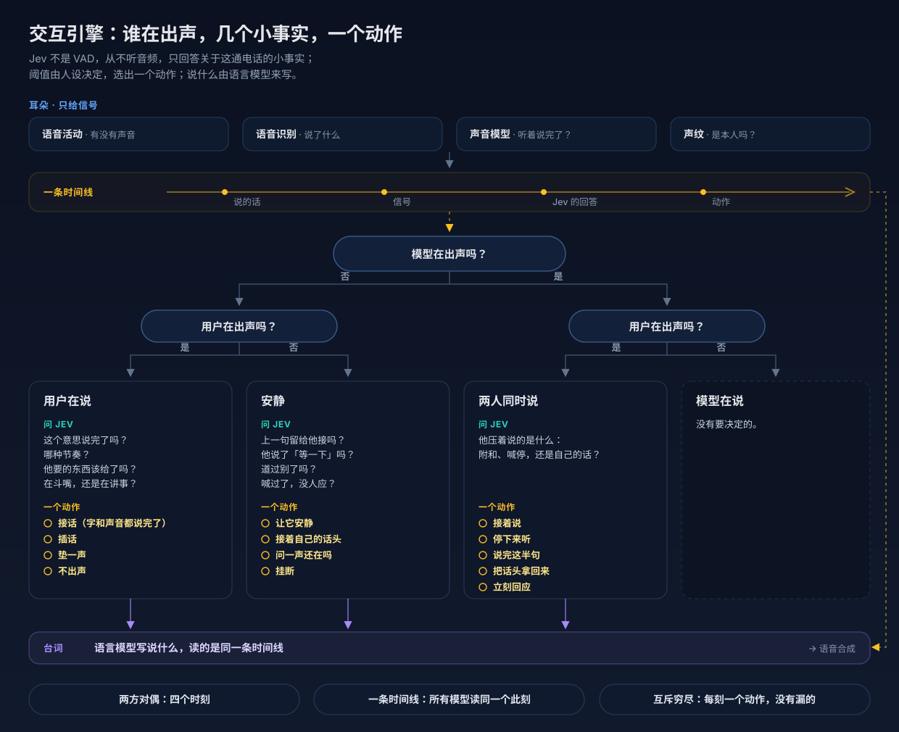

<div align="center">

# Jev-Interaction

**由“系统一”掌控的全双工语音交互。**<br>轮次交互是写出来的决策，而不是训练出来的模型。

[English](README.md) · [Cookbook](cookbook/README.zh-CN.md) · [任务配置](jev_interaction/profiles) · [决策题目](jev_interaction/judge/questions.py) · [文档](#文档)

🏆 被 [TypeSafe](https://typesafe.ai) 选为 **Build of the Week** · 🤗 **在线体验**：[Hugging Face](https://huggingface.co/spaces/pupunpu/Jev-Interaction)

[](https://typesafe.ai) [](https://huggingface.co/spaces/pupunpu/Jev-Interaction)
[](https://pypi.org/project/jev-interaction/) [](https://github.com/native-bond-lab/Jev-Interaction/actions/workflows/tests.yml)     
<br>

*一场对话，大半发生在缝隙里：谁等，谁让，谁只轻轻"嗯"一声。<br>我们把每一道缝隙写成一个问题，交给 Jev。* 欢迎在这里进行体验：[体验入口](https://pupunpu-jev-interaction.hf.space/)（或 [Hugging Face 页面](https://huggingface.co/spaces/pupunpu/Jev-Interaction)）。


</div>


> **基于 [Jev](https://typesafe.ai)。** 这里每一个轮次决策，都是 Jev 在几十毫秒内回答的一道题。没有 Jev，就没有这个项目。

> **来自一个应用实验室。** Native Bond Lab 是一个由消费级语音产品驱动的应用实验室。这里开源的每一部分都来自我们的产品，
> 已经在规模化的真实通话里稳定运行，不是演示代码。


**用级联实现全双工。** 语音识别 → Jev 判断 → 任意大模型 → 任意语音合成。角色可以边说边听，你说话时它会"嗯嗯"，你停下来想词它会等，你应一声它接着说，你插话它会让路或者先说完这句，冷场了它会把话接起来。

**对话的“系统一”。** 人打电话时同时有两个脑子：一个快的，不用想就知道什么时候该等、该让、该“嗯”一声；一个慢的，负责想清楚说什么。在这里，Jev 是那个快的脑子，几十毫秒判断一个时刻；大模型是慢的那个，负责写出要说的话。两者互不等待。

今天的语音助手大致走两条路。**级联方案**在这条流水线上加一个训练出来的小模型，专门猜**用户说完没**，其余的都交给计时器。**端到端全双工模型**（Moshi、GPT-4o Realtime、Gemini Live）把轮次交互学进一个很大的语音模型里：又快又自然，但是个黑盒。你看不到它为什么停，没法按产品或人设改它的接话方式，模型、音色和会话时长也都受厂商限制。

**Jev-Interaction 保留级联的自由，再给它判断力。** 每一个这样的时刻都变成明确的决策：一道用自然语言写的选择题，Jev 给每个选项一个概率，再由策略把概率变成动作。题目、策略和角色的交互习惯都是看得懂的文字，可以直接改，也可以拿真实通话重放验证。

**演示视频：制作中。**

## 快速开始

从 PyPI 装，在任意目录；页面会一步一步带你选服务商、填密钥：

```bash
pip install "jev-interaction[server]"     # 要声音模型加 ,sound，要来电者声纹加 ,voiceprint
jev-interaction serve                     # 打开 http://localhost:8080
```

或者从源码，一条命令装好依赖、启动服务并打开页面：

```bash
git clone https://github.com/native-bond-lab/Jev-Interaction && cd Jev-Interaction
./scripts/setup.sh            # 加 --china 走国内 PyPI 镜像
```

或者用 Docker（任何系统）：

```bash
cp .env.example .env          # 手动填，或者留空，用页面上的设置步骤
docker compose up             # 打开 http://localhost:8080
```

打开 <http://localhost:8080>。设置一次一个节点：法官（Jev）、大模型、语音识别、音色。粘贴密钥，页面会认出是哪家的；大模型从该服务自己的模型列表里选；每一步测试通过再往下走。设置保存在启动目录下的 `.env`。角色卡片下面有「新建角色」和「编辑」：给语言模型的人设、给 Jev 的通话习惯、接话方式和音色，存到 `profiles/`（只在你自己的电脑或自己的 Docker 上出现，公开部署不提供）。然后选一个角色，点中间的圆开始通话（再点一次挂断）。人声检测用的是 TEN VAD，和我们产品里用的一样；戴耳机通话最干净。

每个节点能选哪些服务商、推荐配置（海外和中国大陆）、预设、发布成 Hugging Face Space：见 [docs/setup.zh-CN.md](docs/setup.zh-CN.md)。

### 在自己的代码里用

```python
from jev_interaction import Config, Profile
from jev_interaction.adapters import best_vad
from jev_interaction.adapters.openai_compat import OpenAICompatResponder
from jev_interaction.adapters.scribe import ScribeRealtime
from jev_interaction.judge import JevClient
from jev_interaction.session import Session

session = Session(
    Profile.load("support")          # a built-in persona, or a path to your own YAML,
    send=my_send,                       # 异步函数：把事件发给你的客户端
    judge=JevClient(),
    recognizer=ScribeRealtime(language="en"),
    responder=OpenAICompatResponder(),   # 任意兼容 OpenAI 接口的模型
    vad=best_vad(),                      # TEN VAD（pip install ten-vad），没装就用能量检测
    config=Config(language="en"),
)
await session.start()
await session.on_audio(frame)          # 每 200 毫秒一帧 16 kHz PCM16
await session.on_client({"type": "playback", "state": "idle"})
```

发给客户端的事件：`line`、`listen`、`stop`、`finish_line`、`persona`、`hangup`，以及用于展示的 `user`、`pace`、`decision`。客户端发回：`playback` 和 `heard`。

### 在编程助手里用

在 Claude Code、DeepSeek Harness 或 Codex 里敲一条命令，就给当前会话带上一个语音伙伴：你对着电脑说话，它把你要做的事作为后台任务交给会话，你问它就说进度，做完了告诉你，没事的时候休眠。说话用的是 harness 自己账号下的快模型，第一次用时由你来选；语音识别和合成的服务商也由你选。没有网页，也没有窗口。

```bash
pipx install "jev-interaction[server,local]"
# Claude Code：        /plugin marketplace add native-bond-lab/Jev-Interaction
#                      /plugin install interaction@jev-interaction      然后  /interaction:start
# DeepSeek Harness：   dsh plugin --profile tui add <本仓库>/connectors/deepseek-harness      然后  /interaction
# Codex：              codex plugin marketplace add native-bond-lab/Jev-Interaction
#                      codex plugin add interaction@jev-interaction                              然后  $interaction
```

怎么配置、怎么工作、还有哪些没做完：见 [docs/harness.md](docs/harness.md)（英文）。在自己的代码里用后台任务和休眠（`Session(executors=...)`）：见 [docs/tasks.md](docs/tasks.md)（英文）。

## 它怎么工作



Jev-Interaction 是一个交互引擎，不是人声检测（VAD）。Jev 不听音频，也不判断有没有人在说话；那是耳朵的事（人声检测、语音识别、声音模型、声纹），耳朵只给信号。引擎决定的是这一刻怎么做：接话、等、垫一声"嗯"、插话、被打断时接着说、冷场时接上、挂断。它按三条原则搭起来：

1. **两方对偶。** 模型和用户各自出声或不出声，组合成四个时刻：用户在说、两边都安静、两人同时说、模型在说。每个时刻有自己的一组动作，别的没有。
2. **一条线性的上下文。** 整通电话是一份只追加、不分叉的记录：说的话、信号、Jev 的每个回答、做过的每个动作，都在同一个时钟上（`Ledger`）。每个判断和写台词的模型读的是同一个"此刻"（`judge/state.py` 的 `Now`）；没有哪个决策自己另记一套。
3. **互斥穷尽。** 任何时刻只有一组互不重叠的选项，任何情况都恰好归其中一个管。Jev 回答一次，只做一件事。

| 时刻 | 问 Jev | 一个动作 |
|---|---|---|
| 用户在说 | 说完了吗 · 哪种节奏（每种节奏一道是非题） · 他要的东西该给了吗 · 斗嘴还是讲事 | 接话（字和声音都说说完了） · 插话（节奏允许时） · 垫一声 · 不出声 |
| 安静 | 模型上一句留给他接吗 · 他说了要等一下吗 · 道过别了吗 · 喊过了没人应吗 | 让它安静 · 接着自己的话头 · 问一声还在吗 · 挂断（事实加时钟决定） |
| 两人同时说 | 他压着说的是什么：附和、喊停，还是自己的话 | 接着说 · 停下来听 · 说完这半句 · 把话头拿回来 · 立刻回应 |
| 模型在说 | 不问 | 没有要决定的 |

由这三条原则而来的做法、节奏、同一个引擎换两个人设的实测：见 [docs/policy.zh-CN.md](docs/policy.zh-CN.md)。

## 你能得到什么

- **每个环节都由你选。** 用哪个大模型、什么声音、什么风格、做什么任务、什么人设。人设影响的不只是说的话，还有整套交互方式：急性子会抢话、话说一半就接；温柔的会多应声、耐心等你说完；家教会先把这句讲完再让你；客服说话简短，你一开口就停。
- **节奏每一轮自动切换（策略路由）。** 每一轮 Jev 还会判断这通电话现在处在哪种节奏：普通对话；倾听（对方在倾诉：多应声、等得更久、少打断）；讲述（角色在讲故事：一声"嗯嗯"不会打断它）；急性子（随时接话）。同一通电话里会自己切换，比如从闲聊切到一起玩游戏，再切回来。
- **换任务就是调几个旋钮，零样本。** 没有用任何基准或你的数据训练过。一份任务配置就是一页文字；Full-Duplex-Bench 上的停顿问题，就是改两个旋钮修好的，每个取舍都量过，不靠猜。
- **每个数字都说得出原因。** 每次决定都记下了 Jev 读到的状态和给出的概率，哪里出了问题能定位到具体哪一步；改一句题目，可以先拿录下来的通话重放，再上线。
- **通话不限时长。** 不在模型服务商那边一直开着会话，每次决策、每次回答都是对文字记录的一次新请求。
- **便宜。** 一次决策只给 Jev 几百个 token；我们的测试里，一次回答的大模型费用约 0.002 美元，跑一整轮 400 条基准约 2 美元。

## 任务配置

一套框架，多种产品。配置写明角色是干什么的、电话里是什么习惯、每类决策怎么读。

| 配置 | 应声 | 说到一半停顿 | 被打断 | 冷场 | 策略 |
|---|---|---|---|---|---|
| [陪伴](jev_interaction/profiles/companion.yaml) | 常有，花样多 | 很快接话 | 立刻停，很高兴 | 主动填上 | 默认 |
| [客服](jev_interaction/profiles/support.yaml) | 简短一声"好" | 等着（对方可能在念号码） | 立刻停 | 等着，久了问一次 | 阈值 |
| [家教](jev_interaction/profiles/tutor.yaml) | 鼓励的声音 | 非常耐心 | 先讲完这句 | 给个提示 | 默认 |
| [面试官](jev_interaction/profiles/interviewer.yaml) | 不出声 | 让对方想 | 跑题就打断 | 等回答 | 混合 |
| [Vera · 演讲教练](jev_interaction/profiles/vera.yaml) | 几乎不出声 | 让沉默替她说话 | 先说完这句 | 直接给下一个练习 | 阈值 |
| [话唠阿乐](jev_interaction/profiles/chatterbox_zh.yaml) | 不停应声 | 抢着接话 | 先说完这句 | 一秒都忍不了 | 默认 |
| [小奶狗小言](jev_interaction/profiles/puppy_zh.yaml) | 轻轻"嗯，然后呢" | 耐心等 | 你一开口就停 | 问你怎么啦 | 默认 |
| [电商客服小安](jev_interaction/profiles/support_zh.yaml) | 偶尔一句"好的" | 报订单号时绝不打断 | 立刻停 | 只问一次 | 阈值 |

```yaml
name: Sam
task: 宽带公司的客服，尽快把来电者的问题讲清楚、解决掉。
prompt: >            # 给大模型看
  简明清楚，先复述确认，再一步一步带对方操作。
manner: >            # 给 Jev 看
  对方停顿很久也等他说完（可能在念号码）。被打断立刻停。
policies:
  end_of_turn: {type: threshold, default: 0.7}
  quiet: argmax
```

## 成绩一览

零样本：没有用任何基准的数据训练过。四个公开基准、16 项指标，对手是端到端全双工系统（GPT-Realtime、Gemini Live、GPT-4o、Moshi、Nova Sonic、Freeze-Omni）和专门训练的轮次模型。打开测过的旋钮后，Jev-Interaction 有 3 项排第一，8 项进前三。

**领先的地方：它听得懂此刻该做什么。**

- **真实对话停顿被抢话最少：** 0.06，Gemini Live 0.10，GPT-Realtime 0.12（Full-Duplex-Bench v1.0）。
- **被插话后的回答最切题：** 4.61 分（满分 5），参照里最好的是 4.12。
- **听到"嗯嗯"不停：** 它接着说；Full-Duplex-Bench v1.5 里所有端到端系统都在 0.7 秒内停下。
- **背景人声不接：** 仅次于 Nova Sonic（0.56，Gemini 0.30，GPT-4o 0.04）。
- **两个人聊天时认得出谁在插话：** TurnBench 上只看文字就有 0.92，16 个里第 4；GPT Live 和 Gemini Live 一次都没认出来。

**落后的地方：**只靠声音判断节奏、被插话后回话的速度（1.7 秒，大部分是大模型写第一句）、合成停顿。全部表格、图、逐条原因和旋钮见 [docs/benchmarks.zh-CN.md](docs/benchmarks.zh-CN.md)。

## 可替换的部件

| 部件 | 接口 | 自带实现 |
|---|---|---|
| VAD | `is_voice(pcm) -> bool`，可选 `voiced_ms(pcm, playing) -> int` | `TenVAD`、`EnergyVAD` |
| 语音识别 | 流式，按段输出 | `ScribeRealtime`（ElevenLabs）、`ParaformerRealtime`（阿里云百炼） |
| 大模型 | `lines(messages)`，逐句流式 | `OpenAICompatResponder` |
| 语音合成 | `audio(text)`，流式字节 | `ElevenLabsTTS`、`CosyVoiceTTS`（阿里云百炼） |
| 声音模型（可选） | `score(pcm)` 返回说完的概率、`ready`、`warm()` | `SmartTurn`（`[sound]` 可选依赖）：从声音听是不是说完了；`JEV_SOUND` 可选别的已注册模型 |
| 声纹（可选） | `embed(pcm)` 返回单位向量、`ready`、`warm()` | `EcapaEmbedder`（`[voiceprint]` 可选依赖）：通话前念约 20 秒加通话中学会来电者的声音，挂断即删；`JEV_VOICEPRINT` 可选别的已注册模型 |
| 法官 | `ask(questions, state)` | `JevClient` |
| 策略 | `choose(probs, allowed)`、`draw(p)` | 阈值（全部默认）、取最大、抽签（想要抽签的自己选） |

## 文档

| | |
|---|---|
| [docs/setup.zh-CN.md](docs/setup.zh-CN.md) | 每个节点和可选的服务商、推荐配置（海外／中国大陆）、预设、Hugging Face Space |
| [docs/policy.zh-CN.md](docs/policy.zh-CN.md) | 通话策略全文：时刻、题目、节奏、人设 |
| [docs/benchmarks.zh-CN.md](docs/benchmarks.zh-CN.md) | 全部基准表格、图和逐条原因；测过的旋钮 |
| [docs/extending.zh-CN.md](docs/extending.zh-CN.md) | 新增一个决策；代码目录 |
| [docs/harness.md](docs/harness.md) | 在 Claude Code、DeepSeek Harness 和 Codex 里语音交互：配置、原理、未完成的部分（英文） |
| [docs/tasks.md](docs/tasks.md) | 后台任务和休眠：把活交出去，嘴上接着聊（英文） |
| [docs/adapters.md](docs/adapters.md) | 每个节点的服务商，以及怎么加自己的（英文） |
| [docs/protocol.md](docs/protocol.md) | 服务端和客户端之间的事件（英文） |
| [docs/faq.zh-CN.md](docs/faq.zh-CN.md) | 和级联方案、端到端模型的对比；常见问题 |
| [cookbook/README.zh-CN.md](cookbook/README.zh-CN.md) | 技术栈、参数、角色策略：做法，不是默认值 |
| [docs/stability.md](docs/stability.md) | 公开接口（英文） |

## 路线图

- 一句话写到句号就先送去合成，不等换行。
- 在现有接口后面接第二路识别。
- 在我们产品的引擎里打开测过的旋钮（本仓库里已是 `Config` 选项），10 dB 规则要和声纹一起用（说话轻的真实来电者不能被当成别人）。
- v1.5 用固定的干净版本回答重新评（两次用同一个回答）。
- 在真实通话录音和留出集上调声音模型的线，再细看 300 毫秒这一档。
- TurnBench 跑完整 dev 集（38 段）定阈值，再提交隐藏测试集；更大规模的任务配置评测。
- 把测试脚本放进本仓库，用本仓库的代码跑。

## 参与贡献

改动都先进 `dev`：从 `dev` 开分支，pull request 也提到 `dev`；`main` 只放发布的版本。贡献可以是改一句题目、加一个适配器、一种策略或一个任务配置，每一种都能用重放或同样的基准验证：见 [CONTRIBUTING.md](CONTRIBUTING.md)。

## 引用

如果 Jev-Interaction 对你的研究有帮助，欢迎引用。GitHub 页面右侧的 **Cite this repository** 读取 [CITATION.cff](CITATION.cff)；BibTeX 如下：

```bibtex
@software{jev_interaction,
  author  = {Yang, Hengjie and Wu, Zipeng},
  title   = {Jev-Interaction: full-duplex voice turn-taking as plain-language decisions},
  year    = {2026},
  version = {0.3.0},
  url     = {https://github.com/native-bond-lab/Jev-Interaction},
  license = {Apache-2.0}
}
```

## 致谢

感谢 [Jev](https://typesafe.ai) 和 TypeSafe 团队："把轮次交互写成题目"这个想法之所以可行，是因为有一个法官能在几十毫秒内、对着纯文字、给每个选项一个概率。也感谢 Full-Duplex-Bench、LiveKit eot-bench 和 TurnBench 的作者开放了基准和基线结果。

## 状态

**规模化运行。** Native Bond Lab 是一个由消费级语音产品驱动的应用实验室。产品里的语音通话引擎面对真实用户、真实通话规模化运行，决策、题目、节奏和策略的设计都一样，每个时刻都由 Jev 判断。[docs/benchmarks.zh-CN.md](docs/benchmarks.zh-CN.md) 里所有的基准数字都是在那套引擎上测的。

**本仓库：0.3，alpha。** 决策层是测过的部分。网页客户端只是最简单的示例实现；VAD、语音识别、大模型和声音都可以按[可替换的部件](#可替换的部件)里的接口换成你自己的。Jev 是托管 API（`JEV_API_KEY`）。

| | |
|---|---|
| 决策层（题目、状态、策略、节奏、任务配置） | 测过，已在我们产品里规模化运行 |
| 会话和服务端 | 可用；测试和网页客户端都在用 |
| 网页客户端 | 最简实现，用来试用 |
| 基准测试脚本 | 还没放进本仓库（见路线图） |
| 对外接口 | 清单见 [docs/stability.md](docs/stability.md)，1.0.0-beta 起冻结 |

采用 Apache-2.0 许可证（见 [LICENSE](LICENSE)）。Jev-Interaction 是基于 Jev 的独立项目，与 TypeSafe 无关联、未获其背书。
