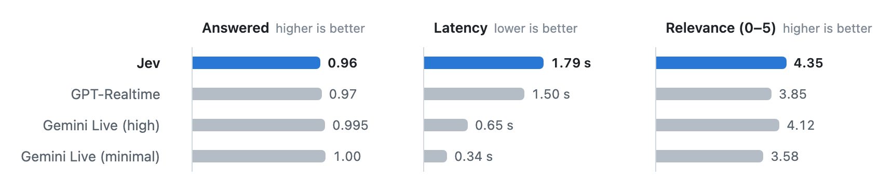
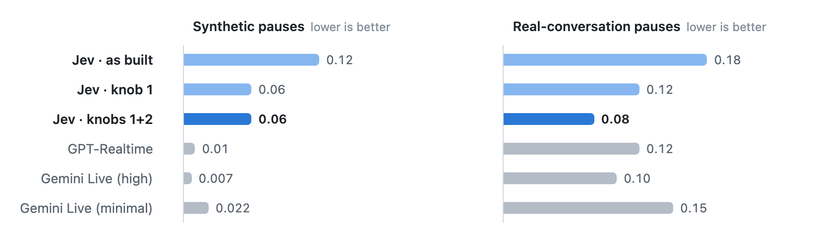
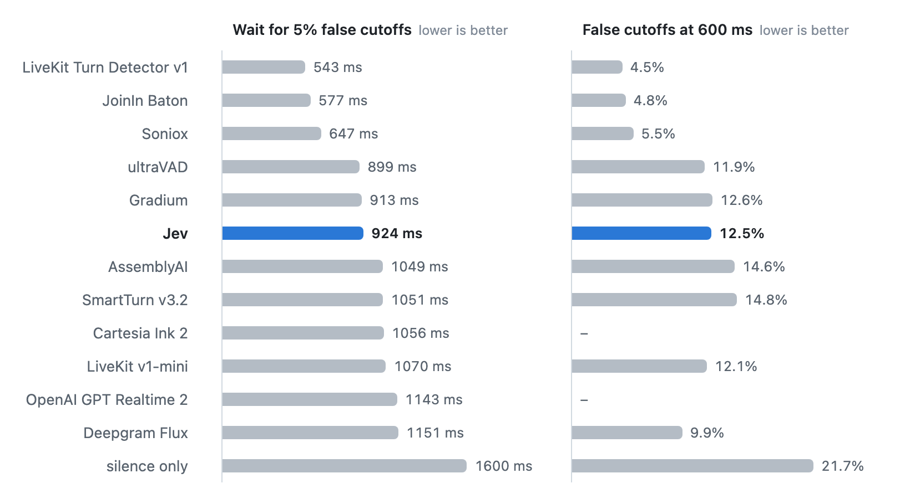
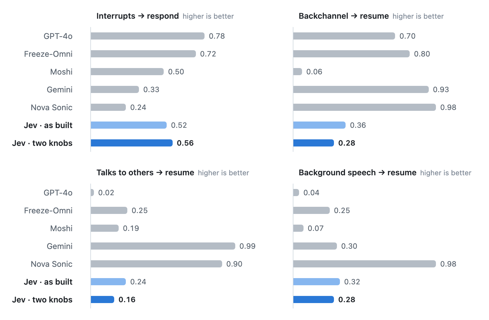
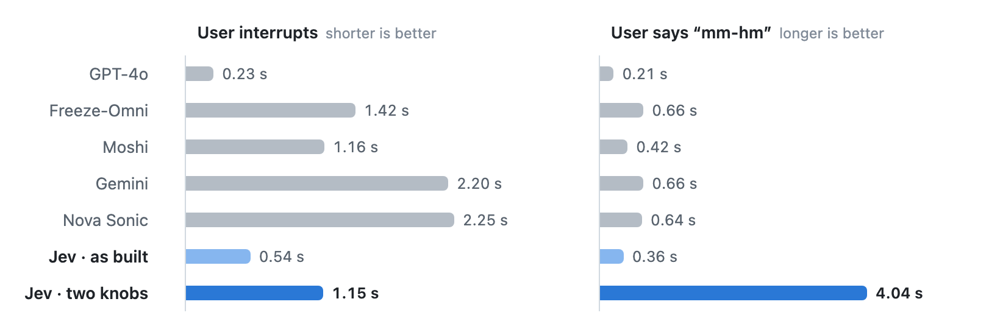
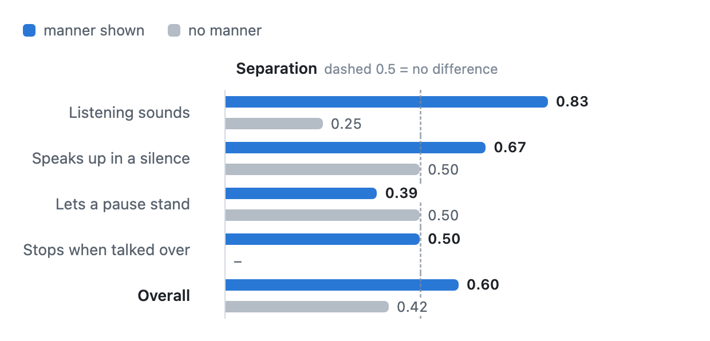
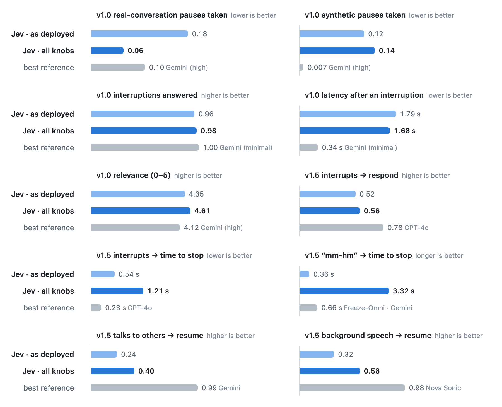

[← README](../README.md) · [中文](benchmarks.zh-CN.md)

# Benchmarks

## Benchmarks at a glance

Zero-shot: nothing here was trained on any benchmark. Four public benchmarks, 16 metrics, against end-to-end duplex
systems (GPT-Realtime, Gemini Live, GPT-4o, Moshi, Nova Sonic, Freeze-Omni) and trained turn detectors. With the knobs
tested below, Jev-Interaction is first on 3 metrics and in the top three on 8.

**Where it leads.** It understands what a moment calls for.

- **Fewest real pauses taken as turns:** 0.06, against Gemini Live 0.10 and GPT-Realtime 0.12 (Full-Duplex-Bench v1.0).
- **Most relevant answers after an interruption:** 4.61 of 5, against 4.12 for the best reference.
- **Talks through an "mm-hm":** it carries on; every end-to-end system in Full-Duplex-Bench v1.5 stops within 0.7 s.
- **Lets background speech pass:** second only to Nova Sonic (0.56, against Gemini 0.30 and GPT-4o 0.04).
- **Catches interruptions between two people:** 0.92 on TurnBench from words alone, 4th of 16, ahead of GPT Live and
  Gemini Live, which caught none.

**Where it trails, and where we would love help.**

- **Pure timing from sound.** On eot-bench (6th of 13 from words alone) and TurnBench end of turn (8th of 16) the
  leaders are small audio models trained on that kind of conversation. The engine now pairs Jev with an open audio
  model and answers only when both say finished: in Chinese, at 2% false cutoffs, that waits less than VoxTurn but
  more than the closed LiveKit v1, and at a tight 300 ms it still cuts in more often than either; in English VoxTurn
  alone is best ([details](#end-of-turn-livekit-eot-bench)).
- **Speed after an interruption.** 1.7 s, against 0.3–1.5 s for end-to-end models; most of it is the language model
  writing its first line, so a faster model or an earlier first sentence closes much of the gap.
- **Synthetic pauses** (0.14 on Full-Duplex-Bench v1.0): it answers clauses that sound finished.

Every decision is a readable question and every run can be replayed, so a contribution is a reworded question, a new
adapter or a policy, measured on the same benchmarks. Issues and pull requests are welcome.

To our knowledge this is the first full-duplex framework that writes turn-taking as plain-language decisions, and,
zero-shot, it is already state of the art on the decisions that take understanding.

## Tested knobs

The knobs measured in "All knobs together" below, as `Config` fields. Off by default; each one is a trade-off.

```python
from jev_interaction import Config
cfg = Config(overlap_ask_ms=1000, listen_max_words=3, not_for_me=True, far_db=10)
```

| field | what it does | measured effect |
|---|---|---|
| `overlap_ask_ms=1000` | ask the floor question only after 1 s of voice over the agent (default 400; measured as `hold_after_ms`, which paused the audio) | an "mm-hm" no longer stops the line (stop latency 0.36 s → 3.3 s); a real interruption stops about 0.6 s later |
| `listen_max_words=3` | drop listening sounds longer than this (default 6) | fewer pauses counted as taking the turn (Full-Duplex-Bench counts 4+ words as a turn) |
| `not_for_me=True` | a "not said to me" choice in the turn and floor questions, never before the first answer | side remarks and background voices let pass instead of answered |
| `far_db=10` | a voice this many dB under the caller's answered words is someone else's | background speech "resume" 0.28 → 0.56; pair it with a voiceprint, or a quiet caller can be dropped |

## Early results

Measured on the voice-call engine in our product with the 0.1 behaviour (same decision layer, ElevenLabs Scribe and TTS;
the experimental listening and overlap changes since 0.1 are not re-measured yet) on [Full-Duplex-Bench](https://github.com/DanielLin94144/Full-Duplex-Bench) v1.0: 50 samples per set, drawn with a
fixed seed. The pause sets used gpt-4o-mini as the language model and the interruption set grok-4.3.

| | this engine (n) | GPT-Realtime | Gemini 3.1 Flash Live (high / minimal) |
|---|---|---|---|
| synthetic pauses taken as turns (lower is better) | 0.12 (50) | 0.01 | 0.007 / 0.022 |
| real-conversation pauses taken as turns | 0.18 (50) | 0.12 | 0.10 / 0.15 |
| interruptions answered | 0.96 (50) | 0.97 | 0.995 / 1.0 |
| latency after an interruption (benchmark rule) | 1.79 s mean, 1.68 median | 1.50 s | 0.65 / 0.34 s |
| relevance of the answer, 0–5 | 4.35 (judged by grok) | 3.85 | 4.12 / 3.58 |

**When the user interrupts.** Full-Duplex-Bench v1.0, 50 interruption samples, grok-4.3. Latency is the benchmark's mean (median 1.68 s); our relevance was judged by grok, the references by the official judge.

<picture>
  <source media="(prefers-color-scheme: dark)" srcset="charts/fdb10-interruptions.dark.png">
  
</picture>

Interruptions are on par with the commercial systems and the answers score well. Pauses are the weak spot: of the 15
pause samples counted as taking the turn, 9 were the agent speaking up on its own because it believed the line had gone
quiet (the samples start without a greeting, and some recordings are quiet enough that the voice detector may miss the
caller), and 6 were answers before the caller had finished, mostly after a complete first sentence. Latency is mostly
the language model writing its first line; the decisions take tens of milliseconds.

### Case study: fixing pauses in two knobs

Because every decision is logged with the state Jev read, the 15 pause samples counted as "taking the turn" could be
traced one by one: 9 were the agent speaking up because the quiet-line question fired while the caller was still in
their first sentence (no words recognized yet), 4 were listening sounds longer than the benchmark's three-word limit,
and 2 were answers after a complete first sentence. Two knobs, tested on the same 100 samples:

| | synthetic pauses | real-conversation pauses |
|---|---|---|
| before | 0.12 | 0.18 |
| no quiet-line question while the caller's voice is going | 0.06 | 0.12 |
| plus listening sounds capped at three words | **0.06** | **0.08** |

**Pauses taken as the end of the turn, before and after the knobs.** 50 samples per set. Knob 1: no quiet-line question while the caller's voice is going. Knob 2: listening sounds capped at three words. Tested in the harness, not yet in the engine.

<picture>
  <source media="(prefers-color-scheme: dark)" srcset="charts/fdb10-pauses.dark.png">
  
</picture>

Real-conversation pauses now beat the commercial systems in the table above (0.10–0.15). These knobs were tested in the
benchmark harness and are not yet in the engine; nothing was retrained.

A third knob, answering only when Jev is at least 0.8 sure the caller has finished, brought real-conversation pauses to
0.04 without slowing answers after interruptions, but ordinary answers took about a second longer (median 0.8 s → 1.8 s).
It stays off: the trade-off is visible, measured and reversible, which is the point.

### End of turn: LiveKit eot-bench

[eot-bench](https://github.com/livekit/eot-bench) scores "has the user finished?" at every pause of 400 real user turns
(English validation split, 11,191 scoring points). We asked Jev the framework's `turn` question as is, from text only
(words arrive 0.5 s late, as the benchmark requires), zero-shot.

| | false cutoffs at 600 ms wait | wait for 5% false cutoffs |
|---|---|---|
| LiveKit Turn Detector v1 | 4.5% | 543 ms |
| Deepgram Flux | 9.9% | 1151 ms |
| **Jev, text only, zero-shot** | **12.5%** | **924 ms** |
| SmartTurn v3.2 | 14.8% | 1051 ms |
| OpenAI GPT Realtime 2 | – | 1143 ms |
| silence only | 21.7% | 1600 ms |

**Has the user finished? LiveKit eot-bench.** 400 real user turns, 11,191 scoring points, sorted by the wait needed for 5% false cutoffs. Jev reads words only, zero-shot. Other systems from the published results; – means not reported.

<picture>
  <source media="(prefers-color-scheme: dark)" srcset="charts/eot-bench.dark.png">
  
</picture>

Mid-table: ahead of AssemblyAI, SmartTurn, Cartesia, OpenAI Realtime and Deepgram at 5%, well behind detectors trained
on audio of this kind of conversation. About 11,000 Jev calls, about one dollar.

**Words and sound together, in the engine.** Words arrive half a second after the sound, so for the first moments of
a pause a text judge has nothing new to read; an audio model hears how the voice ended but not what was said, and the
two miss on different pauses (in English each cut people off on about 85 of 850 mid-turn pauses, only 11 of them the
same). Since 0.3.0 the engine asks both: Jev on the words, a sound model on the last 8 s of audio (SmartTurn v3.2 by
default, BSD-2, on the CPU; [your own](adapters.md#the-sound-model-and-the-voiceprint) plugs in the same way). By
default the turn is taken only when both say finished: cutting someone off is the worse mistake (`Config.sound_rule =
"and"`).

Scored on eot-bench **v1.0** (dataset revision `ca9d98a`; the benchmark's main branch is now v1.1, with 1,888 more
English rows, which we have not run), English validation (400 turns, 11,191 points) and Chinese validation (344
turns, 9,441 points), from each model's predictions at every scoring point. Lower is better in every column.

| Chinese | wait at 2% false cutoffs | wait at 5% | false cutoffs at 300 ms |
|---|---|---|---|
| **Jev + SmartTurn v3.2, both must agree (the engine's default)** | **1050 ms** | **783 ms** | 32.2% |
| Jev, words only | 1119 ms | 839 ms | 34.5% |
| SmartTurn v3.2, sound only | 1274 ms | 891 ms | 40.1% |
| VoxTurn v1 (non-commercial licence) | 1078 ms | 806 ms | 25.0% |
| LiveKit Turn Detector v1 (closed, LiveKit Agents only) | 1006 ms | 799 ms | 20.6% |

| English | wait at 2% false cutoffs | wait at 5% | false cutoffs at 300 ms |
|---|---|---|---|
| **Jev + SmartTurn v3.2, both must agree (the engine's default)** | **1248 ms** | **835 ms** | 29.6% |
| Jev, words only | 1552 ms | 924 ms | 36.7% |
| SmartTurn v3.2, sound only | 1763 ms | 1045 ms | 32.8% |
| VoxTurn v1 (non-commercial licence) | 1000 ms | 462 ms | 8.5% |
| LiveKit Turn Detector v1 (closed, LiveKit Agents only) | 991 ms | 543 ms | 9.9% |

What this says, the losses included:

- **Chinese.** Requiring both waits less than either half alone at every budget. At 2% false cutoffs it waits less
  than VoxTurn (1050 against 1078 ms) but more than the closed LiveKit v1 (1006 ms); at 5% it waits less than both
  (783 against 806 and 799 ms). At a tight 300 ms it loses clearly: 32% of mid-turn pauses cut off, against 25% and
  21%. The sound model needs a stretch of quiet to be sure, and the words are not in yet.
- **English.** VoxTurn alone is the best of everything here, the closed LiveKit v1 included. Requiring both takes Jev
  from 1552 to 1248 ms at 2%, still far behind the trained audio models.
- **Why SmartTurn.** It is the audio model we may ship: VoxTurn is CC BY-NC, LiveKit v1 may only be used inside
  LiveKit Agents. Another one plugs in through the registry.
- **How far to trust it.** The rule and its lines (`sound_min` by language, `words_min`) were chosen on these same
  splits; there is no held-out split and no test on recorded calls yet. Every reading of the sound model and every
  turn it held back is in the call log, to set the lines on your own calls.

SmartTurn and VoxTurn are read all through the pause, as the engine reads SmartTurn. LiveKit v1 is read once at 0.2 s
and held, as on the benchmark's leaderboard; read all through the pause it waits longer (1026 ms in Chinese, 1460 ms in
English, at 2%). VoxTurn read the leaderboard's way: 1131 / 830 ms in Chinese, 982 / 669 ms in English.

### Being talked over: Full-Duplex-Bench v1.5

25 noisy samples per scenario, grok-4.3, scored with the official judge (gpt-4o-2024-08-06).

| scenario | wanted | this engine | paper (GPT-4o · Gemini · Nova Sonic · Moshi) |
|---|---|---|---|
| user interrupts | respond | 0.52 | 0.78 · 0.33 · 0.24 · 0.50 |
| | stop latency | **0.54 s** | 0.23 · 2.20 · 2.25 · 1.16 |
| user backchannels | resume | 0.36 | 0.70 · 0.93 · 0.98 · 0.06 |
| user talks to someone else | resume | 0.24 | 0.02 · 0.99 · 0.90 · 0.19 |
| background speech | resume | 0.32 | 0.04 · 0.30 · 0.98 · 0.07 |

**What the judge saw.** Share of the wanted label per scenario, 25 noisy samples each; paper systems from Table 2. Before/after changes are within the ±0.08 noise of 25 samples.

<picture>
  <source media="(prefers-color-scheme: dark)" srcset="charts/fdb15-behavior.dark.png">
  
</picture>

It stops fast, but it also stops for an "mm-hm", a side remark or a voice in the room. The traces show why: Jev reads
most backchannels right (carry on, 19 of 25), but playback is paused 0.4 s into any voice, before the words are known;
and the `floor` question had no choice for "this is not said to me", so side remarks ended the line early and got
answered. Two knobs, tested in the harness: pause only after 1 s of voice, and add that choice. The agent then talked
through every backchannel (stop latency 0.36 s → 4.0 s; every system in the paper stops within 0.7 s) and let 9 of 25
side remarks pass, at the cost of stopping 0.6 s later for real interruptions (1.15 s). The judge's labels did not move
beyond the noise of 25 samples: it compares the answer against a separate clean run, and a companion's short, varied
answers rarely read as "the same content, resumed".

**How long until the agent stops talking.** Median stop latency by the benchmark's rule. Two knobs: pause playback only after 1 s of voice, and a "not said to me" choice. Tested in the harness; the deployed engine is unchanged.

<picture>
  <source media="(prefers-color-scheme: dark)" srcset="charts/fdb15-stop.dark.png">
  
</picture>

### Task profiles: does behaviour follow the profile?

The four shipped profiles on the same 12 recordings (long story, mid-sentence pause, interruption, silence), with and
without the manner shown to Jev. Separation = how often a profile expected "high" on an axis scores above one expected
"low" on the same recording (0.5 = no difference). Three recordings per cell, so read it as a direction.

| axis | manner shown | no manner |
|---|---|---|
| listening sounds | **0.83** | 0.25 |
| speaks up in a silence | **0.67** | 0.50 |
| lets a mid-sentence pause stand | 0.39 | 0.50 |
| stops when talked over | 0.50 | – |
| overall | **0.60** | 0.42 |

**Does behaviour follow the profile?** Separation across the four shipped profiles on 12 recordings, with and without the manner shown to Jev; 0.5 means no difference. Three recordings per cell, so read it as a direction.

<picture>
  <source media="(prefers-color-scheme: dark)" srcset="charts/task-profiles.dark.png">
  
</picture>

Listening sounds per minute with the manner shown: tutor 7.5, companion 3.0, support 2.3, interviewer 1.0. Pauses do
not separate (no profile took the turn), and every profile yields when talked over, including the tutor that should
finish its sentence: playback is paused before the floor question is asked, as above.

### Two people talking: TurnBench

[TurnBench](https://turnbench.sesame.com) listens to two people in free conversation, one microphone each, and asks
when a speaker's turn ends (EOT) and when one takes the floor from the other (INT). We ran 6 dev conversations (about an
hour): Scribe words per channel, Jev asked at each pause and each overlap, no audio model, no TurnBench training data.
Thresholds and question wording were chosen on these same 6 conversations, so the numbers lean optimistic.

| | EOT recall (false positives ≤ 0.10) | INT recall |
|---|---|---|
| vap (trained on TurnBench's training set) | 0.86 | 0.99 |
| kyutai semantic VAD | 0.84 | 0.98 |
| **Jev, words only** | **0.67** (8th of 16) | **0.92** (4th of 16) |
| GPT Live | 0.62 | 0.00 |
| Gemini Live | 0.73 | 0.00 |

The other speaker leaks into each microphone: about 30% of one channel's words were the other person, 20–40 dB
quieter. Dropping those words took INT false positives on one conversation from 0.39 to 0.06. The first EOT question
("has A finished?") missed turns the other speaker had already taken over; asking "whose turn is it now?" raised EOT
recall from 0.48 to 0.63, and the engine's own voiceprint check on unclear words to 0.67.

### All knobs together

One engine setup with every knob above (no quiet-line question while the caller talks, short listening sounds, pause
after 1 s of voice, a "not said to me" choice in both the floor and the turn question, and a voice 10 dB or more under
the caller's answered words treated as someone else's), grok-4.3 throughout, the v1.5 clean reference re-run with the
same setup. Tested in the harness; the deployed engine is unchanged.

| | engine as deployed | all knobs | best reference |
|---|---|---|---|
| v1.0 real-conversation pauses taken as turns | 0.18 | **0.06** | Gemini (high) 0.10 |
| v1.0 synthetic pauses taken as turns | 0.12 | 0.14 | Gemini (high) 0.007 |
| v1.0 interruptions answered | 0.96 | 0.98 | Gemini (minimal) 1.0 |
| v1.0 latency after an interruption | 1.79 s | 1.68 s | Gemini (minimal) 0.34 s |
| v1.0 relevance (judged by grok) | 4.35 | **4.61** | Gemini (high) 4.12 |
| v1.5 user interrupts: respond | 0.52 | 0.56 | GPT-4o 0.78 |
| v1.5 user interrupts: stop latency | 0.54 s | 1.21 s | GPT-4o 0.23 s |
| v1.5 user backchannels: stop latency (longer is better) | 0.36 s | **3.32 s** | 0.66 s |
| v1.5 user talks to someone else: resume | 0.24 | 0.40 | Gemini 0.99 |
| v1.5 background speech: resume | 0.32 | **0.56** | Nova Sonic 0.98 |

**One engine setup, every knob on.** Engine as deployed (light), all knobs (dark), and the best reference system per metric (gray, named). Harness only; the deployed engine is unchanged.

<picture>
  <source media="(prefers-color-scheme: dark)" srcset="charts/all-knobs.dark.png">
  
</picture>

Across 16 metrics against outside systems (the four benchmarks above), the deployed engine ranks first on 1 and in the
top half on 7; with all knobs, first on 3 and in the top half on 10.

### Every number comes with a reason

An end-to-end model gives a score. A pipeline gives the score and the decisions behind it, because every decision is
logged with the state Jev read and the probabilities it returned. What the traces of the all-knobs run say:

| number | what actually happened |
|---|---|
| backchannel stop latency 3.32 s | Not slow: it did not stop. In the 23 traced samples Jev was asked the floor question 20 times and said "carry on" 20 times. The 3.3 s is the rest of the sentence; every system in the paper stopped within 0.7 s, i.e. an "mm-hm" cut them off. |
| backchannel "resume" 0.32 | The same samples. The judge compares the reply with a separate clean run, and a companion's short, varied replies rarely read as "the same content, resumed". With the same reply in both runs (temperature 0) it rose to 0.56, and talking to others and background speech rose with it. |
| interruption stop latency 1.21 s | A choice: playback pauses after 1 s of voice so a backchannel can be told from an interruption. On the 21 floor questions over real interruptions Jev chose yield 7, finish the sentence 7, carry on 7; the last are visible misses. |
| latency after an interruption 1.68 s | Median 1.71 s over 41 traced turns: 0.8 s waiting to be sure the caller has finished, 0.75 s for the language model's first words, 0.1 s for synthesis and playback. The decisions take tens of milliseconds. |
| real-conversation pauses 0.06 | 3 of 50, each in the trace with the probability Jev gave; one was a one-word "Mm." |
| synthetic pauses 0.14 | 7 of 50, mostly answers right after a clause that sounded finished ("Yeah? What's the story about?"). The synthetic voice pauses after complete clauses. |
| background speech 0.56 | 15 of 22 traced samples were treated as someone else's voice (the 10 dB rule did most of it, Jev's "not said to me" the rest). The 7 still answered had a caller who spoke quietly themselves (less than 10 dB apart) or a first line too short to measure. |
| TurnBench EOT 0.67 | Words arrive after the sound; the audio models that lead were trained on two-person conversation of this kind. |
