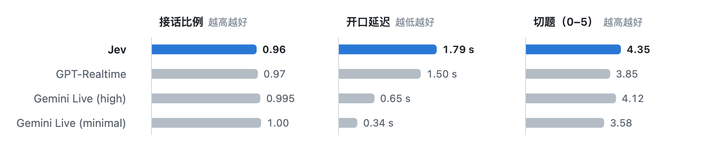
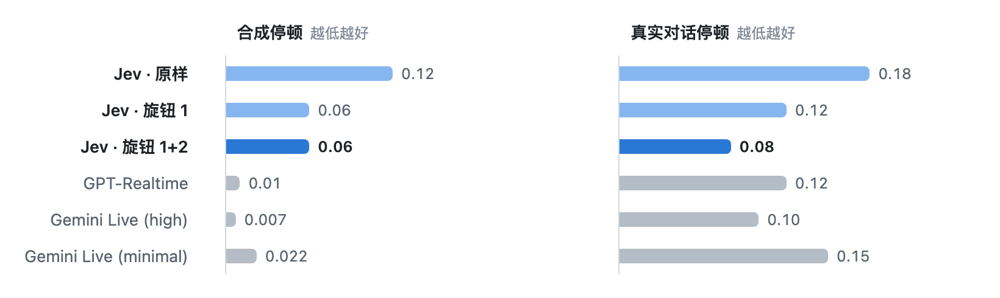
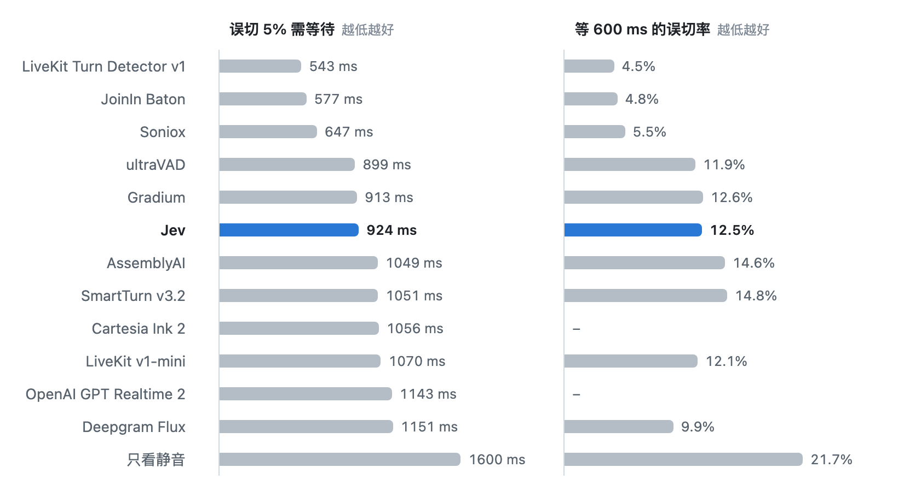
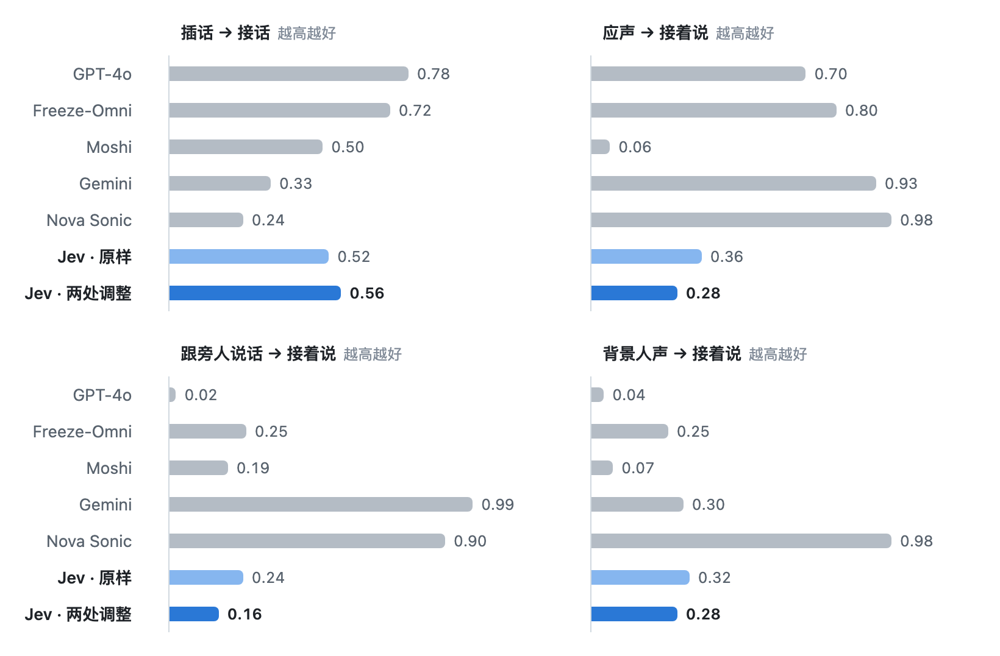
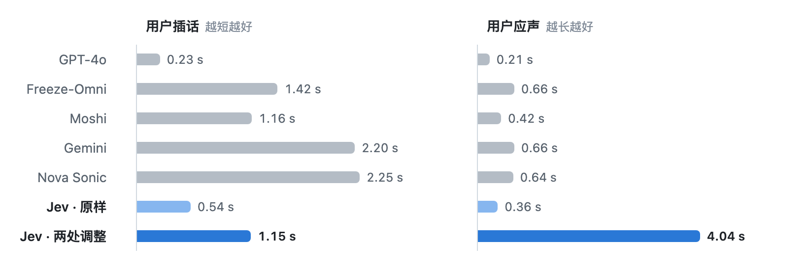
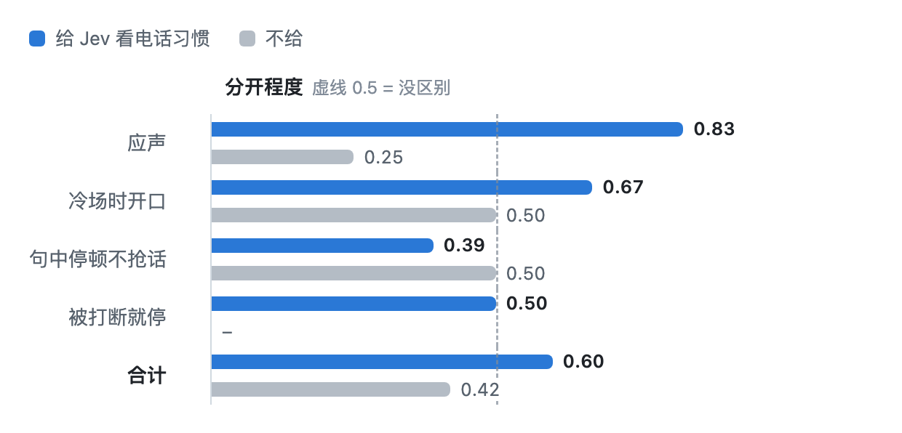
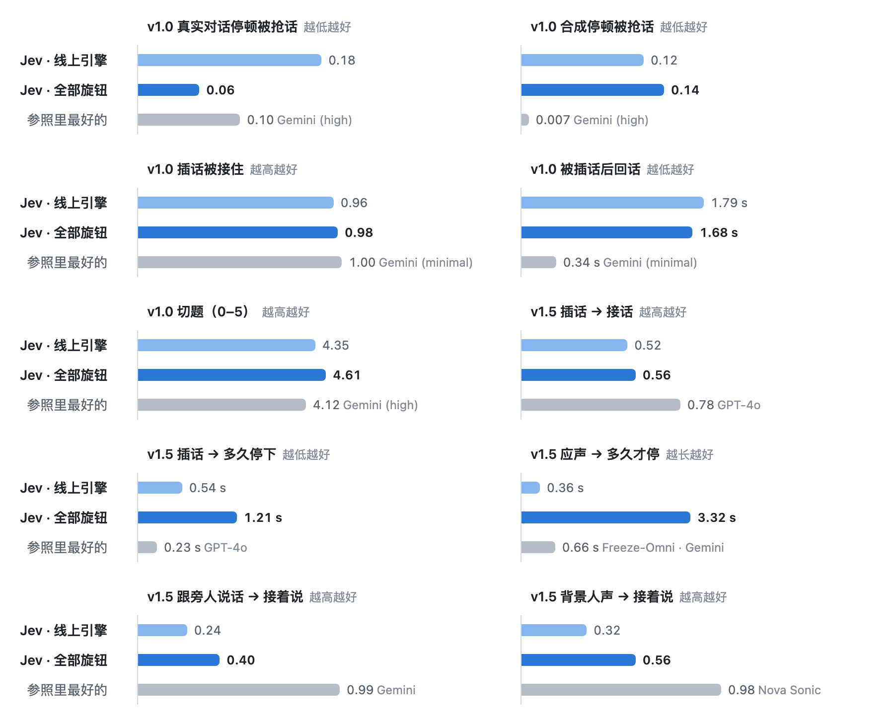

[← README](../README.zh-CN.md) · [English](benchmarks.md)

# 基准测试

## 基准成绩一览

零样本：没有用任何基准的数据训练过。四个公开基准、16 项指标，对手是端到端全双工系统（GPT-Realtime、Gemini Live、GPT-4o、Moshi、Nova Sonic、Freeze-Omni）和专门训练的轮次模型。打开下文测过的旋钮后，Jev-Interaction 有 3 项排第一，8 项进前三。

**领先的地方：它听得懂此刻该做什么。**

- **真实对话停顿被抢话最少：** 0.06，Gemini Live 0.10，GPT-Realtime 0.12（Full-Duplex-Bench v1.0）。
- **被插话后的回答最切题：** 4.61 分（满分 5），参照里最好的是 4.12。
- **听到"嗯嗯"不停：** 它接着说；Full-Duplex-Bench v1.5 里所有端到端系统都在 0.7 秒内停下。
- **背景人声不接：** 仅次于 Nova Sonic（0.56，Gemini 0.30，GPT-4o 0.04）。
- **两个人聊天时认得出谁在插话：** TurnBench 上只看文字就有 0.92，16 个里第 4；GPT Live 和 Gemini Live 一次都没认出来。

**落后的地方，也是最欢迎大家一起做的地方。**

- **只靠声音判断节奏：** eot-bench（只看文字时 13 个里第 6）和 TurnBench 判断说完了（16 个里第 8），领先的都是用这类对话训练过的小声音模型。引擎现在让 Jev 和一个开源声音模型一起判断，两个都说说完了才接话：中文误切 2% 时，等得比 VoxTurn 短，比闭源的 LiveKit v1 长；300 毫秒这一档误切仍比它们多；英文上 VoxTurn 单独最好（[详情](#说完没livekit-eot-bench)）。
- **被插话后回话的速度：** 1.7 秒，端到端模型是 0.3–1.5 秒；大部分时间花在大模型写第一句上，换更快的模型、更早送出第一句就能补回不少。
- **合成停顿**（Full-Duplex-Bench v1.0 上 0.14）：听起来像说完的分句，它会接话。

每个决策都是看得懂的题目，每次运行都能重放，所以贡献可以是改一句题目、加一个适配器或一种策略，在同样的基准上量出来。欢迎提 issue 和 pull request。

据我们所知，这是第一个把轮次交互写成自然语言决策的全双工框架；零样本下，在需要理解的那些决策上，它已经达到业界最好水平。

## 测过的旋钮

下文"全部旋钮一起开"里量过的旋钮，都是 `Config` 的字段。默认关闭；每一个都是取舍。

```python
from jev_interaction import Config
cfg = Config(overlap_ask_ms=1000, listen_max_words=3, not_for_me=True, far_db=10)
```

| 字段 | 作用 | 量出来的效果 |
|---|---|---|
| `overlap_ask_ms=1000` | 用户声音压着角色持续 1 秒才问让路题（默认 0.4 秒；测的时候叫 `hold_after_ms`，是暂停播放） | 一声"嗯嗯"不再打断角色（停下延迟 0.36 秒 → 3.3 秒）；真插话时晚停约 0.6 秒 |
| `listen_max_words=3` | 超过这么多词的应声不出（默认 6） | 停顿被算作抢话的情况变少（Full-Duplex-Bench 把 4 个词以上算作接话） |
| `not_for_me=True` | 轮次题和让路题加一个"不是对我说的"选项，通话第一句不提供 | 对旁人说的话、背景人声会被略过，不再回答 |
| `far_db=10` | 比来电者回答过的话低这么多 dB 的声音，当成别人的 | 背景人声"接着说" 0.28 → 0.56；要和声纹一起用，否则说话轻的来电者可能被忽略 |

## 初步结果

测的是我们产品里的语音通话引擎，按 0.1 版本的做法（同一个决策层，识别和合成用 ElevenLabs；0.1 之后实验性的应声和打断改动还没重测），数据是 [Full-Duplex-Bench](https://github.com/DanielLin94144/Full-Duplex-Bench) v1.0，每类用固定随机种子抽 50 条。停顿两类用 gpt-4o-mini 当语言模型，插话用 grok-4.3。

| | 本引擎（样本数） | GPT-Realtime | Gemini 3.1 Flash Live（high / minimal） |
|---|---|---|---|
| 合成停顿被当成说完（越低越好） | 0.12（50） | 0.01 | 0.007 / 0.022 |
| 真人对话停顿被当成说完 | 0.18（50） | 0.12 | 0.10 / 0.15 |
| 被打断后接话 | 0.96（50） | 0.97 | 0.995 / 1.0 |
| 被打断后回话延迟（评测规则） | 平均 1.79 秒，中位 1.68 秒 | 1.50 秒 | 0.65 / 0.34 秒 |
| 回答相关度（0–5） | 4.35（grok 打分） | 3.85 | 4.12 / 3.58 |

**被打断时。** Full-Duplex-Bench v1.0，50 条插话样本，grok-4.3。延迟按评测规则取平均（中位 1.68 秒）；本引擎的切题分由 grok 评，参照系统由官方评委评。

<picture>
  <source media="(prefers-color-scheme: dark)" srcset="charts/fdb10-interruptions.zh.dark.png">
  
</picture>

插话这一项和商用系统同档，回答质量分也不错。停顿是短板：被算成"抢话"的 15 条里，9 条是角色以为线上没人说话、自己主动开口（测试音频开头没有接电话那一句，有些录音音量小，声音检测可能没听到用户），6 条是用户还没说完就答了，多数是答了多句话里的第一句。回话延迟主要花在语言模型写第一句上，决策本身只要几十毫秒。

### 案例：两个旋钮修好停顿

每个决策都连同 Jev 看到的状态记了下来，所以被算成"抢话"的 15 条停顿样本可以逐条追：9 条是用户还在说第一句、还没识别出字时，"安静了要不要开口"那道题被触发，角色自己开了口；4 条是应声超过了评测规定的 3 个词；2 条是用户说完一句完整的话就答了。改两个旋钮，在同样 100 条上测：

| | 合成停顿 | 真人对话停顿 |
|---|---|---|
| 改之前 | 0.12 | 0.18 |
| 用户声音还在继续时不问"要不要开口" | 0.06 | 0.12 |
| 再把应声限制在 3 个词以内 | **0.06** | **0.08** |

**停顿被当成说完：调整前后。** 每组 50 条。旋钮 1：用户声音还在继续时不问"要不要开口"；旋钮 2：应声限 3 个词以内。只在测试里验证，还没进引擎。

<picture>
  <source media="(prefers-color-scheme: dark)" srcset="charts/fdb10-pauses.zh.dark.png">
  
</picture>

真人对话停顿已经好于上表里的商用系统（0.10–0.15）。这两个旋钮目前只在测试里验证过，还没改进引擎；整个过程没有重新训练任何模型。

第三个旋钮是"Jev 有 0.8 以上把握判断说完了才回答"。它把真人对话停顿降到 0.04，被打断后的回话也没变慢，但平常的回答慢了约 1 秒（中位从 0.8 秒到 1.8 秒）。所以先不开：代价看得见、量得出、随时能撤，这正是这套做法的意义。

### 说完没：LiveKit eot-bench

[eot-bench](https://github.com/livekit/eot-bench) 在 400 段真实用户发言的每个停顿处判断"说完没"（英文验证集，11,191 个打分点）。我们把框架里的 `turn` 题原样问 Jev，只看文字（按评测规定文字晚 0.5 秒到），没有针对这份数据做任何训练或调参。

| | 等 600 毫秒时的误切率 | 误切 5% 时要等多久 |
|---|---|---|
| LiveKit Turn Detector v1 | 4.5% | 543 毫秒 |
| Deepgram Flux | 9.9% | 1151 毫秒 |
| **Jev（只看文字、零样本）** | **12.5%** | **924 毫秒** |
| SmartTurn v3.2 | 14.8% | 1051 毫秒 |
| OpenAI GPT Realtime 2 | – | 1143 毫秒 |
| 只看安静时长 | 21.7% | 1600 毫秒 |

**说完没：LiveKit eot-bench。** 400 段真实用户发言、11,191 个打分点，按误切 5% 所需等待排序。Jev 只看文字、零样本。其他系统取公开结果；– 表示未公布。

<picture>
  <source media="(prefers-color-scheme: dark)" srcset="charts/eot-bench.zh.dark.png">
  
</picture>

排在中游：误切 5% 这一档好于 AssemblyAI、SmartTurn、Cartesia、OpenAI Realtime 和 Deepgram，明显不如直接听音频、专门在这类对话上训练的模型。约 1.1 万次 Jev 调用，约 1 美元。

**文字和声音一起判断，已经进了引擎。** 识别出的字比声音晚半秒到，停顿刚开始时只看文字的判断没有新东西可读；声音模型听得到语气怎么收的，却不知道说了什么。两者错在不同的停顿上（英文里各自在 850 个话没说完的停顿中误切约 85 个，重合的只有 11 个）。从 0.3.0 起引擎两个都问：Jev 看字，声音模型听最后 8 秒音频（默认 SmartTurn v3.2，BSD-2 许可，跑在 CPU 上；[你自己的模型](adapters.md#the-sound-model-and-the-voiceprint)也能同样接进来）。默认两个都说说完了才接话：把人话打断比回得慢更糟（`Config.sound_rule = "and"`）。

测的是 eot-bench **v1.0**（数据集版本 `ca9d98a`；评测的 main 分支现在是 v1.1，多了 1,888 行英文，我们没有跑），英文验证集（400 段发言、11,191 个打分点）和中文验证集（344 段、9,441 个打分点），用每个模型在每个打分点上的预测来算。每一列都是越小越好。

| 中文 | 误切 2% 要等多久 | 误切 5% 要等多久 | 300 毫秒时的误切率 |
|---|---|---|---|
| **Jev + SmartTurn v3.2，两个都说完才接（引擎默认）** | **1050 毫秒** | **783 毫秒** | 32.2% |
| Jev，只看文字 | 1119 毫秒 | 839 毫秒 | 34.5% |
| SmartTurn v3.2，只听声音 | 1274 毫秒 | 891 毫秒 | 40.1% |
| VoxTurn v1（非商用许可） | 1078 毫秒 | 806 毫秒 | 25.0% |
| LiveKit Turn Detector v1（闭源，只能在 LiveKit Agents 里用） | 1006 毫秒 | 799 毫秒 | 20.6% |

| 英文 | 误切 2% 要等多久 | 误切 5% 要等多久 | 300 毫秒时的误切率 |
|---|---|---|---|
| **Jev + SmartTurn v3.2，两个都说完才接（引擎默认）** | **1248 毫秒** | **835 毫秒** | 29.6% |
| Jev，只看文字 | 1552 毫秒 | 924 毫秒 | 36.7% |
| SmartTurn v3.2，只听声音 | 1763 毫秒 | 1045 毫秒 | 32.8% |
| VoxTurn v1（非商用许可） | 1000 毫秒 | 462 毫秒 | 8.5% |
| LiveKit Turn Detector v1（闭源，只能在 LiveKit Agents 里用） | 991 毫秒 | 543 毫秒 | 9.9% |

怎么读，输的地方也写上：

- **中文。** 两个都说完才接，在每一档都比任何一个单独用等得短。误切 2% 时比 VoxTurn 短（1050 对 1078 毫秒），比闭源的 LiveKit v1 长（1006 毫秒）；误切 5% 时比两者都短（783 对 806、799 毫秒）。300 毫秒这一档明显输：话没说完的停顿里误切 32%，它们是 25% 和 21%。声音模型要听到一段安静才拿得准，字也还没到。
- **英文。** VoxTurn 单独用是这里最好的，闭源的 LiveKit v1 也不如它。两个都说完才接，让 Jev 在误切 2% 时从 1552 毫秒降到 1248 毫秒，离训练过的声音模型还差很远。
- **为什么用 SmartTurn。** 它是我们能随代码发出去的声音模型：VoxTurn 是 CC BY-NC，LiveKit v1 只能在 LiveKit Agents 里用。别的模型可以通过注册表接进来。
- **可信到什么程度。** 规则和两条线（按语言的 `sound_min`、`words_min`）是在这两份数据上选的，没有留出集，也还没在录下来的真实通话上测过。声音模型的每次读数、每次它拦下的接话都记在通话日志里，可以用你自己的通话来调。

SmartTurn 和 VoxTurn 都是在整个停顿里反复读，和引擎读 SmartTurn 的方式一样。LiveKit v1 按排行榜的方式在 0.2 秒读一次就不再变；整个停顿反复读的话等得更久（误切 2% 时中文 1026 毫秒、英文 1460 毫秒）。VoxTurn 按排行榜的方式读：中文 1131 / 830 毫秒，英文 982 / 669 毫秒。

### 被插话：Full-Duplex-Bench v1.5

每类 25 条带噪声的样本，grok-4.3，用官方评委（gpt-4o-2024-08-06）打分。

| 场景 | 想要的 | 本引擎 | 论文（GPT-4o · Gemini · Nova Sonic · Moshi） |
|---|---|---|---|
| 用户插话 | 接话 | 0.52 | 0.78 · 0.33 · 0.24 · 0.50 |
| | 停下延迟 | **0.54 秒** | 0.23 · 2.20 · 2.25 · 1.16 |
| 用户应声 | 接着说 | 0.36 | 0.70 · 0.93 · 0.98 · 0.06 |
| 用户跟旁人说话 | 接着说 | 0.24 | 0.02 · 0.99 · 0.90 · 0.19 |
| 背景人声 | 接着说 | 0.32 | 0.04 · 0.30 · 0.98 · 0.07 |

**评委判的行为。** 各场景得到想要标签的比例，每类 25 条带噪声样本；论文系统取 Table 2。调整前后的变化都在 25 条样本 ±0.08 的波动内。

<picture>
  <source media="(prefers-color-scheme: dark)" srcset="charts/fdb15-behavior.zh.dark.png">
  
</picture>

停得快，但用户只说一声"嗯嗯"、跟旁人说一句、或背景里有人说话，也会停下来。从记录能看出原因：应声时 Jev 多数判断对了（25 条里 19 条"接着说"），但有声音进来 0.4 秒就先暂停播放，那时还不知道说的是什么；而 `floor` 那道题里没有"这话不是对我说的"这个选项，所以对旁人说的话会让角色提前收尾、再去回答。在测试里改了两处：声音持续 1 秒才暂停，加上这个选项。改完以后，应声时角色一次都没停（停下延迟从 0.36 秒到 4.0 秒，论文里所有系统都在 0.7 秒以内就停了），对旁人说的话 25 条里有 9 条被略过；代价是真正被插话时晚停 0.6 秒（1.15 秒）。评委的标签没有变好，变化都在 25 条的波动范围内：评委拿这次的回答和另一次干净版本的回答对比，陪伴角色的回答短、每次又不一样，评委很难看出"接着同一段说"。

**多久停下来。** 停下延迟中位数，按评测规则。两处调整：声音持续 1 秒才暂停播放，加"这话不是对我说的"选项。只在测试里验证，线上引擎未改。

<picture>
  <source media="(prefers-color-scheme: dark)" srcset="charts/fdb15-stop.zh.dark.png">
  
</picture>

### 任务配置：行为会不会跟着配置变

自带的四份配置跑同样 12 段录音（长段讲述、句中停顿、插话、冷场），分别给和不给 Jev 看配置里的电话习惯。"分开程度"是：预期高的配置在同一段录音上得分高于预期低的配置的比例（0.5 等于没区别）。每格只有 3 条，只能看方向。

| 方面 | 给电话习惯 | 不给 |
|---|---|---|
| 应声 | **0.83** | 0.25 |
| 冷场时主动开口 | **0.67** | 0.50 |
| 句中停顿不抢话 | 0.39 | 0.50 |
| 被打断就停 | 0.50 | – |
| 合计 | **0.60** | 0.42 |

**换配置，行为跟着变吗。** 四份自带配置、12 段录音，给和不给 Jev 看电话习惯时的分开程度；0.5 等于没区别。每格 3 条，只能看方向。

<picture>
  <source media="(prefers-color-scheme: dark)" srcset="charts/task-profiles.zh.dark.png">
  
</picture>

给电话习惯时每分钟应声次数：家教 7.5、陪伴 3.0、客服 2.3、面试官 1.0。停顿拉不开（所有配置都没抢话）；被打断时所有配置都会停，包括应该"先讲完这句"的家教，原因同上：问那道题之前播放已经先暂停了。

### 两个真人聊天：TurnBench

[TurnBench](https://turnbench.sesame.com) 旁听两个真人自由聊天（各一个麦克风），判断一个人什么时候说完了（EOT）、什么时候有人把话头抢过去（INT）。我们跑了 dev 集 6 段对话（约 1 小时）：每个声道用 Scribe 转写，每次停顿、每次两人同时开口时问 Jev；不用声音模型，也没用 TurnBench 的训练数据。阈值和问法是在这 6 段上挑的，数字偏乐观。

| | 说完了：召回（误判 ≤ 0.10） | 插话：召回 |
|---|---|---|
| vap（用 TurnBench 训练集训练过） | 0.86 | 0.99 |
| kyutai semantic VAD | 0.84 | 0.98 |
| **Jev，只看文字** | **0.67**（16 个里第 8） | **0.92**（16 个里第 4） |
| GPT Live | 0.62 | 0.00 |
| Gemini Live | 0.73 | 0.00 |

对方的声音会串进每个麦克风：一个声道里约 30% 的词其实是另一个人说的，低 20–40 dB。去掉这些词后，一段对话上的插话误判从 0.39 降到 0.06。第一版问"A 说完了吗"，会漏掉对方已经接过话头的情况；改成"现在轮到谁说"，说完了的召回从 0.48 升到 0.63，再用引擎自带的声纹判断说不清的词，升到 0.67。

### 全部旋钮一起开

同一套引擎设置，打开上面所有旋钮（用户还在说时不问"要不要开口"、应声变短、声音持续 1 秒才暂停、让路题和轮次题都有"不是对我说的"选项、比来电者回答过的话低 10 dB 以上的声音当成别人的），全部用 grok-4.3，v1.5 的干净参照也用同一套设置重跑。只在测试里改，线上引擎没动。

| | 线上引擎 | 全部旋钮 | 参照里最好的 |
|---|---|---|---|
| v1.0 真实对话停顿被抢话 | 0.18 | **0.06** | Gemini (high) 0.10 |
| v1.0 合成停顿被抢话 | 0.12 | 0.14 | Gemini (high) 0.007 |
| v1.0 插话被接住 | 0.96 | 0.98 | Gemini (minimal) 1.0 |
| v1.0 被插话后多久回话 | 1.79 秒 | 1.68 秒 | Gemini (minimal) 0.34 秒 |
| v1.0 回答切题程度（grok 评） | 4.35 | **4.61** | Gemini (high) 4.12 |
| v1.5 用户插话：接话 | 0.52 | 0.56 | GPT-4o 0.78 |
| v1.5 用户插话：多久停下 | 0.54 秒 | 1.21 秒 | GPT-4o 0.23 秒 |
| v1.5 用户应声：多久才停（越久越好） | 0.36 秒 | **3.32 秒** | 0.66 秒 |
| v1.5 用户跟旁人说话：接着说 | 0.24 | 0.40 | Gemini 0.99 |
| v1.5 背景人声：接着说 | 0.32 | **0.56** | Nova Sonic 0.98 |

**同一套设置，全部旋钮打开。** 浅色是线上引擎，深色是全部旋钮，灰色是每项参照里最好的系统（标了名字）。只在测试里改，线上引擎没动。

<picture>
  <source media="(prefers-color-scheme: dark)" srcset="charts/all-knobs.zh.dark.png">
  
</picture>

上面四个基准里和外部系统比的 16 项指标：线上引擎排第一 1 项、前一半 7 项；全部旋钮排第一 3 项、前一半 10 项。

### 每个数字都说得出原因

端到端模型只给一个分数。流水线给分数，也给出背后的每个决定，因为每次决定都记下了 Jev 读到的状态和给出的概率。全部旋钮那次的记录说明了这些：

| 数字 | 背后实际发生了什么 |
|---|---|
| 应声时多久才停 3.32 秒 | 不是慢，是没停。能对上记录的 23 条里，Jev 被问了 20 次"要不要让路"，20 次都答"接着说"。3.3 秒是角色把这句话说完的时间；论文里所有系统都在 0.7 秒内停下，也就是被一声"嗯嗯"打断了。 |
| 应声时"接着说" 0.32 | 同一批录音。评委拿这次的回答和另外跑的干净版本对比；陪伴角色的回答短、每次又不一样，评委很少看得出"同一段内容接着说"。两次用同一个回答（温度设为 0）时升到 0.56，跟旁人说话、背景人声也一起涨了。 |
| 插话时多久停下 1.21 秒 | 有意为之：声音持续 1 秒才暂停，好分清是应声还是插话。真插话时问的 21 次让路题里，Jev 选让路 7 次、说完这句再让 7 次、接着说 7 次；最后这 7 次是看得见的误判。 |
| 被插话后多久回话 1.68 秒 | 41 次能对上记录的回答，中位 1.71 秒：0.8 秒在等确认用户说完了，0.75 秒是大模型出第一句，0.1 秒是合成和播放。决策本身只要几十毫秒。 |
| 真实对话停顿 0.06 | 50 条里抢了 3 次，每次都能查到 Jev 当时给的概率；其中一次是一声 "Mm."。 |
| 合成停顿 0.14 | 50 条里 7 次，多是在一句听起来已经说完的话后面接了话（"Yeah? What's the story about?"）。合成语音习惯在完整的分句后停顿。 |
| 背景人声 0.56 | 能对上记录的 22 条里，15 条被当成别人的声音（主要靠 10 dB 规则，其余是 Jev 选了"不是对我说的"）。还被回答的 7 条，要么来电者自己说话就轻（差不到 10 dB），要么第一句太短没测出音量。 |
| TurnBench 说完了 0.67 | 文字比声音晚到；领先的几个都是用这种两人对话训练过的声音模型。 |
