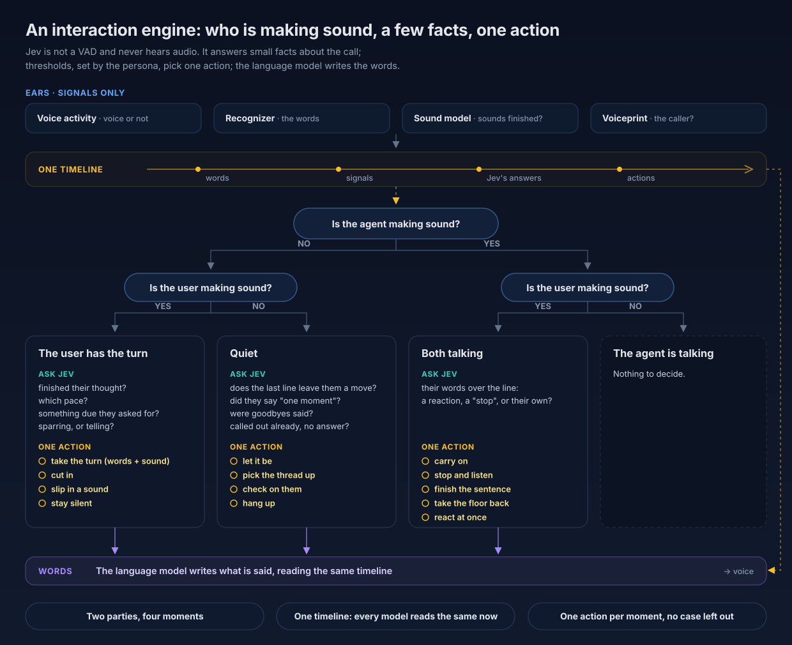

[← README](../README.md) · [中文](policy.zh-CN.md)

# The policy

Jev-Interaction is an interaction engine, not a voice-activity detector. Jev never hears audio and never decides that
someone is speaking; the ears do that (voice activity, the recognizer, a sound model, a voiceprint) and their output is
only signals. What the engine decides is what to do with the moment: answer, wait, slip in an "mm-hm", cut in, carry on
over an interruption, pick a quiet up, hang up. Three principles shape it.

1. **Two parties, four moments.** The agent and the user each make sound or not, which gives four moments: the user
   has the turn, both are quiet, both are talking, the agent is talking. Each moment has its own set of actions, and
   nothing else.
2. **One timeline, one "now".** The call is one record that only grows: the words, the signals, every answer from Jev,
   every action taken, each on the same clock (`Ledger`). Every judgement and the model that writes the lines read the
   same present from it (`judge/state.py`, `Now`); no decision keeps its own account of the call.
3. **One action per moment, no case left out.** In any moment there is one set of choices that do not overlap, and
   every situation belongs to exactly one of them. One answer from Jev, one thing done.

What follows from them:

- **Questions are small facts about the user and the call, one thing each:** "have they finished?", "did they say
  'one moment'?", "is this sparring or telling?". Never "what would the agent do?". A fact is the same whoever the
  agent is.
- **Thresholds, not dice.** Nothing is drawn: the same moment goes the same way, and a recorded call can be worked
  through again. The thresholds sit in one place (`Config`), to be tuned on data.
- **The persona sets the thresholds and the timing, never the questions:** how readily its line stops, whether it cuts
  in, how soon it picks a quiet up.
- **Jev picks the moment, the language model picks the words.** No rule makes Jev's decision for it, and Jev never
  writes a line.

| moment | Jev is asked | one action |
|---|---|---|
| the user has the turn | have they finished · which pace (one yes/no fact per pace) · is something they asked for due · sparring or telling | take the turn (when the words and the sound agree) · cut in (in a pace that does) · slip in a sound · stay silent |
| quiet | does the agent's last line leave them a move · did they say they need a moment · were goodbyes said · has the agent called out with no answer | let it be · pick the thread up · check on them · hang up (the facts and the clock decide) |
| both talking | what their words over the line are: a reaction, a "stop", or something of their own | carry on · stop and listen · finish the sentence · take the floor back · react at once |
| the agent is talking | nothing | nothing to decide |

The caller asking for someone else is one more fact in the first moment (`who`: stay, or put them on; experimental,
for personas that list a `cast`).

**Paces** (normal, patient, narrate, eager) say who holds the floor. Their timing is blended by Jev's probabilities, so
a call that is "60% normal, 40% patient" waits in between.

**The same engine, two personas.** Two personas from our product, a dominant and a submissive one, each with its own
thresholds and timing (`turn_taking` in the persona's YAML: its line stops more or less readily, it always or never
cuts in, it picks a quiet up sooner or later; every shipped persona has one, [cookbook](../cookbook/role-policies.md#turn-taking)),
on the same written moments (`tools/persona_bench.py`, 628 requests to Jev):

- Everyday moments (132): they act alike where nothing calls for a difference: a silence 28 of 28 the same, both
  talking 30 of 32. Cutting in differs where it should: in the six sparring moments the dominant one cuts in and the
  submissive one lets them finish.
- A scene of control (16 moments): they act differently in 6, each the way round one would expect. "Make me." over an
  order: the dominant one takes the floor back, the submissive one carries on; defiant rambling: one cuts in, the other
  lets them finish. Where they should act alike, they do: a real "stop, I'm not okay" stops both, an upset user is let
  finish by both, a quiet after an order is waited out by both.
- The facts Jev gave about the user barely moved between the two (0.002 to 0.048 on average): the questions are the
  same, only the thresholds differ.
