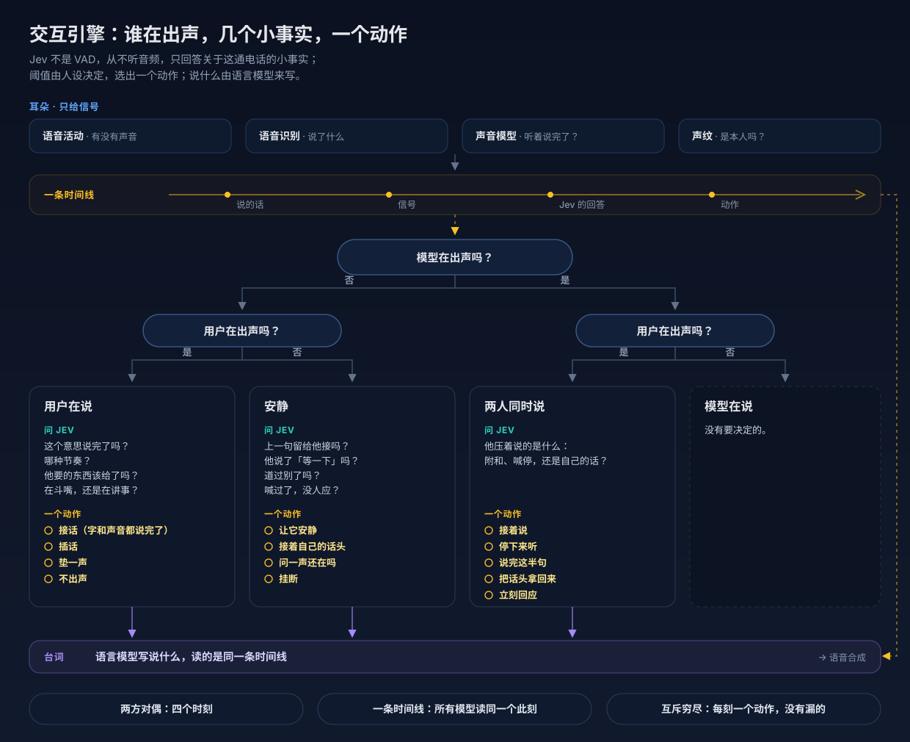

[← README](../README.zh-CN.md) · [English](policy.md)

# 通话策略（policy）

Jev-Interaction 是一个交互引擎，不是人声检测（VAD）。Jev 不听音频，也不判断有没有人在说话；那是耳朵的事（人声检测、语音识别、声音模型、声纹），耳朵只给信号。引擎决定的是这一刻怎么做：接话、等、垫一声"嗯"、插话、被打断时接着说、冷场时接上、挂断。它按三条原则搭起来：

1. **两方对偶。** 模型和用户各自出声或不出声，组合成四个时刻：用户在说、两边都安静、两人同时说、模型在说。每个时刻有自己的一组动作，别的没有。
2. **一条线性的上下文。** 整通电话是一份只追加、不分叉的记录：说的话、信号、Jev 的每个回答、做过的每个动作，都在同一个时钟上（`Ledger`）。每个判断和写台词的模型读的是同一个"此刻"（`judge/state.py` 的 `Now`）；没有哪个决策自己另记一套。
3. **互斥穷尽。** 任何时刻只有一组互不重叠的选项，任何情况都恰好归其中一个管。Jev 回答一次，只做一件事。

由此而来的几条做法：

- **问的是关于用户和通话的小事实，一题一件事：**"说完了吗？""他说了'等一下'吗？""是在斗嘴还是在讲事？"。从不问"模型这时会怎么做"。事实不随角色变。
- **用阈值，不抽签。** 同一个时刻永远同样处理，录下来的通话可以原样重走。阈值集中在一处（`Config`），之后用数据调。
- **人设决定阈值和时机，不改题目：**它的话多容易被打断、插不插话、冷场多久接上。
- **Jev 定时机，语言模型定内容。** 规则不替 Jev 做决定，Jev 也不写台词。

| 时刻 | 问 Jev | 一个动作 |
|---|---|---|
| 用户在说 | 说完了吗 · 哪种节奏（每种节奏一道是非题） · 他要的东西该给了吗 · 斗嘴还是讲事 | 接话（字和声音都说说完了） · 插话（节奏允许时） · 垫一声 · 不出声 |
| 安静 | 模型上一句留给他接吗 · 他说了要等一下吗 · 道过别了吗 · 喊过了没人应吗 | 让它安静 · 接着自己的话头 · 问一声还在吗 · 挂断（事实加时钟决定） |
| 两人同时说 | 他压着说的是什么：附和、喊停，还是自己的话 | 接着说 · 停下来听 · 说完这半句 · 把话头拿回来 · 立刻回应 |
| 模型在说 | 不问 | 没有要决定的 |

来电者要找别人，是第一个时刻里多出来的一个事实（`who`：不换，或换人接；实验性，角色配置里列了 `cast` 才有）。

**节奏**（normal、patient、narrate、eager）表示谁掌握话头。各节奏的等待时间按 Jev 给的概率加权混合：Jev 判断"六成普通、四成耐心"时，等待时间就落在两者之间。

**同一个引擎，换两个人设。** 我们产品里的两个角色，一个支配型（Dom）、一个顺从型（Sub），各带自己的阈值和时机（角色配置里的 `turn_taking`：话多容易被打断、插不插话、冷场多久接上；内置角色都配了，见 [cookbook](../cookbook/role-policies.md#turn-taking)），用同一批写好的时刻测（`tools/persona_bench.py`，628 次 Jev 请求）：

- 日常时刻（132 个）：没理由不同的地方表现一样：冷场 28/28 相同，两人同时说 30/32 相同。插话只在该不同的地方不同：6 个斗嘴的时刻里，Dom 插话，Sub 让对方说完。
- 一场主导的戏（16 个时刻）：6 个时刻表现不同，方向都符合预期。命令说到一半用户来一句"Make me."：Dom 把话头拿回来，Sub 接着说；用户挑衅地一直说：一个插话，一个让他说完。该一样的地方一样：真的"停，我不舒服"两个都停，用户难过时两个都让他说完，下完命令后的安静两个都等着。
- 两边 Jev 给出的用户事实几乎没变（平均差 0.002 到 0.048）：题目一样，只有阈值不同。
